# Diagrama Entidade-Relacionamento — Cartão SUS Inteligente

Modelo lógico do banco MySQL 8 (`schema.sql`). Nove entidades, todas na 3FN.
O diagrama renderiza direto no GitHub e no VS Code (extensão Mermaid).

```mermaid
erDiagram
    TB_USUARIO ||--o| TB_CIDADAO : "1 login por cidadão"
    TB_USUARIO |o--o{ TB_SESSAO_ACESSO : "atendente opera (opcional)"
    TB_CIDADAO ||--o{ TB_CARTEIRA_METADADOS : "possui"
    TB_CIDADAO ||--o{ TB_HISTORICO_CLINICO : "possui"
    TB_CIDADAO ||--o{ TB_SINAL_VITAL : "gera"
    TB_CIDADAO ||--o{ TB_SESSAO_ACESSO : "é auditado em"
    TB_CIDADAO ||--o{ TB_ALERTA : "recebe"
    TB_CIDADAO |o--o{ TB_DISPOSITIVO_IOT : "vincula tensiômetro"
    TB_UNIDADE_SAUDE ||--o{ TB_SESSAO_ACESSO : "registra"
    TB_UNIDADE_SAUDE |o--o{ TB_DISPOSITIVO_IOT : "hospeda terminal NFC"

    TB_USUARIO {
        bigint ID_USUARIO PK
        varchar LOGIN UK
        varchar SENHA_HASH
        enum PERFIL "ADMIN|PROFISSIONAL_SAUDE|CIDADAO"
        tinyint ATIVO
        timestamp CRIADO_EM
    }
    TB_CIDADAO {
        bigint ID_CIDADAO PK
        bigint ID_USUARIO FK,UK
        char CPF_HASH UK
        char NUMERO_CNS UK
        varchar NOME_COMPLETO
        date DATA_NASCIMENTO
        varchar SEGREDO_TOTP
        timestamp CRIADO_EM
    }
    TB_UNIDADE_SAUDE {
        bigint ID_UNIDADE PK
        char CODIGO_CNES UK
        varchar NOME_ESTABELECIMENTO
        enum TIPO_UNIDADE "UBS|UPA|HOSPITAL|AMBULATORIO"
        varchar BAIRRO
        varchar LOGRADOURO
        decimal LATITUDE
        decimal LONGITUDE
        tinyint ATIVO
    }
    TB_CARTEIRA_METADADOS {
        bigint ID_DOCUMENTO PK
        bigint ID_CIDADAO FK
        enum TIPO_DOCUMENTO "RG|CPF|CERTIDAO_NASCIMENTO|CARTAO_VACINA|RECEITA_MEDICA|LAUDO"
        varchar NOME_ARQUIVO
        char HASH_INTEGRIDADE
        date DATA_VALIDADE
        timestamp DATA_CADASTRO
    }
    TB_HISTORICO_CLINICO {
        bigint ID_HISTORICO PK
        bigint ID_CIDADAO FK
        enum TIPO_REGISTRO "ALERGIA|DOENCA_CRONICA|CIRURGIA|MEDICAMENTO_CONTINUO"
        varchar DESCRICAO
        enum GRAU_SEVERIDADE "LEVE|MODERADO|ALTO|CRITICO"
        date DATA_REGISTRO
    }
    TB_SINAL_VITAL {
        bigint ID_SINAL PK
        bigint ID_CIDADAO FK
        enum TIPO_MEDICAO "GLICEMIA|PRESSAO_SISTOLICA|PRESSAO_DIASTOLICA|PESO|FREQUENCIA_CARDIACA"
        decimal VALOR_MEDIDO "CHECK > 0"
        enum ORIGEM "APP|IOT"
        timestamp DATA_HORA
    }
    TB_SESSAO_ACESSO {
        bigint ID_SESSAO PK
        bigint ID_CIDADAO FK
        bigint ID_UNIDADE FK
        bigint ID_USUARIO_ATENDENTE FK "NULL p/ fluxo do terminal"
        char TOKEN_UTILIZADO
        enum STATUS_AUTENTICACAO "AUTORIZADO|EXPIRADO|REJEITADO"
        varchar MOTIVO
        timestamp DATA_HORA_ACESSO
    }
    TB_ALERTA {
        bigint ID_ALERTA PK
        bigint ID_CIDADAO FK
        enum TIPO_ALERTA "PRESSAO_CRITICA|GLICEMIA_CRITICA|TENTATIVA_INDEVIDA|RECEITA_VENCENDO"
        enum SEVERIDADE "ALTA|CRITICA"
        varchar MENSAGEM
        enum STATUS_ENVIO "PENDENTE|ENTREGUE"
        timestamp CRIADO_EM
    }
    TB_DISPOSITIVO_IOT {
        bigint ID_DISPOSITIVO PK
        bigint ID_UNIDADE FK "NULL p/ tensiômetro"
        bigint ID_CIDADAO FK "NULL p/ terminal"
        enum TIPO "TERMINAL_NFC|TENSIOMETRO"
        char CHAVE_API_HASH UK
        tinyint ATIVO
    }
```

## Cardinalidades

| Relacionamento | Cardinalidade | Observação |
|---|---|---|
| TB_USUARIO → TB_CIDADAO | 1:1 | Todo cidadão tem um login; nem todo usuário é cidadão (ADMIN, PROFISSIONAL_SAUDE) |
| TB_CIDADAO → TB_CARTEIRA_METADADOS | 1:N | Vários documentos por cidadão |
| TB_CIDADAO → TB_HISTORICO_CLINICO | 1:N | Alergias, doenças crônicas, cirurgias |
| TB_CIDADAO → TB_SINAL_VITAL | 1:N | Medições do app e dos sensores |
| TB_CIDADAO → TB_SESSAO_ACESSO | 1:N | Trilha de auditoria |
| TB_CIDADAO → TB_ALERTA | 1:N | Alertas gerados pelas regras de IoT |
| TB_UNIDADE_SAUDE → TB_SESSAO_ACESSO | 1:N | Onde o acolhimento ocorreu |
| TB_UNIDADE_SAUDE → TB_DISPOSITIVO_IOT | 0..N : 0..1 | Terminal NFC pertence a uma unidade |
| TB_CIDADAO → TB_DISPOSITIVO_IOT | 0..N : 0..1 | Tensiômetro vinculado a um cidadão |
| TB_USUARIO → TB_SESSAO_ACESSO | 0..N : 0..1 | Atendente, quando o fluxo é de profissional |

Regra de exclusividade: `TB_DISPOSITIVO_IOT` tem exatamente um vínculo, unidade **ou** cidadão. Isso é garantido pelo `CHECK CK_IOT_VINCULO`.

## Decisões de modelagem

- **TB_USUARIO separado de TB_CIDADAO:** permite RBAC e mantém a 3FN, porque perfil e dados civis são coisas diferentes.
- **CPF_HASH no lugar do CPF:** a LGPD exige minimização. A unicidade continua garantida pelo hash.
- **TB_SESSAO_ACESSO como trilha de auditoria:** guarda quem, onde, quando, qual token e qual resultado.
- **TB_ALERTA como saída das regras de IoT:** o app consulta essa tabela ao abrir.
- **TB_DISPOSITIVO_IOT guarda só o hash da chave:** a chave real fica no `.env` do dispositivo, e a chave pode ser revogada com `ATIVO = 0`.
- **CHECK e ENUM no banco:** integridade além da aplicação. Os testes de integridade estão em `docs/evidencia-testes/f1-integridade.txt`.
