<div class="capa" markdown="1">

# Cartão SUS Inteligente — Saúde Conectada

**Global Solution 2026/2 — 3ESOA — FIAP — CitizenTech**

**Grupo: GateMinds**

- Giovanna Mendonca Federico - RM564626
- Leandro de Lima Cuminato - RM556035
- Luciano Henrique Meriato Junior - RM554546
- Pedro Henrique Alves Espirito Santo - RM558897
- Pedro Henrique Ribeiro Sampaio - RM555613

Repositório: <https://github.com/sampaiopedroh/cartao-sus>

Vídeo pitch: **[PENDENTE: link público]**

Documento de entrega com as seis partes do projeto (banco de dados, API, testes, aplicativo móvel, segurança e simulação de IoT) e anexos.

</div>


# Visão geral

## 1.1 O problema
Cidadãos perdem tempo com deslocamentos inúteis até UBS/UPA: vão atrás de equipamentos e remédios que não existem na unidade, ou repetem o histórico clínico em toda consulta. Histórico clínico e documentos civis (RG, CPF, certidões) ficam espalhados em papel e em sistemas fragmentados, sem controle do cidadão sobre quem acessa seus dados.

## 1.2 A solução — Cartão SUS Inteligente
Solução CitizenTech de saúde pública digital com 3 pilares:

| # | Pilar | Descrição | Fonte de dados |
|---|---|---|---|
| 1 | Consulta de Disponibilidade Pública | Equipamentos (CNES) e estoque de medicamentos (BNAFAR), cruzados com telemetria local | APIs abertas do SUS (`apidadosabertos.saude.gov.br`) + nossa API |
| 2 | Carteira Cidadã e Gestão Clínica (Local-First) | Metadados de documentos, receitas, alergias, cirurgias e sinais vitais. Arquivos brutos ficam só no aparelho | App mobile + API |
| 3 | Acolhimento Presencial Seguro (NFC + TOTP) | Aproximação do cartão no balcão + token rotativo de 6 dígitos aprovado no app do cidadão | Terminal NFC (IoT, simulado) + API |

**Princípios:** Mobile-First, Local-First, Zero-Knowledge (servidor não guarda arquivos brutos), Edge Computing (sensores simulados que disparam regras).

## 1.4 ODS
ODS 3 (Saúde e bem-estar), ODS 9 (Indústria, inovação e infraestrutura), ODS 10 (Redução das desigualdades), ODS 11 (Cidades e comunidades sustentáveis). Dialoga com ODS 2 e 13.

# Parte 1 — Banco de dados

## Diagrama entidade-relacionamento

Modelo lógico do banco MySQL 8 (`schema.sql`). Nove entidades, todas na 3FN.
O diagrama renderiza direto no GitHub e no VS Code (extensão Mermaid).

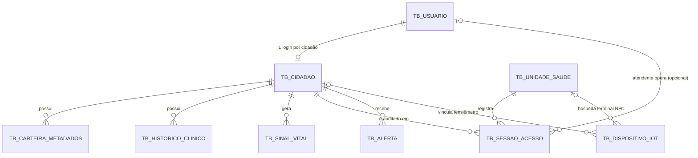

<div class="der" markdown="1">

#### Diagrama entidade-relacionamento completo (com atributos)

```mermaid
erDiagram
    TB_USUARIO ||--o| TB_CIDADAO : "1 login por cidadão"
    TB_USUARIO |o--o{ TB_SESSAO_ACESSO : "atendente opera (opcional)"
    TB_CIDADAO ||--o{ TB_CARTEIRA_METADADOS : "possui"
    TB_CIDADAO ||--o{ TB_HISTORICO_CLINICO : "possui"
    TB_CIDADAO ||--o{ TB_SINAL_VITAL : "gera"
    TB_CIDADAO ||--o{ TB_SESSAO_ACESSO : "é auditado em"
    TB_CIDADAO ||--o{ TB_ALERTA : "recebe"
    TB_CIDADAO |o--o{ TB_DISPOSITIVO_IOT : "vincula tensiômetro"
    TB_UNIDADE_SAUDE ||--o{ TB_SESSAO_ACESSO : "registra"
    TB_UNIDADE_SAUDE |o--o{ TB_DISPOSITIVO_IOT : "hospeda terminal NFC"

    TB_USUARIO {
        bigint ID_USUARIO PK
        varchar LOGIN UK
        varchar SENHA_HASH
        enum PERFIL "ADMIN|PROFISSIONAL_SAUDE|CIDADAO"
        tinyint ATIVO
        timestamp CRIADO_EM
    }
    TB_CIDADAO {
        bigint ID_CIDADAO PK
        bigint ID_USUARIO FK,UK
        char CPF_HASH UK
        char NUMERO_CNS UK
        varchar NOME_COMPLETO
        date DATA_NASCIMENTO
        varchar SEGREDO_TOTP
        timestamp CRIADO_EM
    }
    TB_UNIDADE_SAUDE {
        bigint ID_UNIDADE PK
        char CODIGO_CNES UK
        varchar NOME_ESTABELECIMENTO
        enum TIPO_UNIDADE "UBS|UPA|HOSPITAL|AMBULATORIO"
        varchar BAIRRO
        varchar LOGRADOURO
        decimal LATITUDE
        decimal LONGITUDE
        tinyint ATIVO
    }
    TB_CARTEIRA_METADADOS {
        bigint ID_DOCUMENTO PK
        bigint ID_CIDADAO FK
        enum TIPO_DOCUMENTO "RG|CPF|CERTIDAO_NASCIMENTO|CARTAO_VACINA|RECEITA_MEDICA|LAUDO"
        varchar NOME_ARQUIVO
        char HASH_INTEGRIDADE
        date DATA_VALIDADE
        timestamp DATA_CADASTRO
    }
    TB_HISTORICO_CLINICO {
        bigint ID_HISTORICO PK
        bigint ID_CIDADAO FK
        enum TIPO_REGISTRO "ALERGIA|DOENCA_CRONICA|CIRURGIA|MEDICAMENTO_CONTINUO"
        varchar DESCRICAO
        enum GRAU_SEVERIDADE "LEVE|MODERADO|ALTO|CRITICO"
        date DATA_REGISTRO
    }
    TB_SINAL_VITAL {
        bigint ID_SINAL PK
        bigint ID_CIDADAO FK
        enum TIPO_MEDICAO "GLICEMIA|PRESSAO_SISTOLICA|PRESSAO_DIASTOLICA|PESO|FREQUENCIA_CARDIACA"
        decimal VALOR_MEDIDO "CHECK > 0"
        enum ORIGEM "APP|IOT"
        timestamp DATA_HORA
    }
    TB_SESSAO_ACESSO {
        bigint ID_SESSAO PK
        bigint ID_CIDADAO FK
        bigint ID_UNIDADE FK
        bigint ID_USUARIO_ATENDENTE FK "NULL p/ fluxo do terminal"
        char TOKEN_UTILIZADO
        enum STATUS_AUTENTICACAO "AUTORIZADO|EXPIRADO|REJEITADO"
        varchar MOTIVO
        timestamp DATA_HORA_ACESSO
    }
    TB_ALERTA {
        bigint ID_ALERTA PK
        bigint ID_CIDADAO FK
        enum TIPO_ALERTA "PRESSAO_CRITICA|GLICEMIA_CRITICA|TENTATIVA_INDEVIDA|RECEITA_VENCENDO"
        enum SEVERIDADE "ALTA|CRITICA"
        varchar MENSAGEM
        enum STATUS_ENVIO "PENDENTE|ENTREGUE"
        timestamp CRIADO_EM
    }
    TB_DISPOSITIVO_IOT {
        bigint ID_DISPOSITIVO PK
        bigint ID_UNIDADE FK "NULL p/ tensiômetro"
        bigint ID_CIDADAO FK "NULL p/ terminal"
        enum TIPO "TERMINAL_NFC|TENSIOMETRO"
        char CHAVE_API_HASH UK
        tinyint ATIVO
    }
```

</div>


### Cardinalidades

| Relacionamento | Cardinalidade | Observação |
|---|---|---|
| TB_USUARIO → TB_CIDADAO | 1:1 | Todo cidadão tem um login; nem todo usuário é cidadão (ADMIN, PROFISSIONAL_SAUDE) |
| TB_CIDADAO → TB_CARTEIRA_METADADOS | 1:N | Vários documentos por cidadão |
| TB_CIDADAO → TB_HISTORICO_CLINICO | 1:N | Alergias, doenças crônicas, cirurgias |
| TB_CIDADAO → TB_SINAL_VITAL | 1:N | Medições do app e dos sensores |
| TB_CIDADAO → TB_SESSAO_ACESSO | 1:N | Trilha de auditoria |
| TB_CIDADAO → TB_ALERTA | 1:N | Alertas gerados pelas regras de IoT |
| TB_UNIDADE_SAUDE → TB_SESSAO_ACESSO | 1:N | Onde o acolhimento ocorreu |
| TB_UNIDADE_SAUDE → TB_DISPOSITIVO_IOT | 0..N : 0..1 | Terminal NFC pertence a uma unidade |
| TB_CIDADAO → TB_DISPOSITIVO_IOT | 0..N : 0..1 | Tensiômetro vinculado a um cidadão |
| TB_USUARIO → TB_SESSAO_ACESSO | 0..N : 0..1 | Atendente, quando o fluxo é de profissional |

Regra de exclusividade: `TB_DISPOSITIVO_IOT` tem exatamente um vínculo, unidade **ou** cidadão. Isso é garantido pelo `CHECK CK_IOT_VINCULO`.

### Decisões de modelagem

- **TB_USUARIO separado de TB_CIDADAO:** permite RBAC e mantém a 3FN, porque perfil e dados civis são coisas diferentes.
- **CPF_HASH no lugar do CPF:** a LGPD exige minimização. A unicidade continua garantida pelo hash.
- **TB_SESSAO_ACESSO como trilha de auditoria:** guarda quem, onde, quando, qual token e qual resultado.
- **TB_ALERTA como saída das regras de IoT:** o app consulta essa tabela ao abrir.
- **TB_DISPOSITIVO_IOT guarda só o hash da chave:** a chave real fica no `.env` do dispositivo, e a chave pode ser revogada com `ATIVO = 0`.
- **CHECK e ENUM no banco:** integridade além da aplicação. Os testes de integridade estão em `docs/evidencia-testes/f1-integridade.txt`.

## 4.2 Dicionário de dados (resumo)

| Tabela | PK | FKs | Uniques | ENUMs |
|---|---|---|---|---|
| TB_USUARIO | ID_USUARIO | — | LOGIN | PERFIL |
| TB_CIDADAO | ID_CIDADAO | ID_USUARIO | CPF_HASH, NUMERO_CNS, ID_USUARIO | — |
| TB_UNIDADE_SAUDE | ID_UNIDADE | — | CODIGO_CNES | TIPO_UNIDADE |
| TB_CARTEIRA_METADADOS | ID_DOCUMENTO | ID_CIDADAO | — | TIPO_DOCUMENTO |
| TB_HISTORICO_CLINICO | ID_HISTORICO | ID_CIDADAO | — | TIPO_REGISTRO, GRAU_SEVERIDADE |
| TB_SINAL_VITAL | ID_SINAL | ID_CIDADAO | — | TIPO_MEDICAO, ORIGEM |
| TB_SESSAO_ACESSO | ID_SESSAO | ID_CIDADAO, ID_UNIDADE, ID_USUARIO_ATENDENTE | — | STATUS_AUTENTICACAO |
| TB_ALERTA | ID_ALERTA | ID_CIDADAO | — | TIPO_ALERTA, SEVERIDADE, STATUS_ENVIO |
| TB_DISPOSITIVO_IOT | ID_DISPOSITIVO | ID_UNIDADE, ID_CIDADAO | CHAVE_API_HASH | TIPO |

> **Campos sensíveis:** `CPF_HASH`, `SEGREDO_TOTP`, `SENHA_HASH` e `CHAVE_API_HASH`. Nunca retornados pela API.

## As sete consultas (`database/consultas.sql`)

```sql
-- ========================================================
-- Cartão SUS Inteligente — Consultas de uso real (MySQL 8)
-- Requisito do edital (Parte 1, item 03): 5+ SELECTs com JOIN e agregação.
-- Q2 e Q7 usam janela de 7 dias a partir de NOW(): o resultado depende da data.
-- ========================================================
USE cartao_sus;

-- Q1. Prontuário consolidado do cidadão (perfil + histórico). Tipo: JOIN de 2 tabelas.
SELECT c.NOME_COMPLETO, c.NUMERO_CNS,
       h.TIPO_REGISTRO, h.DESCRICAO, h.GRAU_SEVERIDADE, h.DATA_REGISTRO
FROM TB_CIDADAO c
JOIN TB_HISTORICO_CLINICO h ON h.ID_CIDADAO = c.ID_CIDADAO
WHERE c.NUMERO_CNS = '898000000000000'
ORDER BY FIELD(h.GRAU_SEVERIDADE, 'CRITICO', 'ALTO', 'MODERADO', 'LEVE'), h.DATA_REGISTRO DESC;

-- Q2. Média de glicemia dos últimos 7 dias por cidadão. Tipo: AVG + filtro temporal.
SELECT c.NOME_COMPLETO,
       COUNT(s.ID_SINAL)             AS total_medicoes,
       ROUND(AVG(s.VALOR_MEDIDO), 2) AS glicemia_media_7dias,
       MAX(s.VALOR_MEDIDO)           AS glicemia_maxima
FROM TB_CIDADAO c
JOIN TB_SINAL_VITAL s ON s.ID_CIDADAO = c.ID_CIDADAO
WHERE s.TIPO_MEDICAO = 'GLICEMIA'
  AND s.DATA_HORA >= NOW() - INTERVAL 7 DAY
GROUP BY c.ID_CIDADAO, c.NOME_COMPLETO
HAVING COUNT(s.ID_SINAL) > 0
ORDER BY glicemia_media_7dias DESC;

-- Q3. Última medição de pressão por cidadão. Tipo: subconsulta correlacionada + agregação condicional.
SELECT c.NOME_COMPLETO,
       MAX(CASE WHEN s.TIPO_MEDICAO = 'PRESSAO_SISTOLICA'  THEN s.VALOR_MEDIDO END) AS ultima_sistolica,
       MAX(CASE WHEN s.TIPO_MEDICAO = 'PRESSAO_DIASTOLICA' THEN s.VALOR_MEDIDO END) AS ultima_diastolica
FROM TB_CIDADAO c
LEFT JOIN TB_SINAL_VITAL s
       ON s.ID_CIDADAO = c.ID_CIDADAO
      AND s.DATA_HORA = (SELECT MAX(s2.DATA_HORA)
                         FROM TB_SINAL_VITAL s2
                         WHERE s2.ID_CIDADAO = c.ID_CIDADAO
                           AND s2.TIPO_MEDICAO = s.TIPO_MEDICAO)
GROUP BY c.ID_CIDADAO, c.NOME_COMPLETO;

-- Q4. Ranking de unidades por acolhimentos autorizados. Tipo: JOIN + COUNT + SUM condicional.
SELECT u.NOME_ESTABELECIMENTO, u.CODIGO_CNES, u.BAIRRO,
       COUNT(sa.ID_SESSAO) AS total_acolhimentos,
       SUM(CASE WHEN sa.STATUS_AUTENTICACAO = 'AUTORIZADO' THEN 1 ELSE 0 END) AS autorizados,
       SUM(CASE WHEN sa.STATUS_AUTENTICACAO = 'REJEITADO'  THEN 1 ELSE 0 END) AS rejeitados
FROM TB_UNIDADE_SAUDE u
JOIN TB_SESSAO_ACESSO sa ON sa.ID_UNIDADE = u.ID_UNIDADE
GROUP BY u.ID_UNIDADE, u.NOME_ESTABELECIMENTO, u.CODIGO_CNES, u.BAIRRO
ORDER BY autorizados DESC;

-- Q5. Alertas pendentes com identificação do cidadão. Tipo: JOIN de 3 tabelas.
SELECT a.ID_ALERTA, a.TIPO_ALERTA, a.SEVERIDADE, a.MENSAGEM, a.CRIADO_EM,
       c.NOME_COMPLETO, c.NUMERO_CNS, u.LOGIN AS email_cidadao
FROM TB_ALERTA a
JOIN TB_CIDADAO c ON c.ID_CIDADAO = a.ID_CIDADAO
JOIN TB_USUARIO u ON u.ID_USUARIO = c.ID_USUARIO
WHERE a.STATUS_ENVIO = 'PENDENTE'
ORDER BY FIELD(a.SEVERIDADE, 'CRITICA', 'ALTA'), a.CRIADO_EM ASC;

-- Q6. Carteira de documentos por cidadão. Tipo: LEFT JOIN + COUNT + GROUP_CONCAT.
SELECT c.NOME_COMPLETO,
       COUNT(d.ID_DOCUMENTO) AS qtd_documentos,
       GROUP_CONCAT(d.TIPO_DOCUMENTO ORDER BY d.TIPO_DOCUMENTO SEPARATOR ', ') AS tipos
FROM TB_CIDADAO c
LEFT JOIN TB_CARTEIRA_METADADOS d ON d.ID_CIDADAO = c.ID_CIDADAO
GROUP BY c.ID_CIDADAO, c.NOME_COMPLETO;

-- Q7. Auditoria: cidadãos com 3 ou mais sessões rejeitadas nos últimos 7 dias. Tipo: JOIN de 3 tabelas + HAVING.
-- A regra de bloqueio em tempo real usa janela de 10 min, na aplicação (SDD 5.4).
SELECT c.NOME_COMPLETO, u.LOGIN,
       COUNT(sa.ID_SESSAO) AS rejeicoes_7dias
FROM TB_SESSAO_ACESSO sa
JOIN TB_CIDADAO c ON c.ID_CIDADAO = sa.ID_CIDADAO
JOIN TB_USUARIO u ON u.ID_USUARIO = c.ID_USUARIO
WHERE sa.STATUS_AUTENTICACAO = 'REJEITADO'
  AND sa.DATA_HORA_ACESSO >= NOW() - INTERVAL 7 DAY
GROUP BY c.ID_CIDADAO, c.NOME_COMPLETO, u.LOGIN
HAVING COUNT(sa.ID_SESSAO) >= 3;
```

## Resultado da execução das consultas

```text
# Evidência F1 — consultas.sql
# Data de referência: 2026-11-11 03:02. Q2 e Q7 dependem da janela de 7 dias.
NOME_COMPLETO	NUMERO_CNS	TIPO_REGISTRO	DESCRICAO	GRAU_SEVERIDADE	DATA_REGISTRO
Maria Souza Lima	898000000000000	ALERGIA	Penicilina	CRITICO	2024-05-10
Maria Souza Lima	898000000000000	DOENCA_CRONICA	Diabetes tipo 2	ALTO	2021-02-01
Maria Souza Lima	898000000000000	CIRURGIA	Colecistectomia (vesícula)	MODERADO	2019-08-15
NOME_COMPLETO	total_medicoes	glicemia_media_7dias	glicemia_maxima
Maria Souza Lima	2	125.00	138.00
NOME_COMPLETO	ultima_sistolica	ultima_diastolica
Maria Souza Lima	124.00	80.00
João Pereira Santos	185.00	115.00
NOME_ESTABELECIMENTO	CODIGO_CNES	BAIRRO	total_acolhimentos	autorizados	rejeitados
UBS JARDIM COLOMBO	9186492	JARDIM COLOMBO	2	2	0
UPA VILA PRUDENTE	8530378	JARDIM INDEPENDENCIA	3	0	3
ID_ALERTA	TIPO_ALERTA	SEVERIDADE	MENSAGEM	CRIADO_EM	NOME_COMPLETO	NUMERO_CNS	email_cidadao
1	PRESSAO_CRITICA	CRITICA	Alerta de Pressão Crítica: Procure a UPA mais próxima	2026-11-11 06:02:58	João Pereira Santos	182345678901234	joao.pereira@cartaosus.demo
2	TENTATIVA_INDEVIDA	ALTA	3 tentativas inválidas de leitura detectadas no terminal da UPA	2026-11-11 06:02:58	João Pereira Santos	182345678901234	joao.pereira@cartaosus.demo
3	RECEITA_VENCENDO	ALTA	Receita médica vence em 14/11/2026	2026-11-11 06:02:58	João Pereira Santos	182345678901234	joao.pereira@cartaosus.demo
NOME_COMPLETO	qtd_documentos	tipos
Maria Souza Lima	3	RG, CPF, CARTAO_VACINA
João Pereira Santos	2	RG, RECEITA_MEDICA
NOME_COMPLETO	LOGIN	rejeicoes_7dias
João Pereira Santos	joao.pereira@cartaosus.demo	3
exit=0
```


# Parte 2 — API RESTful

A API é ASP.NET Core (.NET 10) em três camadas (Controller, Service, Repository), com EF Core, JWT e chave de dispositivo (`X-API-KEY`) para os sensores. O Swagger fica em `/swagger`, e a exportação em `docs/swagger.json`.

## Endpoints (18 operações)

| Método | Caminho | Grupo | Respostas |
|---|---|---|---|
| POST | `/api/v1/acolhimento/validar-nfc` | Acolhimento | 200 |
| GET | `/api/v1/admin/auditoria` | Admin | 200 |
| POST | `/api/v1/auth/cadastro` | Auth | 201 |
| POST | `/api/v1/auth/login` | Auth | 200 |
| GET | `/api/v1/auth/me` | Auth | 200 |
| GET | `/api/v1/cidadao/{id}/prontuario` | Cidadao | 200 |
| GET | `/api/v1/cidadao/{id}/sinais-vitais` | Cidadao | 200 |
| PUT | `/api/v1/cidadao/{id}/historico/{idHistorico}` | Cidadao | 200 |
| GET | `/api/v1/cidadao/{id}/alertas` | Cidadao | 200 |
| PUT | `/api/v1/cidadao/{id}/alertas/{idAlerta}` | Cidadao | 200 |
| GET | `/api/v1/cidadao/{id}/acessos` | Cidadao | 200 |
| POST | `/api/v1/documentos` | Documentos | 201 |
| DELETE | `/api/v1/documentos/{idDoc}` | Documentos | 200 |
| GET | `/api/v1/sus/equipamentos/{cnes}` | Sus | 200 |
| GET | `/api/v1/sus/medicamentos` | Sus | 200 |
| GET | `/api/v1/sus/medicamentos/catalogo` | Sus | 200 |
| POST | `/api/v1/telemetria/sinais-vitais` | Telemetria | 201 |
| GET | `/api/v1/unidades` | Unidades | 200 |

## 5.1 Convenções

| Convenção | Regra |
|---|---|
| Base URL | `http://localhost:8080` (dev) |
| Versionamento | `/api/v1/...` |
| Autenticação | `Authorization: Bearer <JWT>` (exceto cadastro/login e IoT) |
| IoT | `X-API-KEY: <chave do dispositivo>` + `X-Device-Type: TERMINAL_NFC\|TENSIOMETRO` |
| Formato | JSON, UTF-8, camelCase |
| Paginação | Listas E12, E13, E14: `?page=0&size=20` → `{ "content": [...], "page": 0, "size": 20, "totalElements": n }` |
| Erros | Envelope único `ErrorResponse` |
| Idempotência | PUT e DELETE idempotentes; POST não |

**Envelope de erro:**

```json
{
  "timestamp": "2026-11-10T10:15:30Z",
  "status": 400,
  "erro": "VALIDACAO",
  "mensagem": "tokenRotativo: deve ter exatamente 6 dígitos",
  "campos": { "tokenRotativo": "deve ter exatamente 6 dígitos" }
}
```

Códigos `erro`: `VALIDACAO` (400), `NAO_AUTORIZADO` (401), `SEM_PERMISSAO` (403), `TOKEN_INVALIDO` (403), `BLOQUEADO` (403), `NAO_ENCONTRADO` (404), `CONFLITO` (409), `FALHA_ORIGEM` (502), `ERRO_INTERNO` (500).

**Mapa de status:** 200 OK · 201 Created · 204 No Content · 400 validação · 401 não autenticado · 403 sem permissão / TOTP inválido / bloqueio · 404 não existe · 409 conflito · 502 falha da API do SUS.

## 5.4 Camadas (Controller / Service / Repository)

```
backend/src/CartaoSus.Api/
├── Controllers/         # [ApiController] — recebe, valida, devolve DTOs
│   ├── AuthController.cs            (E1, E2)
│   ├── AcolhimentoController.cs     (E3)
│   ├── CidadaoController.cs         (E4, E5, E7, E10, acessos)
│   ├── TelemetriaController.cs      (E6)
│   ├── DocumentosController.cs      (E8, E9)
│   ├── SusController.cs             (E11, E12, catálogo)
│   ├── UnidadesController.cs        (E13)
│   └── AdminController.cs           (E14)
├── Services/            # regras de negócio
│   ├── AuthService.cs               (Identity PasswordHasher, emissão JWT)
│   ├── TotpService.cs               (RFC 6238: gerar/validar, anti-reuso)
│   ├── AcolhimentoService.cs        (handshake, 3 falhas → bloqueio + alerta)
│   ├── CidadaoService.cs            (prontuário, sinais, histórico)
│   ├── AlertaService.cs
│   ├── TelemetriaService.cs         (ingestão + limiares → alertas)
│   ├── DocumentoService.cs
│   └── SusProxyService.cs           (HttpClient → CNES/BNAFAR, 502 em falha)
├── Repositories/        # interface + implementação EF Core
├── Models/              # entidades EF (ver 4.6)
├── Dtos/                # records de request/response, com DataAnnotations
├── Security/            # ApiKeyAuthHandler, JwtConfig, TotpValidator
├── Data/                # CartaoSusDbContext, catalogo-medicamentos.json
├── Seed/                # SeedDemoService (ver 8.5)
└── Program.cs           # DI, JWT, Swagger, middleware de erro
```

**Regras de camada (rígidas):**
1. Controller nunca toca repositório. Só chama service.
2. Service recebe DTOs, não `HttpContext`. A identidade vem de `ClaimsPrincipal` passado pelo controller.
3. Repositório só expõe consultas. Sem regra de negócio.
4. Regras de negócio (TOTP, limiares, bloqueio) são testáveis sem subir o servidor.

**Esqueleto do fluxo E3:**

```csharp
[ApiController]
[Route("api/v1/acolhimento")]
public class AcolhimentoController : ControllerBase
{
    private readonly IAcolhimentoService _service;
    public AcolhimentoController(IAcolhimentoService service) => _service = service;

    [HttpPost("validar-nfc")]
    [Authorize(AuthenticationSchemes = ApiKeyAuthHandler.Scheme)]
    public async Task<IActionResult> ValidarNfc([FromBody] ValidarNfcRequest req)
        => Ok(await _service.ValidarNfcAsync(req)); // falha lança exceção → 403 pelo middleware
}

public class AcolhimentoService : IAcolhimentoService
{
    // 1. localiza cidadão por CNS (repositório) → NaoEncontradoException (404)
    // 2. se rejeições nos últimos 10 min ≥ 3 → BloqueadoException (403) + Alerta TENTATIVA_INDEVIDA
    // 3. valida TOTP → falha: grava sessão REJEITADO e lança TokenInvalidoException (403)
    // 4. sucesso: grava sessão AUTORIZADO e monta resumo do prontuário
}
```

## 5.7 Exemplos `curl`

```bash

# Parte 3 — Plano e resultados de testes

## 6.1 Estratégia

| Nível | Ferramenta | Foco |
|---|---|---|
| Unitário | xUnit + Moq | Regras de negócio isoladas (TOTP, limiares, bloqueio) |
| Contrato | xUnit (snapshot de JSON) | Shape de respostas que o app e os sensores consomem |
| Integração | xUnit + `WebApplicationFactory` + MySQL em Docker | Fluxos HTTP → banco real |
| Manual | curl / Postman + app Android | Ponta a ponta e UX |

## Relatório consolidado

Execução consolidada da F9 (11/11/2026), atualizada na F10 com a revisão de UX, documentos e compartilhamento (casos MT-15 a MT-18), com banco limpo recriado a partir de `schema.sql`, `seed.sql` e `gerar_chaves.py`. API e aplicativo na versão final do repositório.

### Resumo

| Tipo | Quantidade | Resultado | Como executar | Evidência |
|---|---|---|---|---|
| Unitários (backend) | 12 (UT-01 a UT-12) | 12 PASS | `dotnet test --filter "Category!=Integracao"` | `f9-unitarios-contrato.txt` |
| Contrato (backend) | 8 (CT-01 a CT-08) | 8 PASS | mesmo comando acima | `f9-unitarios-contrato.txt` |
| Integração (MySQL) | 12 casos (IT-01 a IT-10, com IT-08 e IT-10 em dois casos) | 12 PASS | `backend/tests/run-integration.sh` | `f9-integracao.txt` |
| Manuais | 19 (MT-01 a MT-19) | 19 PASS | roteiro manual (abaixo) | `mt-XX-*`, `ux-*` |
| Unitários (aplicativo Android) | 59 | 59 PASS | `./gradlew testDebugUnitTest` | saída do Gradle (`mobile/`) |

**Resultado geral: 110 de 110 casos aprovados, sem falhas** (12 + 8 + 12 + 19 + 59).

### Testes manuais (MT)

| ID | Caso | Onde foi executado | Resultado | Evidência |
|---|---|---|---|---|
| MT-01 | Login válido | API e app | PASS | `mt-01-login-valido.txt`, `mt-01-app-login.png` |
| MT-02 | Login com senha errada | API e app | PASS | `mt-02-senha-errada.txt`, `mt-02-app-senha-errada.png` |
| MT-03 | Payload malformado | API | PASS | `mt-03-payload-malformado.txt` |
| MT-04 | Cadastro duplicado (409) | API | PASS | `mt-04-cadastro-duplicado.txt` |
| MT-05 | Handshake com TOTP válido | API e app (código da tela Token enviado ao terminal) | PASS | `mt-05-handshake-valido-api.txt`, `mt-05-handshake-valido-app.txt`, `mt-05-app-token.png` |
| MT-06 | Handshake com código de 5 minutos atrás | API | PASS | `mt-06-codigo-antigo.txt` |
| MT-07 | Três falhas, bloqueio e alerta | API e app (alerta visível no Dashboard) | PASS | `mt-07-bloqueio-alerta-api.txt`, `mt-07-08-app-alertas.png` |
| MT-08 | Pressão crítica pelo tensiômetro | API e app (alerta visível no Dashboard) | PASS | `mt-08-pressao-critica-tensiometro.txt`, `mt-07-08-app-alertas.png` |
| MT-09 | Tentativas de SQL injection | API | PASS | `mt-09-sql-injection.txt` |
| MT-10 | Prontuário de outro cidadão (403) | API | PASS | `mt-10-prontuario-de-outro.txt` |
| MT-11 | CRUD de documento, verificado pelo handshake | API | PASS | `mt-11-crud-documento.txt` |
| MT-12 | Medicamento no BNAFAR | API e app | PASS | `mt-12-medicamento-bnafar.txt`, `mt-12-app-medicamento.png` |
| MT-13 | App sem conexão e sincronização da fila | app (API parada e depois restaurada) | PASS | `mt-13-app-offline.png`, `mt-13-app-sincronizado.png` |
| MT-14 | Auditoria por perfil | API | PASS | `mt-14-auditoria-perfil.txt` |
| MT-15 | Botão "Início" volta à tela inicial a partir de Saúde, Consultar e Atendimento; Voltar do sistema volta ao Início | app (emulador) | PASS | `ux-resumo.md`, `ux-inicio.png` |
| MT-16 | Anexar documento pelo seletor do Android; o documento continua na lista depois de reiniciar o app e abre no visualizador | app (emulador) | PASS | `ux-documentos.png` |
| MT-17 | Documento cujo arquivo foi apagado: aviso na lista e sem queda do app ao compartilhar | app (emulador) | PASS | `ux-documentos-arquivo-ausente.png` |
| MT-19 | Acessibilidade: descrições para o leitor de tela na árvore de acessibilidade e layout com a fonte do sistema em 200% | app (emulador) | PASS | `a11y-arvore-acessibilidade.md`, `a11y-contraste.md`, `a11y-fonte-200-*.png`, `a11y-talkback-foco-titulo.png`, `a11y-como-chegar-sem-mapas.png`, `../acessibilidade.md` |
| MT-18 | Compartilhamento só depois de o atendente validar o código (terminal responde `AUTORIZADO`); sem validação o botão não aparece | app e terminal | PASS | `ux-compartilhar-liberado.png`, `ux-compartilhar-android.png` |

### Problemas encontrados durante o projeto

| Fase | Problema | Correção |
|---|---|---|
| F10 | Com a fonte em 200%, palavras quebravam no meio nos atalhos e na barra inferior, e o título da barra superior era cortado | Atalhos em uma coluna, botões empilhados, rótulos e título com tamanho limitado (MT-19) |
| F10 | "Como chegar" fechava o app sem aplicativo de mapas | Erro tratado com aviso ao usuário |
| F10 | Avisos de vulnerabilidade em `MySqlConnector` 2.5.0 (moderada) e `System.Security.Cryptography.Pkcs` 10.0.9 (alta) | Atualizados para 2.6.2 e 10.0.15; `dotnet list package --vulnerable` sem alertas e testes verdes |
| F10 | A coleção do Postman era só a exportação do Swagger e não rodava de ponta a ponta (sem token, sem chave de dispositivo e sem variáveis de caminho) | Coleção reescrita em ordem, com 26 requisições e 39 testes; executada no Newman sem falhas (`f10-newman.txt`) |
| F10 | O app fechava ao compartilhar um documento cujo arquivo o Android não permitia mais ler (`SecurityException`) | O app confere cada arquivo antes, ignora os ilegíveis e avisa o usuário (MT-17) |
| F10 | A aba "Início" não voltava à tela inicial | Navegação interna com Início como destino inicial (MT-15) |
| F3 | O prontuário (E4) não mostrava documentos, diferente do SDD | Teste de integração IT-07 verificou pelo handshake (E3) |
| F4 | `AuthService` dependia do banco e impedia testes unitários | Refatorado; cadastro com um único `SaveChanges` |
| F5 | Teste rodou sobre build antigo e falhou por engano | Recompilação; resultado revalidado |
| F6 | Fuso horário: container MySQL em UTC e API em UTC-3, afetando `NOW()` nas consultas Q2 e Q7 | Registrado como limitação |
| F7 | Pressionar o botão de login com campo vazio retornava 400 sem mensagem clara ao usuário | Validação de formulário no app antes do envio |
| F8 | A tela Consulta SUS não rolava; os resultados ficavam fora da tela | Adicionada rolagem |
| F8 | Crash ao abrir a Consulta SUS: lista rolável aninhada em coluna rolável | Substituída por coluna simples |
| F9 | Dashboard sem botão "Sair", exigido pelo plano da F8 | Botão adicionado e verificado |
| F9 | Script de teste do MT-07 comparava contagem absoluta de alertas, ignorando o alerta de demonstração já existente | Comparação antes e depois do caso |
| F9 | Teste MT-11 reutilizava janela de código já aceita | Espera da janela seguinte antes da segunda leitura |

### Limitações conhecidas

- Compartilhamento de documentos sem NFC real: a ideia é compartilhar as informações por NFC, mas, pelas limitações da simulação (sem leitor NFC físico nem HCE no emulador), o grupo optou por liberar o compartilhamento pelo seletor do Android depois que o atendente valida o código (ver `docs/adr/ADR-nfc-compartilhamento.md`).
- O segredo TOTP fica no SharedPreferences do aplicativo, sem criptografia (SDD 7.4).
- O anti-reuso do TOTP é em memória: vale para uma única instância da API.
- O estoque do BNAFAR é consultado em tempo real e muda com o tempo; os testes conferem o formato da resposta, não a quantidade (ver `docs/adr/ADR-limitacoes-aceitas.md`).
- O botão de compartilhar documentos é liberado pela conta, não pelo aparelho: se a mesma pessoa estiver logada em dois celulares, os dois mostram o botão. Não expõe dados a terceiros (ver `docs/adr/ADR-limitacoes-aceitas.md`).
- A consulta de remédio usa o estoque de São Paulo; a API do BNAFAR não informa total de registros, então o `totalElements` é aproximado.
- Cada pressão gera um alerta por leitura: sístole e diástole acima do limiar geram dois alertas.
- As consultas Q2 e Q7 usam `NOW()` do banco, que está em UTC; a janela pode deslocar 3 horas em relação à hora local.
- Testes manuais MT-05, MT-07, MT-08, MT-12 e MT-13 foram executados com o emulador Android; a versão física não foi testada.

### Segurança das evidências

Nenhum segredo, chave, senha ou token aparece nas evidências. As senhas de demonstração, as chaves de dispositivo e os segredos TOTP foram lidos do `.env` ou do console do seeder e omitidos das saídas.

# Parte 4 — Aplicativo móvel (Android, Kotlin)

Aplicativo nativo em Kotlin com Jetpack Compose e Material 3, arquitetura MVVM com `StateFlow`, Retrofit com Gson para consumir a API, Room para a fila offline e para os caminhos dos documentos, e Navigation Compose.

## Telas e funcionalidades

| Tela | O que faz |
|---|---|
| Login e cadastro | Entrar com e-mail e senha; criar conta com CPF, CNS e data (com máscara), recebendo o código secreto uma única vez |
| Início | Cartão digital com o número do CNS, atalhos e avisos de saúde |
| Atendimento | Código de 6 dígitos (TOTP) com contagem regressiva; histórico de atendimentos; compartilhar documentos depois que o atendente valida o código |
| Consultar | Remédios com estoque em São Paulo e unidades de saúde por distância, com "Como chegar" e equipamentos |
| Saúde | Registro de pressão, glicemia e peso, gráfico, alerta crítico e fila offline |
| Meus documentos | Anexar PDF ou foto pelo seletor do Android; só o caminho fica no celular |

Cada tela trata os três estados (carregando, vazio e erro com "Tentar de novo") e dá retorno a cada ação. A interface usa fonte grande, alto contraste, botões de 56 dp e textos em português simples, pensando em pessoas de todas as idades.

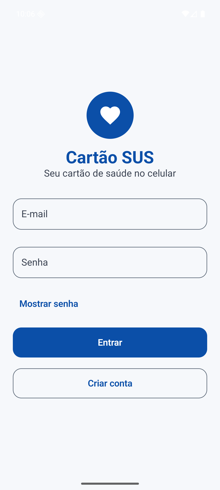

*Tela de login*
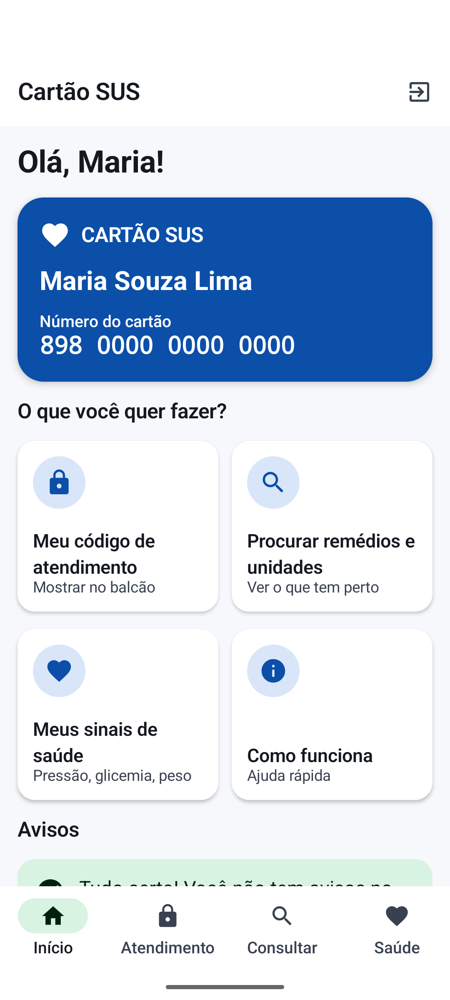

*Início: cartão digital e atalhos*
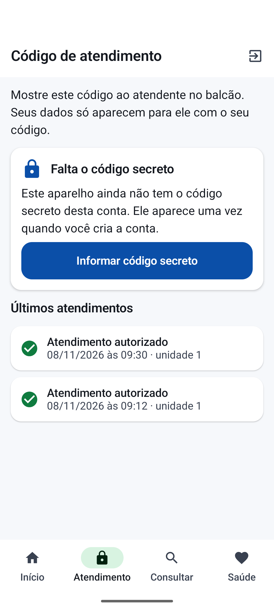

*Atendimento: histórico e código secreto*
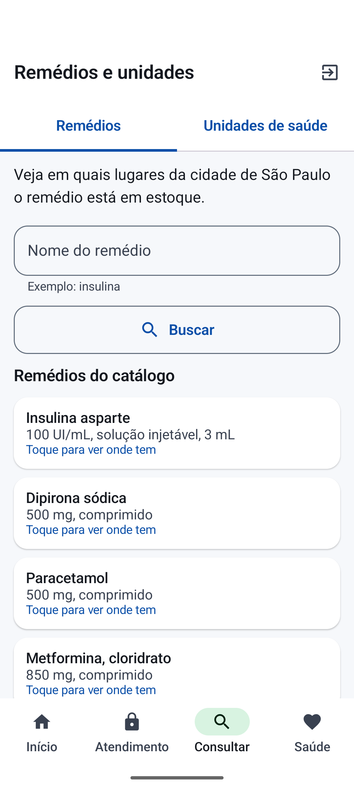

*Consultar remédios e unidades*
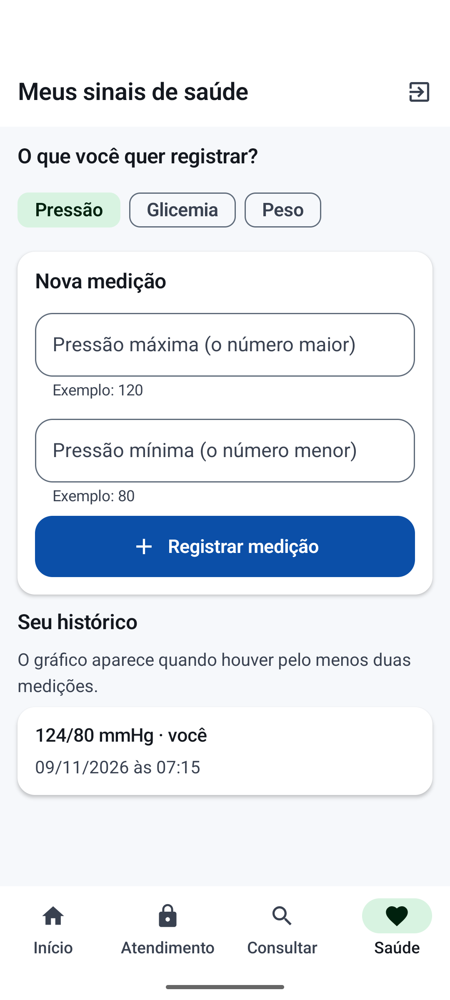

*Sinais de saúde*
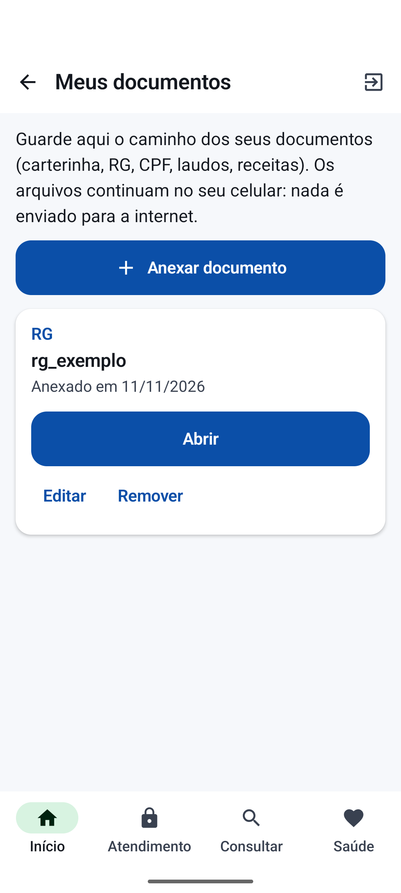

*Meus documentos*
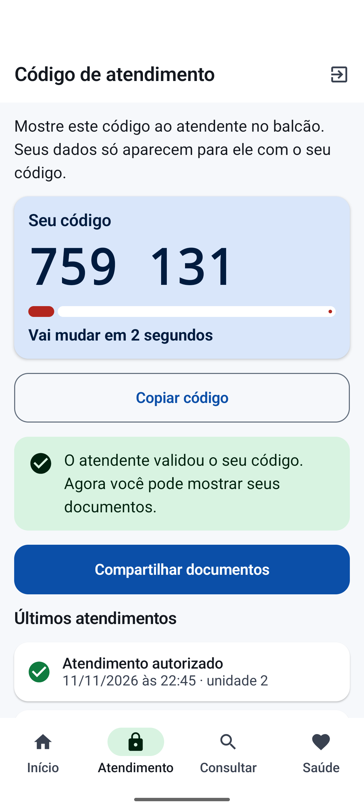

*Compartilhar documentos liberado depois da validação do código*
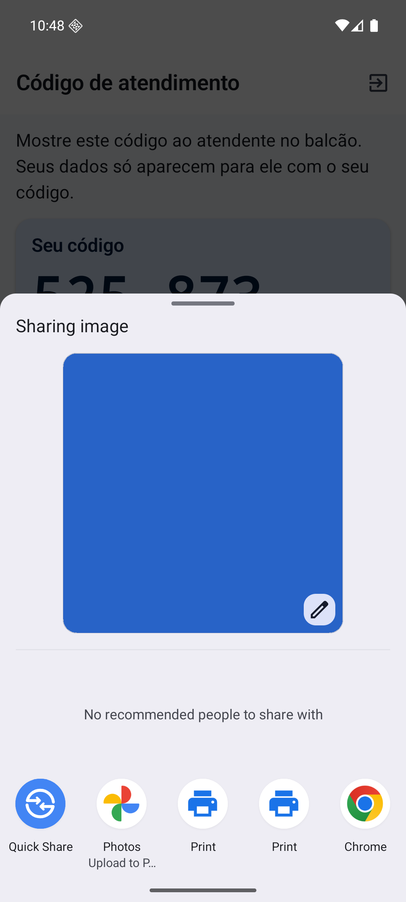

*Compartilhamento do Android com o documento escolhido*
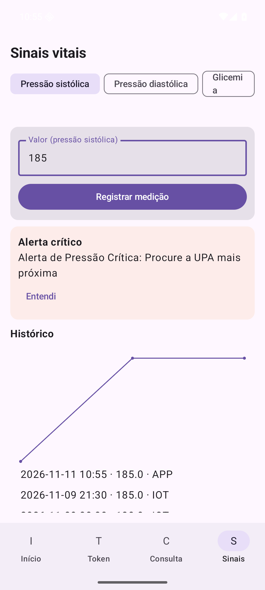

*Alerta crítico de pressão*
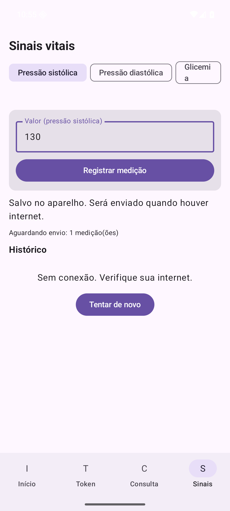

*Medição guardada sem conexão*

## Acessibilidade

O aplicativo foi revisado para pessoas com deficiência visual: funciona com o leitor de tela TalkBack (telas nomeadas, títulos navegáveis, códigos lidos dígito por dígito, cartões lidos de uma vez, avisos anunciados, gráfico descrito em texto), com letra grande (testado com a fonte do sistema em 200%) e com contraste de 4,5:1 ou mais nos temas claro e escuro, verificado por teste automático. Nada depende só da cor. Detalhes em `docs/acessibilidade.md`.

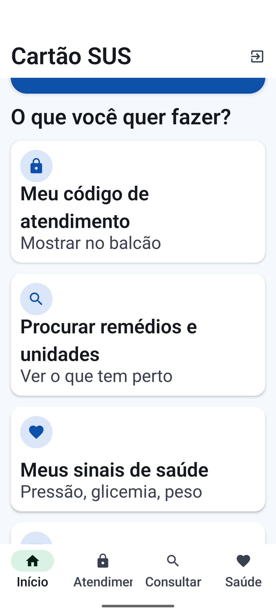

*Início com a fonte do sistema em 200%*

## Navegação e usabilidade

A barra inferior tem quatro abas com ícone e texto (Início, Atendimento, Consultar e Saúde). O botão Início volta à tela inicial a partir de qualquer aba, e o botão Voltar do sistema também. Sair da conta pede confirmação.

## Compartilhamento de documentos e NFC

A ideia do produto é compartilhar as informações por NFC. Por limitação da simulação (sem leitor físico e sem emulação de cartão no emulador), o aplicativo libera o compartilhamento pelo seletor do Android depois que o atendente valida o código. A decisão completa está no anexo.


# Parte 5 — Segurança

## 8.1 Modelo de ameaças

| Ameaça | Mitigação | Onde |
|---|---|---|
| Senha vazada | Hash com salt (Identity PasswordHasher); nunca texto puro | AuthService |
| Acesso a dados de outro cidadão | RBAC + verificação de dono do recurso (403) | Controllers + Services |
| Replay de token de acolhimento | TOTP com janela ±1 passo + anti-reuso | TotpService |
| Força bruta no handshake | Bloqueio após 3 falhas (10 min) + alerta | AcolhimentoService |
| SQL Injection | EF Core/LINQ parametrizado; nenhuma concatenação | Repositórios |
| XSS | API só devolve JSON; app não usa WebView | Pipeline da API |
| Exposição de arquivos | Arquivos nunca saem do device; servidor guarda hash | Mobile + E8 |
| Enumeração de usuários | Mensagem de login genérica | AuthService |
| Chave de dispositivo vazada | Só o hash fica no banco; chave revogável (`ATIVO`) | ApiKeyAuthHandler |
| Segredo no repositório | `.env` ignorado pelo git; seed sem segredos | Repositório |

## 8.2 Login seguro (0,5 pt)

1. Cadastro e login são públicos. IoT autentica por `X-API-KEY`. Todo o resto exige JWT.
2. `Program.cs`: `AddAuthentication().AddJwtBearer(...)` e `AddAuthentication().AddScheme<ApiKeyAuthHandler>(...)`. Rotas públicas via `[AllowAnonymous]`.
3. JWT HS256 com `sub`, `nome`, `perfil`, `idCidadao`, `exp` (30 min). Chave em `JWT_SECRET` (variável de ambiente, 256 bits ou mais).
4. Senha: `PasswordHasher<Usuario>` (PBKDF2 com salt).

## 8.3 Controle de acesso RBAC (0,5 pt)

| Perfil | Pode |
|---|---|
| `ADMIN` | E14 (auditoria); gerenciar dispositivos e usuários |
| `PROFISSIONAL_SAUDE` | E4, E5, E10, E11, E12, E13 |
| `CIDADAO` | Próprios dados: E4 a E10; E11 a E13 |

Implementação: `[Authorize(Roles = "ADMIN")]` nos controllers e verificação de propriedade no service (`cidadao.Id == usuarioLogado.IdCidadao`), senão `SemPermissaoException` (403).

## 8.4 TOTP no servidor (RFC 6238)

- `TotpService` valida com a janela `[contador-1, contador, contador+1]` (±30 s).
- Anti-reuso: `ConcurrentDictionary` de `cns:contador` + registro na sessão.
- Segredo gerado no cadastro (E1) e exibido uma vez. O app guarda em SharedPreferences (7.4).

## 8.5 Segredos: como ficam fora do repositório (correção da contradição do v2)

**Regra:** nenhum valor secreto é versionado. Isso vale para chaves de dispositivo, segredo JWT, senhas de demo e segredos TOTP.

| Segredo | Onde fica | Como é usado |
|---|---|---|
| `JWT_SECRET` | `.env` | Variável de ambiente lida pelo `Program.cs` |
| `MYSQL_ROOT_PASSWORD` | `.env` | `docker-compose.yml` e connection string |
| Chaves dos dispositivos (`IOT_KEY_TERMINAL_UBS`, `IOT_KEY_TERMINAL_UPA`, `IOT_KEY_TENSIOMETRO`) | `.env` (dos scripts) | Scripts Python enviam no header `X-API-KEY` |
| Hash das chaves | `TB_DISPOSITIVO_IOT.CHAVE_API_HASH` | Gerado por `iot/gerar_chaves.py`; o backend compara o SHA-256 |
| Senhas demo | `.env` (`SENHA_DEMO`) | `SeedDemoService` grava o hash com o `PasswordHasher` |
| Segredos TOTP demo | Gerados pelo `SeedDemoService` | Preenchem `SEGREDO_TOTP` onde está `__SERA_GERADO__` |

**Fluxo da primeira execução:**

1. `cp .env.example .env` e preencher `MYSQL_ROOT_PASSWORD`, `JWT_SECRET` e `SENHA_DEMO`.
2. `python iot/gerar_chaves.py` gera as três chaves de dispositivo, grava no `.env` e imprime o `UPDATE` com os hashes. Esse `UPDATE` vai para `database/seed_dispositivos.sql`, que está no `.gitignore`.
3. `docker compose up -d` sobe o MySQL. Depois, `schema.sql`, `seed.sql` e `seed_dispositivos.sql`.
4. `dotnet run`. Com `SEED_DEMO=true`, o `SeedDemoService` troca os `__SERA_GERADO__` de senha e de segredo TOTP, e imprime os segredos TOTP **uma vez** no console.

**O que isso responde:** a pergunta "preciso gerar o hash da senha do seed?" passa a ser respondida pelo próprio backend. O hash é gerado automaticamente na primeira execução. Ninguém precisa copiar hash à mão.

## 8.6 Boas práticas (3 ou mais exigidas — implementamos 6)

| # | Prática | Implementação |
|---|---|---|
| 1 | Validação de entrada | DataAnnotations em todos os DTOs + filtro global (5.5) |
| 2 | Hash de senha | Identity PasswordHasher (PBKDF2, salt) |
| 3 | Proteção contra SQLi | EF Core/LINQ parametrizado; teste MT-09 |
| 4 | Proteção contra XSS | API só JSON; app sem WebView |
| 5 | Segredos fora do código | `.env` ignorado pelo git; `.env.example` sem valores reais (8.5) |
| 6 | Controle de acesso | RBAC + verificação de dono; testes IT-10 |

**Opcional:** `RateLimiter` do ASP.NET Core em `/auth/login` (10 req/min). Não é do conteúdo do curso; entra só se sobrar tempo.

## 8.7 LGPD

- Minimização: servidor não guarda CPF nem arquivos brutos, só SHA-256 e metadados.
- Consentimento: handshake só acontece com TOTP ativo do cidadão.
- Transparência: `TB_SESSAO_ACESSO` mostra ao cidadão quem acessou seus dados (tela 4).
- Base legal: execução de políticas públicas de saúde (art. 7º, III) e consentimento.

**DEFINIÇÃO DE PRONTO (Segurança):** login com hash; JWT com expiração; RBAC em cada endpoint; TOTP com anti-reuso; 6 boas práticas comprovadas por testes (MT-09, MT-10, IT-10); nenhum segredo versionado (verificado com `git grep` antes da entrega).

# Parte 6 — Simulação de IoT

Dois sensores simulados em Python. Cada um envia dados à API, e a API dispara uma regra de negócio que aparece no app do cidadão.

### Sensores

| Sensor | O que mede | Como se conecta à API | Regra que dispara | O que aparece no app |
|---|---|---|---|---|
| **Terminal NFC** (`terminal_nfc.py`) | Aproximação do cartão do cidadão no balcão (CNS) e o código TOTP digitado pelo atendente | `POST /api/v1/acolhimento/validar-nfc` com `X-API-KEY` do terminal | Três tokens inválidos em 10 minutos bloqueiam o CNS por 10 minutos e geram o alerta `TENTATIVA_INDEVIDA` | Alerta de segurança e histórico de acessos |
| **Tensiômetro** (`tensiometro.py`) | Pressão arterial: sístole e diástole, em mmHg | `POST /api/v1/telemetria/sinais-vitais` com `X-API-KEY` do tensiômetro | Sístole acima de 180 ou diástole acima de 110 geram o alerta `PRESSAO_CRITICA` | Banner "Alerta de Pressão Crítica: Procure a UPA mais próxima" |

### Como o sistema é influenciado

O **Terminal NFC** mede a presença física do cartão do cidadão no balcão e envia à API o par (CNS + código TOTP). Ele influencia o sistema ao orquestrar o consentimento: sem o código válido do app do cidadão, nenhum dado clínico é liberado, e tentativas seguidas acionam bloqueio de segurança.

O **Tensiômetro** mede a pressão arterial em casa e influencia o sistema ao transformar uma leitura isolada em decisão: se a pressão ultrapassa o limiar de crise, a API gera um alerta crítico imediato, e o app orienta o cidadão à UPA mais próxima, evitando deslocamentos inúteis ou atraso no atendimento.

Fluxo: sensor → API → regra de negócio → `TB_ALERTA` → app (consulta `GET /api/v1/cidadao/{id}/alertas`).

### Pré-requisitos

- Python 3.11 ou superior
- Banco e API no ar (ver o [README do backend](../backend/README.md))
- `.env` preenchido na pasta `cartao-sus/`, com as chaves dos dispositivos

### Como executar

Todos os comandos rodam na pasta `cartao-sus/`.

**1. Instale a dependência**

```bash
python3 -m venv iot/.venv
iot/.venv/bin/pip install -r iot/requirements.txt
```

**2. Gere as chaves dos dispositivos** (se ainda não existirem)

```bash
python3 iot/gerar_chaves.py
```

**3. Cadastre os dispositivos no banco** (uma vez, com o banco no ar)

```bash
docker compose exec -T mysql sh -c 'mysql -uroot -p"$MYSQL_ROOT_PASSWORD" cartao_sus' < database/seed_dispositivos.sql
```

**4. Rode o tensiômetro: cenário de demonstração**

```bash
iot/.venv/bin/python iot/tensiometro.py --cenario demo
```

Três leituras: 120/80 (normal), 130/85 (elevada) e 185/115 (crise). Só a última dispara o alerta.

**5. Rode o terminal: tentativas com código errado**

```bash
iot/.venv/bin/python iot/terminal_nfc.py --cns 182345678901234 --cnes 8530378 --token 000000 --repeticoes 3
```

As três tentativas são recusadas. Na terceira, o alerta de tentativa indevida é gravado.

**6. Rode o terminal: quarta tentativa com o código do app**

Com o segredo TOTP do cidadão no ambiente, o script gera o código do momento (simulando o app do cidadão):

```bash
SEGREDO_TOTP=<segredo do cidadão> iot/.venv/bin/python iot/terminal_nfc.py --cns 182345678901234 --cnes 8530378 --app
```

Resposta esperada: `BLOQUEADO`. O segredo é impresso no console da API ao iniciar com `SEED_DEMO=true` e não é gravado em arquivo.

#### Opções

| Script | Opção | Efeito |
|---|---|---|
| `terminal_nfc.py` | `--token CODIGO` | Código digitado pelo atendente |
| `terminal_nfc.py` | `--app` | Gera o código do momento a partir de `SEGREDO_TOTP` |
| `terminal_nfc.py` | `--repeticoes N` | Repete a tentativa (use 3 para força bruta) |
| `tensiometro.py` | `--cenario demo` | Roteiro com 120/80, 130/85 e 185/115 |
| `tensiometro.py` | `--sistolica X --diastolica Y` | Uma leitura manual |

Códigos de saída: `0` se a API aceitou tudo, `1` se alguma leitura foi recusada, `2` se a API não respondeu.

Variáveis: `API_URL` (padrão `http://localhost:8080`), `IOT_KEY_TERMINAL_UBS`, `IOT_KEY_TERMINAL_UPA`, `IOT_KEY_TENSIOMETRO`. Os scripts leem essas variáveis do `.env` quando elas não estão no ambiente.

### Limitações

- **Simulação por REST, não por MQTT.** O edital aceita script, JSON ou MQTT simulado. Optamos por REST para usar o mesmo contrato da API.
- **Sem sensor físico.** O cartão é representado pelo CNS digitado, e a leitura NFC é simulada.
- **Um alerta por leitura de pressão.** Sístole e diástole geram cada um o seu registro. Quando as duas passam do limiar, aparecem dois alertas para a mesma medição.
- **Código TOTP no modo `--app`.** A geração usa o relógio da máquina onde o script roda.

### Teste: código de atendimento e compartilhamento de documentos

> A ideia é usar NFC para compartilhar as informações. Por limitações da simulação (sem leitor NFC físico nem HCE no emulador), o compartilhamento dos documentos usa o seletor do Android, liberado depois que o atendente valida o código. Ver `docs/adr/ADR-nfc-compartilhamento.md`.

1. App no emulador, conta da Maria, aba **Atendimento** aberta e com o código secreto salvo.
2. No terminal (com a API no ar):

```bash
SEGREDO_TOTP=<segredo da Maria> iot/.venv/bin/python iot/terminal_nfc.py --cns 898000000000000 --cnes 8530378 --app
```

3. A resposta é `AUTORIZADO`. Em até 5 segundos o app mostra "O atendente validou o seu código" e o botão **Compartilhar documentos**.
4. Escolha os documentos e toque em Compartilhar: o app abre o compartilhamento do Android só com os arquivos marcados. A autorização vale para um envio; para outro é preciso um novo código validado.
5. Com código errado (`--token 000000`) o botão não aparece.

Os arquivos nunca passam pela API: só o app e o Android os enviam.

## 9.5 Explicação (texto para o PDF)

> O **Terminal NFC** mede a presença física do cartão do cidadão no balcão e envia ao backend o par (CNS + token TOTP). Ele influencia o sistema ao orquestrar o consentimento: sem o token válido, nenhum dado clínico é liberado, e tentativas seguidas acionam bloqueio.
>
> O **Tensiômetro** mede a pressão arterial em casa e influencia o sistema ao transformar uma leitura isolada em decisão: se a pressão ultrapassa o limiar de crise, o backend gera um alerta crítico imediato e o app orienta o cidadão à UPA mais próxima.

**DEFINIÇÃO DE PRONTO (IoT):** 2 scripts Python executáveis contra a API local, lendo chaves do `.env`; cada um gera alertas verificáveis em `GET /alertas` e no app; explicação sensor → medição → influência no PDF; `requirements.txt` com `requests`.

# Anexos

## Repositório e vídeo

- Repositório: <https://github.com/sampaiopedroh/cartao-sus>
- Vídeo pitch: **[PENDENTE: link público]**

## Declaração de uso de IA

O grupo usou ferramentas de inteligência artificial como apoio, e todas as decisões, a execução e a validação foram feitas e revisadas por pessoas do grupo.

| Ferramenta | Para que foi usada |
|---|---|
| **Gemini** | Montar e revisar o documento de design (SDD): requisitos, modelo de dados e plano de fases |
| **Claude (Claude Code)** | Montar o esqueleto do projeto e escrever, a partir do SDD, o código do banco, da API, do aplicativo e dos sensores, os testes, os scripts e a documentação |

Como o grupo conduziu e validou o trabalho:
- O grupo definiu o tema, as decisões de escopo (por exemplo, TOTP, municípios, tecnologias do curso) e aprovou cada plano de fase antes da execução.
- Os testes (unitários, de contrato, de integração e manuais) foram executados em ambiente real: banco no Docker, API local e aplicativo no emulador Android. Os resultados estão em `docs/evidencia-testes/`.
- As decisões que mudaram ao longo do projeto estão em `docs/adr/`.

*Texto sujeito à confirmação final do grupo e à regra da disciplina sobre uso de IA.*

## Limitações conhecidas

- Compartilhamento de documentos sem NFC real: a ideia é compartilhar as informações por NFC, mas, pelas limitações da simulação (sem leitor NFC físico nem HCE no emulador), o grupo optou por liberar o compartilhamento pelo seletor do Android depois que o atendente valida o código (ver `docs/adr/ADR-nfc-compartilhamento.md`).
- O segredo TOTP fica no SharedPreferences do aplicativo, sem criptografia (SDD 7.4).
- O anti-reuso do TOTP é em memória: vale para uma única instância da API.
- O estoque do BNAFAR é consultado em tempo real e muda com o tempo; os testes conferem o formato da resposta, não a quantidade (ver `docs/adr/ADR-limitacoes-aceitas.md`).
- O botão de compartilhar documentos é liberado pela conta, não pelo aparelho: se a mesma pessoa estiver logada em dois celulares, os dois mostram o botão. Não expõe dados a terceiros (ver `docs/adr/ADR-limitacoes-aceitas.md`).
- A consulta de remédio usa o estoque de São Paulo; a API do BNAFAR não informa total de registros, então o `totalElements` é aproximado.
- Cada pressão gera um alerta por leitura: sístole e diástole acima do limiar geram dois alertas.
- As consultas Q2 e Q7 usam `NOW()` do banco, que está em UTC; a janela pode deslocar 3 horas em relação à hora local.
- Testes manuais MT-05, MT-07, MT-08, MT-12 e MT-13 foram executados com o emulador Android; a versão física não foi testada.

## Decisão: compartilhamento sem NFC real

**Status:** adotada (Plano F10, sessão de UX do app)

### Contexto

O Cartão SUS Inteligente foi pensado para que o cidadão aproxime o celular do terminal no balcão e compartilhe, por **NFC**, as informações e os documentos que o atendente precisa ver, depois de o atendente validar o código TOTP.

No projeto, o NFC é **simulado**: o script `iot/terminal_nfc.py` envia o CNS e o código para a API (`POST /api/v1/acolhimento/validar-nfc`). Não há leitor NFC físico, e o emulador Android não simula troca de dados por NFC (HCE).

### Decisão

A ideia continua sendo usar NFC para compartilhar as informações. Por limitação da simulação, **optamos por uma alternativa**: depois que o atendente valida o código, o app libera o botão "Compartilhar documentos". O cidadão escolhe os documentos e o app abre o compartilhamento do Android com só os arquivos marcados.

- O caminho dos arquivos fica só no celular (nada é enviado à API).
- A liberação vale para um envio; outro envio exige novo código validado.
- A validação é detectada pelo histórico de atendimentos da conta (atendimento `AUTORIZADO` novo).

### Consequências

- Funciona e é testável no emulador e em qualquer celular, sem hardware NFC.
- O atendente recebe os arquivos pelo app que o celular oferecer (e-mail, mensagem, Quick Share), e não por toque.
- Se outro aparelho da mesma conta for atendido, o botão também aparece. Não é risco de segurança (os aparelhos são do mesmo dono e o envio exige confirmação); a explicação completa e o motivo de não mudar agora estão em `ADR-limitacoes-aceitas.md`.

### Caminho para NFC real (trabalho futuro)

Implementar o celular como cartão (Host Card Emulation, HCE) e o leitor no terminal, trocando o seletor do Android pela troca de dados por NFC. A regra de liberação (código validado) continua a mesma.
