# SDD — CARTÃO SUS INTELIGENTE: SAÚDE CONECTADA

**Software Design Document v2.0** — Documento de implementação completo (blueprint executável)

| Campo | Valor |
|---|---|
| Projeto | Cartão SUS Inteligente — Saúde Conectada (CitizenTech) |
| Disciplina | FIAP Global Solution 2026/2 — 3ESOA (Engenharia de Software) |
| Versão | 2.0 (revisão completa do SDD v1) |
| Data | 10/11/2026 |
| Stack | Java Spring Boot 3 + MySQL 8 + Kotlin (Android nativo) + Python (IoT) |
| Entrega | 19/11/2026, até 23h55 (.zip + README + PDF de evidências + .txt com nomes e link do pitch) |

---

## 0. COMO USAR ESTE DOCUMENTO (IMPORTANTE PARA IA/AGENTES)

Este SDD é um **blueprint executável**: qualquer agente de IA (ou desenvolvedor) deve conseguir implementar o MVP completo apenas seguindo este documento, na ordem da **Seção 10 (Plano de Implementação)**.

Regras de leitura:

1. **Seções 1–3** definem o *o quê* e o *porquê*. Leia primeiro — elas dão contexto a tudo.
2. **Seções 4–9** são as seis partes cobradas no edital. Cada uma termina com um bloco `DEFINIÇÃO DE PRONTO` (critérios de aceite).
3. **Seção 10** é a ordem de implementação recomendada. Siga-a estritamente — cada fase depende da anterior.
4. **Seção 11** mapeia cada item do edital para o artefato que o satisfaz. Use como checklist final.
5. Comandos: Maven e Python estão explícitos; o app Android roda pelo Android Studio (Run ▶ com emulador) ou `./gradlew installDebug` dentro de `mobile/`. Todo endpoint tem exemplo `curl`.
6. Convenção de nomes: tabelas `TB_*`, colunas `SNAKE_CASE`, classes Java `CamelCase`, rotas `/api/v1/...`, JSON `camelCase`.

---

## 1. VISÃO GERAL E CONTEXTO

### 1.1 O Problema

Cidadãos brasileiros perdem tempo e dinheiro com **deslocamentos inúteis** até UBS/UPA: vão atrás de equipamentos e remédios que não existem na unidade, ou são obrigados a repetir histórico clínico em toda consulta. Ao mesmo tempo, o histórico clínico e documentos civis (RG, CPF, certidões) ficam espalhados em papel e em sistemas fragmentados, sem controle do cidadão sobre quem acessa seus dados.

### 1.2 A Solução — Cartão SUS Inteligente

Solução CitizenTech de saúde pública digital com **3 pilares de serviço**:

| # | Pilar | Descrição | Fonte de dados |
|---|---|---|---|
| 1 | **Consulta de Disponibilidade Pública** | Consulta em tempo real de equipamentos (API CNES) e posição consolidada de medicamentos (API BNAFAR), cruzada com telemetria local | APIs abertas do SUS (`apidadosabertos.saude.gov.br`) + nossa API |
| 2 | **Carteira Cidadã e Gestão Clínica (Local-First)** | Autoalimentação de documentos civis, receitas, alergias, cirurgias e telemetria de sinais vitais (pressão, glicemia, peso). Arquivos brutos ficam **somente no aparelho do cidadão**; o servidor guarda apenas metadados e hashes | App mobile + API |
| 3 | **Acolhimento Presencial Seguro (NFC + TOTP)** | Handshake no balcão da UBS/UPA: aproximação do cartão + token rotativo de 6 dígitos aprovado no app do cidadão (consentimento em dois fatores) | Terminal NFC (IoT) + API |

**Princípios de design:** Mobile-First, Local-First (custódia de arquivos no device), Zero-Knowledge (servidor não possui os arquivos brutos), Edge Computing (sensores simulados que geram regras de negócio).

### 1.3 Público e Stakeholders

| Stakeholder | Papel | Necessidade principal |
|---|---|---|
| Cidadão (usuário final) | Dona dos dados, aprova acessos | Agilidade na triagem, transparência, custódia dos próprios documentos |
| Recepcionista / Profissional de Saúde | Consome o handshake | Identificar o paciente e acessar alertas críticos com consentimento |
| Administrador da solução | Opera o sistema | Auditoria de acessos, gestão de usuários e unidades |
| Gestor público (SUS) | Observador | Redução de desperdício e melhor alocação de recursos |

### 1.4 ODS da ONU atendidos

ODS 3 (Saúde e bem-estar), ODS 9 (Indústria, inovação e infraestrutura), ODS 10 (Redução das desigualdades), ODS 11 (Cidades e comunidades sustentáveis) — o projeto também dialoga com ODS 2 e 13.

### 1.5 Escopo (MVP) e Não-Escopo

**Dentro do escopo (MVP):** cadastro/login, carteira de documentos (metadados), histórico clínico, telemetria de sinais vitais, handshake NFC+TOTP, auditoria de acessos, proxy para APIs SUS, alertas críticos de IoT, 2 sensores simulados, app Android com 6 telas.

**Fora do escopo (não fazer no MVP):** integração real com equipamento físico NFC, app iOS, pagamentos, prontuário eletrônico oficial (PEC/e-SUS), fila de atendimento, envio real de push notification (no MVP o app puxa alertas por polling ao abrir/renderizar).

---

## 2. DECISÕES DE ARQUITETURA (ADRs)

| # | Decisão | Escolha | Motivo |
|---|---|---|---|
| ADR-1 | Backend | **Java 21 + Spring Boot 3.3** | Exigência do edital (C#/Java); ecossistema maduro; Bean Validation; OpenAPI nativo |
| ADR-2 | Banco | **MySQL 8** | Exigência relacional do edital; ENUM/CHECK nativos; fácil subir via Docker |
| ADR-3 | Mobile | **Kotlin nativo + Jetpack Compose** | Android-first; Keystore/EncryptedSharedPreferences para custódia segura de arquivos e segredo TOTP |
| ADR-4 | IoT | **Python 3 (scripts simulados) + REST** | Edital permite "script, JSON ou MQTT simulado"; REST é o mesmo contrato da API (demonstra integração real) |
| ADR-5 | Auth | **JWT (HS256) + TOTP RFC 6238** | Login por senha (BCrypt) emite JWT; handshake presencial exige segundo fator TOTP |
| ADR-6 | Migração de schema | **Flyway** | Scripts SQL versionados, mesma fonte do `database/` do edital |
| ADR-7 | Testes | **JUnit 5 + Mockito + Testcontainers + Pact** | Cobre a pirâmide exigida: unitário, contrato, integração, além dos manuais |
| ADR-8 | Docs de API | **springdoc-openapi (Swagger UI)** | Exigência do edital ("Swagger ou Postman") |
| ADR-9 | Dados sensíveis | **Hash SHA-256 para CPF, BCrypt para senha, arquivos só no device** | LGPD + minimização de dados |

---

## 3. ARQUITETURA DO SISTEMA (C4)

### 3.1 Diagrama de Contexto (Nível 1)

```
  APIs PÚBLICAS DO GOVERNO (SUS)
  https://apidadosabertos.saude.gov.br
  GET /assistencia-a-saude/cnes-equipamentos
  GET /bnafar/estoque-medicamentos
            ▲
            │ HTTPS/REST (server-side, via backend)
            │
  CIDADÃO (Pessoa) ◄──── HTTPS/REST ────► BACKEND API (Spring)
  usa o app Android                        cartao-sus-api
                                           (JWT + RBAC + TOTP)
  RECEPCIONISTA (Pessoa) ◄───────────────►        │
                                                  │ JDBC
  DISPOSITIVOS IoT                                ▼
  Terminal NFC (UBS)  ── HTTPS/REST ──►     MySQL 8 (cartao_sus)
  Tensiômetro (casa)     X-API-KEY por dispositivo
```

### 3.2 Diagrama de Containers (Nível 2)

```
┌──────────────── APP ANDROID (Kotlin/Compose) ────────────────┐
│ Telas: Login · Cadastro · Dashboard · Token TOTP · Consulta SUS · Sinais Vitais
│ MVVM (ViewModel + StateFlow) · Retrofit/OkHttp · EncryptedSharedPreferences/Keystore
│ Room (cache offline de medições)
└──────────────────────────────┬───────────────────────────────┘
                               │ HTTPS/REST + Bearer JWT
┌──────────────── BACKEND — SPRING BOOT 3.3 ───────────────────┐
│  Controllers ──► Services ──► Repositories (JPA) ──► MySQL 8 (Flyway)
│  (REST + Bean    (regras: TOTP,   (query parametrizada,
│   Validation)     limiares, RBAC)  transac.)
│
│  Security: JwtFilter, TOTPValidator
│  SUS Proxy Client (RestClient p/ APIs do SUS)
│  Alertas (regras) + Auditoria
└───────────┬───────────────────────────────┬──────────────────┘
            │                               │
   Scripts Python IoT              Server-side REST
   (X-API-KEY)                     (proxy CNES/BNAFAR)
            │                               │
   POST /api/v1/acolhimento/validar-nfc     apidadosabertos.saude.gov.br
   POST /api/v1/telemetria/sinais-vitais
```

### 3.3 Estrutura do Repositório (monorepo)

```
slaa/  (raiz do .zip)
├── README.md                 # execução, declaração de uso de IA, link do pitch
├── docker-compose.yml        # MySQL 8 local
├── .env.example              # variáveis (JWT_SECRET, DB_*)
├── sdd.md                    # este documento
├── docs/
│   ├── evidencia-testes/     # prints/logs/relatórios dos testes executados
│   └── postman-collection.json  # (ou export do Swagger)
├── database/
│   ├── schema.sql            # DDL (CREATE TABLE + constraints)
│   ├── seed.sql              # INSERTs de carga inicial
│   └── consultas.sql         # 7 SELECTs de uso real (JOIN + agregação)
├── backend/                  # Spring Boot (Maven)
│   ├── pom.xml
│   ├── src/main/java/br/com/slaa/...
│   └── src/test/java/br/com/slaa/...
│       └── src/test/resources/pacts/   # contratos Pact (CT-01..08)
├── mobile/                   # Android (Kotlin + Compose)
│   └── app/src/main/java/br/com/slaa/...
└── iot/
    ├── terminal_nfc.py       # Sensor 1: leitor NFC da recepção
    ├── tensiometro.py        # Sensor 2: medidor de pressão conectado
    └── requirements.txt
```

### 3.4 Stack de Tecnologia (resumo executável)

| Camada | Tecnologia | Versão | Papel |
|---|---|---|---|
| Backend | Java + Spring Boot | 21 / 3.3.x | API RESTful |
| Backend | Spring Web, Spring Data JPA, Spring Security, Validation | 6.1.x | Web, persistência, auth, validação |
| Backend | springdoc-openapi | 2.6.x | Swagger UI + OpenAPI 3 |
| Backend | Flyway | 10.x | Migrações SQL |
| Backend | jjwt | 0.12.x | Emissão/validação JWT HS256 |
| Backend | Testcontainers, Mockito, JUnit 5, Pact JVM, WireMock | 1.20.x, 5.x, 5.10.x, 4.x, 3.x | Testes integração, unit, contrato, simulação de API externa |
| Banco | MySQL | 8.0 | Persistência relacional |
| Mobile | Kotlin + Jetpack Compose | 2.0 / BOM 2024.x | App Android |
| Mobile | Retrofit + OkHttp + kotlinx.serialization | 2.11 / 4.12 / 1.7.x | Consumo da API |
| Mobile | security-crypto (EncryptedSharedPreferences) + Keystore | 1.1.0-alpha06 | Segurança local / TOTP |
| IoT | Python 3 + requests | 3.11+ | Sensores simulados |
| Infra | Docker Compose (mysql:8) | — | Ambiente local reproduzível |

---

---

## 4. PARTE 1 — BANCO DE DADOS (2,0 pts do edital)

### 4.1 Modelo Entidade-Relacionamento (DER Lógico)

> Requisito do edital: 4+ entidades, PK, FK, cardinalidades, normalizado (3FN).

9 entidades, todas em 3FN. Diagrama Mermaid (renderiza no GitHub/VS Code):

```mermaid
erDiagram
    TB_USUARIO ||--o| TB_CIDADAO : "1 login por cidadão"
    TB_USUARIO |o--o{ TB_SESSAO_ACESSO : "atendente opera (opcional)"
    TB_CIDADAO ||--o{ TB_CARTEIRA_METADADOS : "possui"
    TB_CIDADAO ||--o{ TB_HISTORICO_CLINICO : "possui"
    TB_CIDADAO ||--o{ TB_SINAL_VITAL : "gera"
    TB_CIDADAO ||--o{ TB_SESSAO_ACESSO : "audita"
    TB_CIDADAO ||--o{ TB_ALERTA : "recebe"
    TB_CIDADAO |o--o{ TB_DISPOSITIVO_IOT : "vincula tensiometro domestico"
    TB_UNIDADE_SAUDE ||--o{ TB_SESSAO_ACESSO : "registra"
    TB_UNIDADE_SAUDE |o--o{ TB_DISPOSITIVO_IOT : "hospeda terminal NFC"

    TB_USUARIO {
        bigint ID_USUARIO PK
        varchar LOGIN UK
        varchar SENHA_HASH
        enum PERFIL "ADMIN|PROFISSIONAL_SAUDE|CIDADAO"
        bool ATIVO
        timestamp CRIADO_EM
    }
    TB_CIDADAO {
        bigint ID_CIDADAO PK
        bigint ID_USUARIO FK,UK
        char CPF_HASH UK
        char NUMERO_CNS UK
        varchar NOME_COMPLETO
        date DATA_NASCIMENTO
        varchar SEGREDO_TOTP "Base32, cifrado"
        timestamp CRIADO_EM
    }
    TB_UNIDADE_SAUDE {
        bigint ID_UNIDADE PK
        char CODIGO_CNES UK
        varchar NOME_ESTABELECIMENTO
        enum TIPO_UNIDADE "UBS|UPA|HOSPITAL|AMBULATORIO"
        varchar BAIRRO
        varchar LOGRADOURO
        decimal LATITUDE
        decimal LONGITUDE
        bool ATIVO
    }
    TB_CARTEIRA_METADADOS {
        bigint ID_DOCUMENTO PK
        bigint ID_CIDADAO FK
        enum TIPO_DOCUMENTO "RG|CPF|CERTIDAO_NASCIMENTO|CARTAO_VACINA|RECEITA_MEDICA|LAUDO"
        varchar NOME_ARQUIVO
        char HASH_INTEGRIDADE
        date DATA_VALIDADE "obrigatoria p/ RECEITA_MEDICA"
        timestamp DATA_CADASTRO
    }
    TB_HISTORICO_CLINICO {
        bigint ID_HISTORICO PK
        bigint ID_CIDADAO FK
        enum TIPO_REGISTRO "ALERGIA|DOENCA_CRONICA|CIRURGIA|MEDICAMENTO_CONTINUO"
        varchar DESCRICAO
        enum GRAU_SEVERIDADE "LEVE|MODERADO|ALTO|CRITICO"
        date DATA_REGISTRO
    }
    TB_SINAL_VITAL {
        bigint ID_SINAL PK
        bigint ID_CIDADAO FK
        enum TIPO_MEDICAO "GLICEMIA|PRESSAO_SISTOLICA|PRESSAO_DIASTOLICA|PESO|FREQUENCIA_CARDIACA"
        decimal VALOR_MEDIDO
        enum ORIGEM "APP|IOT"
        timestamp DATA_HORA
    }
    TB_SESSAO_ACESSO {
        bigint ID_SESSAO PK
        bigint ID_CIDADAO FK
        bigint ID_UNIDADE FK
        bigint ID_USUARIO_ATENDENTE FK
        char TOKEN_UTILIZADO
        enum STATUS_AUTENTICACAO "AUTORIZADO|EXPIRADO|REJEITADO"
        varchar MOTIVO
        timestamp DATA_HORA_ACESSO
    }
    TB_ALERTA {
        bigint ID_ALERTA PK
        bigint ID_CIDADAO FK
        enum TIPO_ALERTA "PRESSAO_CRITICA|GLICEMIA_CRITICA|TENTATIVA_INDEVIDA|RECEITA_VENCENDO"
        enum SEVERIDADE "ALTA|CRITICA"
        varchar MENSAGEM
        enum STATUS_ENVIO "PENDENTE|ENTREGUE"
        timestamp CRIADO_EM
    }
    TB_DISPOSITIVO_IOT {
        bigint ID_DISPOSITIVO PK
        bigint ID_UNIDADE FK "NULL p/ tensiometro"
        bigint ID_CIDADAO FK "NULL p/ terminal"
        enum TIPO "TERMINAL_NFC|TENSIOMETRO"
        char CHAVE_API
        bool ATIVO
    }
```



Cardinalidades resumidas: `TB_USUARIO 1:1 TB_CIDADAO`, `TB_CIDADAO 1:N {TB_CARTEIRA_METADADOS, TB_HISTORICO_CLINICO, TB_SINAL_VITAL, TB_SESSAO_ACESSO, TB_ALERTA}`, `TB_UNIDADE_SAUDE 1:N {TB_SESSAO_ACESSO, TB_DISPOSITIVO_IOT}` (terminal NFC), `TB_CIDADAO 0..N TB_DISPOSITIVO_IOT` (tensiômetro vinculado). Cardinalidades opcionais (`|o`) indicam FKs anuláveis.

**Decisões de modelagem (justificadas):**
- `TB_USUARIO` separado de `TB_CIDADAO` → suporta RBAC (ADMIN/PROFISSIONAL_SAUDE não são cidadãos) e mantém a 3FN.
- `CPF_HASH` (SHA-256) em vez de CPF em texto → LGPD: servidor não armazena dado civil bruto; unicidade preservada via hash.
- `TB_SESSAO_ACESSO` = trilha de auditoria completa (quem, onde, quando, token usado, status, motivo) → segurança e transparência.
- `TB_ALERTA` = canal de saída das regras de IoT (pressão crítica, tentativa indevida) consumido pelo app.
- `TB_DISPOSITIVO_IOT` = identidade + chave de API de cada sensor simulado (permite revogação).
- `CHECK (VALOR_MEDIDO > 0)` e ENUMs no banco → integridade além da aplicação.

### 4.2 Dicionário de Dados (resumo)

| Tabela | PK | FKs | Uniques | ENUMs |
|---|---|---|---|---|
| TB_USUARIO | ID_USUARIO | — | LOGIN | PERFIL |
| TB_CIDADAO | ID_CIDADAO | ID_USUARIO | CPF_HASH, NUMERO_CNS, ID_USUARIO | — |
> Campos sensíveis: `CPF_HASH` (SHA-256) e `SEGREDO_TOTP` (cifrado em produção). Nunca retornados pela API.
| TB_UNIDADE_SAUDE | ID_UNIDADE | — | CODIGO_CNES | TIPO_UNIDADE |
| TB_CARTEIRA_METADADOS | ID_DOCUMENTO | ID_CIDADAO | — | TIPO_DOCUMENTO |
| TB_HISTORICO_CLINICO | ID_HISTORICO | ID_CIDADAO | — | TIPO_REGISTRO, GRAU_SEVERIDADE |
| TB_SINAL_VITAL | ID_SINAL | ID_CIDADAO | — | TIPO_MEDICAO, ORIGEM |
| TB_SESSAO_ACESSO | ID_SESSAO | ID_CIDADAO, ID_UNIDADE, ID_USUARIO_ATENDENTE | — | STATUS_AUTENTICACAO |
| TB_ALERTA | ID_ALERTA | ID_CIDADAO | — | TIPO_ALERTA, SEVERIDADE, STATUS_ENVIO |
| TB_DISPOSITIVO_IOT | ID_DISPOSITIVO | ID_UNIDADE (terminal), ID_CIDADAO (tensiômetro) | CHAVE_API | TIPO |

### 4.3 Script DDL (`database/schema.sql` — roda sem erro no MySQL 8)

```sql
-- ========================================================
-- Cartão SUS Inteligente — Schema (MySQL 8)
-- Executar: mysql -u root -p < database/schema.sql
-- ========================================================
CREATE DATABASE IF NOT EXISTS cartao_sus
  CHARACTER SET utf8mb4 COLLATE utf8mb4_unicode_ci;
USE cartao_sus;

CREATE TABLE TB_USUARIO (
    ID_USUARIO   BIGINT AUTO_INCREMENT PRIMARY KEY,
    LOGIN        VARCHAR(100) NOT NULL UNIQUE,
    SENHA_HASH   VARCHAR(100) NOT NULL,           -- BCrypt (custo 12)
    PERFIL       ENUM('ADMIN','PROFISSIONAL_SAUDE','CIDADAO') NOT NULL,
    ATIVO        TINYINT(1) NOT NULL DEFAULT 1,
    CRIADO_EM    TIMESTAMP NOT NULL DEFAULT CURRENT_TIMESTAMP
) ENGINE=InnoDB;

CREATE TABLE TB_CIDADAO (
    ID_CIDADAO      BIGINT AUTO_INCREMENT PRIMARY KEY,
    ID_USUARIO      BIGINT NOT NULL UNIQUE,
    CPF_HASH        CHAR(64) NOT NULL UNIQUE,     -- SHA-256 do CPF (LGPD)
    NUMERO_CNS      CHAR(15) NOT NULL UNIQUE,
    NOME_COMPLETO   VARCHAR(150) NOT NULL,
    DATA_NASCIMENTO DATE NOT NULL,
    SEGREDO_TOTP    VARCHAR(64) NOT NULL,         -- Base32; cifrado em produção (AES-GCM, chave em env)
    CRIADO_EM       TIMESTAMP NOT NULL DEFAULT CURRENT_TIMESTAMP,
    CONSTRAINT FK_CIDADAO_USUARIO FOREIGN KEY (ID_USUARIO)
        REFERENCES TB_USUARIO(ID_USUARIO)
) ENGINE=InnoDB;

CREATE TABLE TB_UNIDADE_SAUDE (
    ID_UNIDADE            BIGINT AUTO_INCREMENT PRIMARY KEY,
    CODIGO_CNES           CHAR(7) NOT NULL UNIQUE,
    NOME_ESTABELECIMENTO  VARCHAR(150) NOT NULL,
    TIPO_UNIDADE          ENUM('UBS','UPA','HOSPITAL','AMBULATORIO') NOT NULL,
    BAIRRO                VARCHAR(80) NOT NULL,
    LOGRADOURO            VARCHAR(200) NOT NULL,
    LATITUDE              DECIMAL(10,7) NULL,
    LONGITUDE             DECIMAL(10,7) NULL,
    ATIVO                 TINYINT(1) NOT NULL DEFAULT 1
) ENGINE=InnoDB;

CREATE TABLE TB_CARTEIRA_METADADOS (
    ID_DOCUMENTO      BIGINT AUTO_INCREMENT PRIMARY KEY,
    ID_CIDADAO        BIGINT NOT NULL,
    TIPO_DOCUMENTO    ENUM('RG','CPF','CERTIDAO_NASCIMENTO','CARTAO_VACINA','RECEITA_MEDICA','LAUDO') NOT NULL,
    NOME_ARQUIVO      VARCHAR(200) NOT NULL,
    HASH_INTEGRIDADE  CHAR(64) NOT NULL,          -- SHA-256 do arquivo armazenado no device
    DATA_VALIDADE     DATE NULL,                  -- obrigatória p/ RECEITA_MEDICA (alerta RECEITA_VENCENDO)
    DATA_CADASTRO     TIMESTAMP NOT NULL DEFAULT CURRENT_TIMESTAMP,
    CONSTRAINT FK_DOC_CIDADAO FOREIGN KEY (ID_CIDADAO)
        REFERENCES TB_CIDADAO(ID_CIDADAO)
) ENGINE=InnoDB;

CREATE TABLE TB_HISTORICO_CLINICO (
    ID_HISTORICO     BIGINT AUTO_INCREMENT PRIMARY KEY,
    ID_CIDADAO       BIGINT NOT NULL,
    TIPO_REGISTRO    ENUM('ALERGIA','DOENCA_CRONICA','CIRURGIA','MEDICAMENTO_CONTINUO') NOT NULL,
    DESCRICAO        VARCHAR(255) NOT NULL,
    GRAU_SEVERIDADE  ENUM('LEVE','MODERADO','ALTO','CRITICO') NOT NULL DEFAULT 'MODERADO',
    DATA_REGISTRO    DATE NOT NULL,
    CONSTRAINT FK_HIST_CIDADAO FOREIGN KEY (ID_CIDADAO)
        REFERENCES TB_CIDADAO(ID_CIDADAO)
) ENGINE=InnoDB;

CREATE TABLE TB_SINAL_VITAL (
    ID_SINAL       BIGINT AUTO_INCREMENT PRIMARY KEY,
    ID_CIDADAO     BIGINT NOT NULL,
    TIPO_MEDICAO   ENUM('GLICEMIA','PRESSAO_SISTOLICA','PRESSAO_DIASTOLICA','PESO','FREQUENCIA_CARDIACA') NOT NULL,
    VALOR_MEDIDO   DECIMAL(6,2) NOT NULL,
    ORIGEM         ENUM('APP','IOT') NOT NULL DEFAULT 'APP',
    DATA_HORA      TIMESTAMP NOT NULL DEFAULT CURRENT_TIMESTAMP,
    CONSTRAINT FK_SINAL_CIDADAO FOREIGN KEY (ID_CIDADAO)
        REFERENCES TB_CIDADAO(ID_CIDADAO),
    CONSTRAINT CK_SINAL_VALOR_POSITIVO CHECK (VALOR_MEDIDO > 0),
    INDEX IDX_SINAL_CIDADAO_DATA (ID_CIDADAO, DATA_HORA)
) ENGINE=InnoDB;

CREATE TABLE TB_SESSAO_ACESSO (
    ID_SESSAO               BIGINT AUTO_INCREMENT PRIMARY KEY,
    ID_CIDADAO              BIGINT NOT NULL,
    ID_UNIDADE              BIGINT NOT NULL,
    ID_USUARIO_ATENDENTE    BIGINT NULL,          -- preenchido no fluxo PROFISSIONAL_SAUDE
    TOKEN_UTILIZADO         CHAR(6) NOT NULL,
    STATUS_AUTENTICACAO     ENUM('AUTORIZADO','EXPIRADO','REJEITADO') NOT NULL,
    MOTIVO                  VARCHAR(100) NULL,
    DATA_HORA_ACESSO        TIMESTAMP NOT NULL DEFAULT CURRENT_TIMESTAMP,
    CONSTRAINT FK_SESSAO_CIDADAO FOREIGN KEY (ID_CIDADAO)
        REFERENCES TB_CIDADAO(ID_CIDADAO),
    CONSTRAINT FK_SESSAO_UNIDADE FOREIGN KEY (ID_UNIDADE)
        REFERENCES TB_UNIDADE_SAUDE(ID_UNIDADE),
    CONSTRAINT FK_SESSAO_ATENDENTE FOREIGN KEY (ID_USUARIO_ATENDENTE)
        REFERENCES TB_USUARIO(ID_USUARIO),
    INDEX IDX_SESSAO_STATUS (STATUS_AUTENTICACAO, DATA_HORA_ACESSO)
) ENGINE=InnoDB;

CREATE TABLE TB_ALERTA (
    ID_ALERTA     BIGINT AUTO_INCREMENT PRIMARY KEY,
    ID_CIDADAO    BIGINT NOT NULL,
    TIPO_ALERTA   ENUM('PRESSAO_CRITICA','GLICEMIA_CRITICA','TENTATIVA_INDEVIDA','RECEITA_VENCENDO') NOT NULL,
    SEVERIDADE    ENUM('ALTA','CRITICA') NOT NULL,
    MENSAGEM      VARCHAR(255) NOT NULL,
    STATUS_ENVIO  ENUM('PENDENTE','ENTREGUE') NOT NULL DEFAULT 'PENDENTE',
    CRIADO_EM     TIMESTAMP NOT NULL DEFAULT CURRENT_TIMESTAMP,
    CONSTRAINT FK_ALERTA_CIDADAO FOREIGN KEY (ID_CIDADAO)
        REFERENCES TB_CIDADAO(ID_CIDADAO),
    INDEX IDX_ALERTA_CIDADAO_STATUS (ID_CIDADAO, STATUS_ENVIO)
) ENGINE=InnoDB;

CREATE TABLE TB_DISPOSITIVO_IOT (
    ID_DISPOSITIVO  BIGINT AUTO_INCREMENT PRIMARY KEY,
    ID_UNIDADE      BIGINT NULL,                  -- terminal NFC (UBS/UPA)
    ID_CIDADAO      BIGINT NULL,                  -- tensiômetro doméstico vinculado ao cidadão
    TIPO            ENUM('TERMINAL_NFC','TENSIOMETRO') NOT NULL,
    CHAVE_API       CHAR(32) NOT NULL UNIQUE,     -- UUID sem hífen
    ATIVO           TINYINT(1) NOT NULL DEFAULT 1,
    CONSTRAINT FK_IOT_UNIDADE FOREIGN KEY (ID_UNIDADE)
        REFERENCES TB_UNIDADE_SAUDE(ID_UNIDADE),
    CONSTRAINT FK_IOT_CIDADAO FOREIGN KEY (ID_CIDADAO)
        REFERENCES TB_CIDADAO(ID_CIDADAO),
    CONSTRAINT CK_IOT_VINCULO CHECK ((ID_UNIDADE IS NULL) <> (ID_CIDADAO IS NULL))  -- exatamente um vínculo
) ENGINE=InnoDB;
```

### 4.4 Carga Inicial (`database/seed.sql`)

```sql
USE cartao_sus;

-- Usuários. Hash abaixo é PLACEHOLDER (mesmo valor para todos). Para que "123456" funcione,
-- gere com BCryptPasswordEncoder(12) do Spring e substitua antes de rodar o MVP.
INSERT INTO TB_USUARIO (LOGIN, SENHA_HASH, PERFIL, ATIVO) VALUES
('admin@slaa.gov.br',      '$2b$12$8p0wih3cQ/5HN4rCBex9N.mdoJRknymr3PMwNO1ScSiK6qKkt4k1.', 'ADMIN', 1),
('maria.souza@email.com',  '$2b$12$8p0wih3cQ/5HN4rCBex9N.mdoJRknymr3PMwNO1ScSiK6qKkt4k1.', 'CIDADAO', 1),
('joao.pereira@email.com', '$2b$12$8p0wih3cQ/5HN4rCBex9N.mdoJRknymr3PMwNO1ScSiK6qKkt4k1.', 'CIDADAO', 1),
('carla.lima@email.com',   '$2b$12$8p0wih3cQ/5HN4rCBex9N.mdoJRknymr3PMwNO1ScSiK6qKkt4k1.', 'PROFISSIONAL_SAUDE', 1);

-- Cidadãos. CPF_HASH e SEGREDO_TOTP são PLACEHOLDERS de exemplo (CPF_HASH = SHA-256 do CPF real;
-- SEGREDO_TOTP é gerado no cadastro E1 em produção). CNS no formato de 15 dígitos.
INSERT INTO TB_CIDADAO (ID_USUARIO, CPF_HASH, NUMERO_CNS, NOME_COMPLETO, DATA_NASCIMENTO, SEGREDO_TOTP) VALUES
(2, 'a5e4f7d1c2b8e9a3f6d0c1b2e3f4a5b6c7d8e9f0a1b2c3d4e5f6a7b8c9d0e1f2', '898000000000000', 'Maria Souza Lima', '1985-03-12', 'JBSWY3DPEHPK3PXP'),
(3, 'b1c2d3e4f5a6b7c8d9e0f1a2b3c4d5e6f7a8b9c0d1e2f3a4b5c6d7e8f9a0b1c2', '182345678901234', 'João Pereira Santos', '1978-11-25', 'KRSXG5CTMVRXEZLU');

-- Unidades de saúde (código CNES real de 7 dígitos)
INSERT INTO TB_UNIDADE_SAUDE (CODIGO_CNES, NOME_ESTABELECIMENTO, TIPO_UNIDADE, BAIRRO, LOGRADOURO, LATITUDE, LONGITUDE) VALUES
('2078015', 'UBS Jardim das Flores', 'UBS', 'Jardim das Flores', 'Rua das Acácias, 120', -23.5505200, -46.6333090),
('2078023', 'UPA Lapa', 'UPA', 'Lapa', 'Av. Celso Garcia, 2400', -23.5273000, -46.6057000),
('2078031', 'Hospital Municipal Sul', 'HOSPITAL', 'Santo Amaro', 'Av. Washington Luís, 1100', -23.6513000, -46.7040000);

-- Carteira de documentos (somente metadados; arquivos ficam no device)
INSERT INTO TB_CARTEIRA_METADADOS (ID_CIDADAO, TIPO_DOCUMENTO, NOME_ARQUIVO, HASH_INTEGRIDADE) VALUES
(1, 'RG', 'rg_maria.pdf', '9f86d081884c7d659a2feaa0c55ad015a3bf4f1b2b0b822cd15d6c15b0f00a08'),
(1, 'CPF', 'cpf_maria.jpg', '60303ae22b998861bce3b28f33eec1be758a213c86c93c076dbe9f558c11c752'),
(1, 'CARTAO_VACINA', 'vacina_maria.pdf', 'fd61a03af4f77d870fc21e05e7e80678095c92d808cfb3b5c279ee04c74aca13'),
(2, 'RG', 'rg_joao.pdf', 'e3b0c44298fc1c149afbf4c8996fb92427ae41e4649b934ca495991b7852b855'),
(2, 'RECEITA_MEDICA', 'receita_joao.pdf', 'ca978112ca1bbdcafac231b39a23dc4da786eff8147c4e72b9807785afee48bb');
-- DATA_VALIDADE da receita (ex.: 14/11/2026) é preenchida via E8 e dispara RECEITA_VENCENDO
UPDATE TB_CARTEIRA_METADADOS SET DATA_VALIDADE = '2026-11-14' WHERE TIPO_DOCUMENTO = 'RECEITA_MEDICA';

-- Histórico clínico (alergias, doenças crônicas, cirurgias)
INSERT INTO TB_HISTORICO_CLINICO (ID_CIDADAO, TIPO_REGISTRO, DESCRICAO, GRAU_SEVERIDADE, DATA_REGISTRO) VALUES
(1, 'ALERGIA', 'Penicilina', 'CRITICO', '2024-05-10'),
(1, 'DOENCA_CRONICA', 'Diabetes tipo 2', 'ALTO', '2021-02-01'),
(1, 'CIRURGIA', 'Colecistectomia (vesícula)', 'MODERADO', '2019-08-15'),
(2, 'DOENCA_CRONICA', 'Hipertensão arterial', 'ALTO', '2020-07-01'),
(2, 'ALERGIA', 'Dipirona', 'ALTO', '2023-01-20');

-- Sinais vitais (telemetria do app e do IoT)
INSERT INTO TB_SINAL_VITAL (ID_CIDADAO, TIPO_MEDICAO, VALOR_MEDIDO, ORIGEM, DATA_HORA) VALUES
(1, 'GLICEMIA', 112.00, 'APP', '2026-11-09 07:15:00'),
(1, 'GLICEMIA', 138.00, 'APP', '2026-11-08 19:40:00'),
(1, 'PRESSAO_SISTOLICA', 124.00, 'APP', '2026-11-09 07:15:00'),
(1, 'PRESSAO_DIASTOLICA', 80.00, 'APP', '2026-11-09 07:15:00'),
(2, 'PRESSAO_SISTOLICA', 185.00, 'IOT', '2026-11-09 21:30:00'),
(2, 'PRESSAO_DIASTOLICA', 115.00, 'IOT', '2026-11-09 21:30:00'),
(2, 'PRESSAO_SISTOLICA', 130.00, 'IOT', '2026-11-09 08:00:00'),
(2, 'PRESSAO_DIASTOLICA', 85.00, 'IOT', '2026-11-09 08:00:00'),
(2, 'PESO', 92.50, 'APP', '2026-11-01 06:00:00');

-- Trilha de auditoria (sessões de acolhimento)
INSERT INTO TB_SESSAO_ACESSO (ID_CIDADAO, ID_UNIDADE, ID_USUARIO_ATENDENTE, TOKEN_UTILIZADO, STATUS_AUTENTICACAO, MOTIVO, DATA_HORA_ACESSO) VALUES
(1, 1, 4, '482913', 'AUTORIZADO', NULL, '2026-11-08 09:12:00'),
(1, 1, 4, '771204', 'AUTORIZADO', NULL, '2026-11-08 09:30:00'),
(2, 2, NULL, '111222', 'REJEITADO', 'Token inválido', '2026-11-09 21:35:00'),
(2, 2, NULL, '333444', 'REJEITADO', 'Token inválido', '2026-11-09 21:36:00'),
(2, 2, NULL, '555666', 'REJEITADO', 'Token inválido', '2026-11-09 21:37:00');

-- Alertas gerados pelas regras de IoT
INSERT INTO TB_ALERTA (ID_CIDADAO, TIPO_ALERTA, SEVERIDADE, MENSAGEM, STATUS_ENVIO) VALUES
(2, 'PRESSAO_CRITICA', 'CRITICA', 'Alerta de Pressão Crítica: Procure a UPA mais próxima', 'PENDENTE'),
(2, 'TENTATIVA_INDEVIDA', 'ALTA', '3 tentativas inválidas de leitura detectadas na UPA Lapa', 'PENDENTE'),
(2, 'RECEITA_VENCENDO', 'ALTA', 'Receita médica vence em 14/11/2026', 'PENDENTE');

-- Dispositivos IoT registrados (chaves usadas pelos scripts Python)
INSERT INTO TB_DISPOSITIVO_IOT (ID_UNIDADE, ID_CIDADAO, TIPO, CHAVE_API, ATIVO) VALUES
(1, NULL, 'TERMINAL_NFC', 'a1b2c3d4e5f6a7b8c9d0e1f2a3b4c5d6', 1),
(2, NULL, 'TERMINAL_NFC', 'b2c3d4e5f6a7b8c9d0e1f2a3b4c5d6e7', 1),
(NULL, 2, 'TENSIOMETRO', 'c3d4e5f6a7b8c9d0e1f2a3b4c5d6e7f8', 1);  -- tensiômetro do João (cidadão 2)
```

> **Nota de implementação:** `CPF_HASH`, `SEGREDO_TOTP` e `HASH_INTEGRIDADE` do seed são placeholders de formato. Na implementação, `CPF_HASH` é gerado com `DigestUtils.sha256Hex(cpf)` (Apache Commons Codec) e `SEGREDO_TOTP` no cadastro (E1). Os hashes de documento devem ser calculados sobre os arquivos reais de teste.

### 4.5 Consultas de Uso Real (`database/consultas.sql` — 7 SELECTs com JOIN e agregação)

```sql
USE cartao_sus;

-- Q1. Prontuário consolidado do cidadão (histórico + perfil) — JOIN de 2 tabelas
SELECT c.NOME_COMPLETO, c.NUMERO_CNS,
       h.TIPO_REGISTRO, h.DESCRICAO, h.GRAU_SEVERIDADE, h.DATA_REGISTRO
FROM TB_CIDADAO c
JOIN TB_HISTORICO_CLINICO h ON h.ID_CIDADAO = c.ID_CIDADAO
WHERE c.NUMERO_CNS = '898000000000000'
ORDER BY h.GRAU_SEVERIDADE, h.DATA_REGISTRO DESC;

-- Q2. Média de glicemia dos últimos 7 dias por cidadão (agregação AVG + filtro temporal)
SELECT c.NOME_COMPLETO,
       COUNT(s.ID_SINAL)          AS total_medicoes,
       ROUND(AVG(s.VALOR_MEDIDO), 2) AS glicemia_media_7dias,
       MAX(s.VALOR_MEDIDO)        AS glicemia_maxima
FROM TB_CIDADAO c
JOIN TB_SINAL_VITAL s ON s.ID_CIDADAO = c.ID_CIDADAO
WHERE s.TIPO_MEDICAO = 'GLICEMIA'
  AND s.DATA_HORA >= NOW() - INTERVAL 7 DAY
GROUP BY c.ID_CIDADAO, c.NOME_COMPLETO
HAVING COUNT(s.ID_SINAL) > 0
ORDER BY glicemia_media_7dias DESC;

-- Q3. Última medição de pressão por cidadão (agregação com subconsulta de MAX por grupo)
SELECT c.NOME_COMPLETO,
       MAX(CASE WHEN s.TIPO_MEDICAO = 'PRESSAO_SISTOLICA'  THEN s.VALOR_MEDIDO END) AS ultima_sistolica,
       MAX(CASE WHEN s.TIPO_MEDICAO = 'PRESSAO_DIASTOLICA' THEN s.VALOR_MEDIDO END) AS ultima_diastolica
FROM TB_CIDADAO c
LEFT JOIN TB_SINAL_VITAL s
       ON s.ID_CIDADAO = c.ID_CIDADAO
      AND s.DATA_HORA = (SELECT MAX(s2.DATA_HORA)
                         FROM TB_SINAL_VITAL s2
                         WHERE s2.ID_CIDADAO = c.ID_CIDADAO
                           AND s2.TIPO_MEDICAO = s.TIPO_MEDICAO)
GROUP BY c.ID_CIDADAO, c.NOME_COMPLETO;

-- Q4. Ranking de unidades por acolhimentos autorizados (JOIN + COUNT + ORDER BY)
SELECT u.NOME_ESTABELECIMENTO, u.CODIGO_CNES, u.BAIRRO,
       COUNT(sa.ID_SESSAO) AS total_acolhimentos,
       SUM(CASE WHEN sa.STATUS_AUTENTICACAO = 'AUTORIZADO' THEN 1 ELSE 0 END) AS autorizados,
       SUM(CASE WHEN sa.STATUS_AUTENTICACAO = 'REJEITADO'  THEN 1 ELSE 0 END) AS rejeitados
FROM TB_UNIDADE_SAUDE u
JOIN TB_SESSAO_ACESSO sa ON sa.ID_UNIDADE = u.ID_UNIDADE
GROUP BY u.ID_UNIDADE, u.NOME_ESTABELECIMENTO, u.CODIGO_CNES, u.BAIRRO
ORDER BY autorizados DESC;

-- Q5. Alertas pendentes com identificação do cidadão (JOIN de 3 tabelas)
SELECT a.ID_ALERTA, a.TIPO_ALERTA, a.SEVERIDADE, a.MENSAGEM, a.CRIADO_EM,
       c.NOME_COMPLETO, c.NUMERO_CNS, u.LOGIN AS email_cidadao
FROM TB_ALERTA a
JOIN TB_CIDADAO c ON c.ID_CIDADAO = a.ID_CIDADAO
JOIN TB_USUARIO u ON u.ID_USUARIO = c.ID_USUARIO
WHERE a.STATUS_ENVIO = 'PENDENTE'
ORDER BY a.SEVERIDADE DESC, a.CRIADO_EM ASC;

-- Q6. Carteira de documentos por cidadão (JOIN + agregação COUNT)
SELECT c.NOME_COMPLETO, COUNT(d.ID_DOCUMENTO) AS qtd_documentos,
       GROUP_CONCAT(d.TIPO_DOCUMENTO ORDER BY d.TIPO_DOCUMENTO SEPARATOR ', ') AS tipos
FROM TB_CIDADAO c
LEFT JOIN TB_CARTEIRA_METADADOS d ON d.ID_CIDADAO = c.ID_CIDADAO
GROUP BY c.ID_CIDADAO, c.NOME_COMPLETO;

-- Q7. Auditoria: cidadãos com 3+ sessões rejeitadas nos últimos 7 dias (relatório de tentativas indevidas;
-- a regra de bloqueio em tempo real usa janela de 10 min, na aplicação)
SELECT c.NOME_COMPLETO, u.LOGIN,
       COUNT(sa.ID_SESSAO) AS rejeicoes_7dias
FROM TB_SESSAO_ACESSO sa
JOIN TB_CIDADAO c ON c.ID_CIDADAO = sa.ID_CIDADAO
JOIN TB_USUARIO u ON u.ID_USUARIO = c.ID_USUARIO
WHERE sa.STATUS_AUTENTICACAO = 'REJEITADO'
  AND sa.DATA_HORA_ACESSO >= NOW() - INTERVAL 7 DAY
GROUP BY c.ID_CIDADAO, c.NOME_COMPLETO, u.LOGIN
HAVING COUNT(sa.ID_SESSAO) >= 3;
```

### 4.6 Mapeamento JPA (backend)

- Entidades Java: `Usuario`, `Cidadao`, `UnidadeSaude`, `CarteiraMetadados`, `HistoricoClinico`, `SinalVital`, `SessaoAcesso`, `Alerta`, `DispositivoIot` (pacote `br.com.slaa.model`).
- ENUMs do banco ↔ `@Enumerated(EnumType.STRING)` com nomes idênticos aos do SQL.
- `Cidadao.usuario` = `@OneToOne`, `UnidadeSaude.sessoes` = `@OneToMany(mappedBy = "unidade")`, etc.
- Todas as consultas customizadas via `@Query` JPQL **parametrizada** (nunca concatenação de string — anti SQLi).
- Flyway: `V1__schema.sql` e `V2__seed.sql` espelhando `database/` (ou use o próprio `schema.sql` via `spring.sql.init` em dev).

**DEFINIÇÃO DE PRONTO (Banco):** script DDL roda sem erro no MySQL 8; seed populado; 7 SELECTs executam com dados da carga inicial; DER com 9 entidades e cardinalidades documentado no PDF.

---

## 5. PARTE 2 — API RESTFUL (4,0 pts do edital)

### 5.1 Convenções Globais

| Convenção | Regra |
|---|---|
| Base URL | `http://localhost:8080` (dev) / `https://api.slaa.gov.br` (prod) |
| Versionamento | `/api/v1/...` no path |
| Autenticação | Header `Authorization: Bearer <JWT>` (exceto login/cadastro e IoT) |
| IoT | Header `X-API-KEY: <chave do dispositivo>` + `X-Device-Type: TERMINAL_NFC\|TENSIOMETRO` |
| Formato | JSON, `charset=UTF-8`, campos em `camelCase` |
| Paginação | Aplicada às listas E12, E13 e E14: `?page=0&size=20` → `{ "content": [...], "page": 0, "size": 20, "totalElements": n }` |
| Erros | Envelope único `ErrorResponse` (abaixo), nunca exceção crua |
| Idempotência | DELETE e PUT são idempotentes; POST não |

**Envelope de erro padrão (todos os endpoints):**

```json
{
  "timestamp": "2026-11-10T10:15:30Z",
  "status": 400,
  "erro": "VALIDACAO",
  "mensagem": "tokenRotativo: deve ter exatamente 6 dígitos",
  "campos": { "tokenRotativo": "deve ter exatamente 6 dígitos" }
}
```

Códigos `erro`: `VALIDACAO` (400), `NAO_AUTORIZADO` (401), `SEM_PERMISSAO` (403), `TOKEN_INVALIDO` (403, TOTP errado/expirado), `BLOQUEADO` (403, após 3 falhas em 10 min), `NAO_ENCONTRADO` (404), `CONFLITO` (409), `FALHA_ORIGEM` (502), `ERRO_INTERNO` (500).

**Mapa de status HTTP:** `200` OK · `201` Created · `204` No Content · `400` validação · `401` não autenticado · `403` sem permissão (`SEM_PERMISSAO`), token TOTP inválido (`TOKEN_INVALIDO`) ou bloqueio (`BLOQUEADO`) · `404` recurso inexistente · `409` conflito (ex.: CNS já cadastrado) · `502` falha da API externa do SUS.

### 5.2 Matriz de Endpoints (14 endpoints — cobre GET/POST/PUT/DELETE)

> Requisito do edital: 6+ endpoints funcionais cobrindo GET, POST, PUT e DELETE.

| # | Método | Rota | Perfil | Descrição | Retornos |
|---|---|---|---|---|---|
| E1 | POST | `/api/v1/auth/cadastro` | Público | Cria conta cidadã (usuário + cidadão) | 201, 400, 409 |
| E2 | POST | `/api/v1/auth/login` | Público | Autentica e emite JWT (30 min) | 200, 400, 401 |
| E3 | POST | `/api/v1/acolhimento/validar-nfc` | IoT (Terminal NFC) | Handshake: CNS + CNES + token TOTP | 200, 400, 403, 404 |
| E4 | GET | `/api/v1/cidadao/{id}/prontuario` | CIDADÃO (próprio), PROFISSIONAL_SAUDE | Histórico clínico + alertas críticos | 200, 403, 404 |
| E5 | GET | `/api/v1/cidadao/{id}/sinais-vitais` | CIDADÃO (próprio), PROFISSIONAL_SAUDE | Medições filtradas por tipo/período | 200, 403, 404 |
| E6 | POST | `/api/v1/telemetria/sinais-vitais` | CIDADÃO (JWT) ou IoT (X-API-KEY) | Ingestão de medição (app ou sensor) | 201, 400 |
| E7 | PUT | `/api/v1/cidadao/{id}/historico/{idHistorico}` | CIDADÃO (próprio) | Atualiza registro clínico (ex.: alergia) | 200, 400, 403, 404 |
| E8 | POST | `/api/v1/documentos` | CIDADÃO (próprio) | Registra metadado de documento da carteira | 201, 400 |
| E9 | DELETE | `/api/v1/documentos/{idDoc}` | CIDADÃO (próprio) | Exclui metadado de documento | 204, 403, 404 |
| E10 | GET | `/api/v1/cidadao/{id}/alertas` | CIDADÃO (próprio), PROFISSIONAL_SAUDE | Lista alertas (IoT, tentativa indevida) | 200, 403, 404 |
| E11 | GET | `/api/v1/sus/equipamentos/{cnes}` | CIDADÃO, PROFISSIONAL_SAUDE | Proxy CNES (equipamentos por unidade) | 200, 404, 502 |
| E12 | GET | `/api/v1/sus/medicamentos` | CIDADÃO, PROFISSIONAL_SAUDE | Proxy BNAFAR (`?municipio=&nome=&page=`) | 200, 404, 502 |
| E13 | GET | `/api/v1/unidades` | CIDADÃO, PROFISSIONAL_SAUDE | Unidades ativas (p/ mapa e rota da UPA) | 200 |
| E14 | GET | `/api/v1/admin/auditoria` | ADMIN | Sessões de acesso com filtros (auditoria) | 200, 403 |

> **Endpoints extras (fora da matriz E1–E14, usados pelo app):** `GET /api/v1/cidadao/{id}/acessos` (tela 4, últimas `TB_SESSAO_ACESSO`); `PUT /api/v1/cidadao/{id}/alertas/{idAlerta}` (marca `ENTREGUE`); `POST /api/v1/auth/totp/ativar` (opcional, rotação de segredo).

### 5.3 Contratos Detalhados por Endpoint

#### E1 — POST `/api/v1/auth/cadastro` (público)

```json
// REQUEST
{
  "login": "maria.souza@email.com",
  "senha": "123456",
  "cpf": "12345678901",
  "numeroCns": "898000000000000",
  "nomeCompleto": "Maria Souza Lima",
  "dataNascimento": "1985-03-12"
}
// 201 CREATED → { "idCidadao": 1, "segredoTotp": "JBSWY3DPEHPK3PXP",
//                 "mensagem": "Conta criada. Guarde o segredo TOTP no app (exibido uma única vez)." }
// 400 → erro VALIDACAO (cpf inválido, senha < 6 chars...)
// 409 → "Já existe conta com este CPF ou CNS."
```

Validações: `login` e-mail válido; `senha` ≥ 6 chars; `cpf` 11 dígitos; `numeroCns` 15 dígitos; `nomeCompleto` ≥ 3 chars; `dataNascimento` passada. Senha vai a BCrypt; CPF armazenado como SHA-256.

#### E2 — POST `/api/v1/auth/login` (público)

```json
// REQUEST
{ "login": "maria.souza@email.com", "senha": "123456" }
// 200 → { "token": "eyJhbGciOiJIUzI1NiJ9...", "tipo": "Bearer",
//         "expiraEmMinutos": 30, "perfil": "CIDADAO", "idCidadao": 1,
//         "nome": "Maria Souza Lima" }
// 400 → VALIDACAO (payload malformado)
// 401 → "Credenciais inválidas." (mensagem idêntica p/ usuário inexistente → anti-enumeração)
```

#### E3 — POST `/api/v1/acolhimento/validar-nfc` (IoT — coração do Pilar 3)

```json
// REQUEST (headers: X-API-KEY, X-Device-Type: TERMINAL_NFC)
{
  "numeroCns": "898000000000000",
  "codigoCnesUnidade": "2078015",
  "tokenRotativo": "482913"
}
// 200 → { "status": "AUTORIZADO",
//         "mensagem": "Identificação e autorização validadas com sucesso.",
//         "paciente": {
//           "nomeCompleto": "Maria Souza Lima", "cns": "898000000000000",
//           "documentosDisponiveis": ["RG", "CPF", "CARTAO_VACINA"],
//           "alertasCriticos": [ { "tipo": "ALERGIA", "substancia": "Penicilina", "severidade": "CRITICO" } ],
//           "ultimasMedicoes": { "glicemia": 112.0, "pressaoArterial": "124/80",
//                                "dataRegistro": "2026-11-09T07:15:00" } } }
// 400 → VALIDACAO (cns/cnes/token ausentes ou malformados)
// 403 → envelope: { "timestamp": "...", "status": 403, "erro": "TOKEN_INVALIDO",
//                   "mensagem": "Token expirado ou inválido.", "campos": {} }
// 403 → envelope com erro "BLOQUEADO" ("Acolhimento bloqueado por 10 min após 3 falhas.")
// 404 → NAO_ENCONTRADO ("CNS não encontrado" / "Unidade não encontrada")
```

**Regra de negócio (TOTP):** o servidor valida o token contra `SEGREDO_TOTP` do cidadão (RFC 6238, janela de ±1 passo de 30s, sem tolerar reuso — token usado é marcado na sessão). **3 falhas em até 10 min** (contadas em `TB_SESSAO_ACESSO` com status `REJEITADO`) → novas tentativas recebem `BLOQUEADO` por 10 min para aquele CNS, e é criado `TB_ALERTA` (`TENTATIVA_INDEVIDA`) consumido pelo app. Sucesso registra sessão `AUTORIZADO` com o ID do atendente se o fluxo for iniciado por profissional logado.

#### E4 — GET `/api/v1/cidadao/{id}/prontuario`

```json
// 200 → { "idCidadao": 1, "nomeCompleto": "Maria Souza Lima", "cns": "898000000000000",
//         "historico": [ { "tipo": "ALERGIA", "descricao": "Penicilina",
//                          "severidade": "CRITICO", "dataRegistro": "2024-05-10" } ],
//         "alertasPendentes": [ { "tipo": "RECEITA_VENCENDO", "mensagem": "...", "criadoEm": "..." } ] }
// 403 → CIDADÃO tentando acessar outro id; 404 → id inexistente
```

#### E5 — GET `/api/v1/cidadao/{id}/sinais-vitais?tipo=GLICEMIA&de=2026-11-01&ate=2026-11-10`

```json
// 200 → { "tipo": "GLICEMIA", "medicoes": [ { "valor": 112.0, "origem": "APP",
//           "dataHora": "2026-11-09T07:15:00" } ],
//         "resumo": { "media": 125.0, "minima": 112.0, "maxima": 138.0, "total": 2 } }
```

#### E6 — POST `/api/v1/telemetria/sinais-vitais`

```json
// REQUEST (via JWT do cidadão, ou X-API-KEY do tensiômetro)
{ "tipoMedicao": "PRESSAO_SISTOLICA", "valor": 185.0, "dataHora": "2026-11-10T06:00:00",
  "numeroCns": "182345678901234" }   // opcional: obrigatório só se o dispositivo não tiver vínculo
// 201 → { "idSinal": 10, "alertaDisparado": true,
//         "alerta": { "tipo": "PRESSAO_CRITICA",
//                     "mensagem": "Alerta de Pressão Crítica: Procure a UPA mais próxima" } }
// 400 → VALIDACAO (tipo inválido, valor ≤ 0)
// 403 → SEM_PERMISSAO se numeroCns informado não coincidir com o cidadão vinculado ao dispositivo
```

Com `X-API-KEY` de tensiômetro vinculado (`TB_DISPOSITIVO_IOT.ID_CIDADAO`), o cidadão é resolvido pelo vínculo.

**Regra de alerta (limiar de crise hipertensiva):** Sistólica > 180 ou Diastólica > 110 → cria `TB_ALERTA` `PRESSAO_CRITICA` (severidade CRITICA) + o app exibe alerta e sugere UPA mais próxima (combinando `GET /unidades`). Glicemia ≥ 300 → `GLICEMIA_CRITICA`. Origem `IOT` quando via X-API-KEY.

#### E7 — PUT `/api/v1/cidadao/{id}/historico/{idHistorico}`

```json
// REQUEST
{ "descricao": "Penicilina (confirmado 2026)", "grauSeveridade": "CRITICO" }
// 200 → histórico atualizado; 400 → VALIDACAO; 403 → outro cidadão; 404 → não existe
```

#### E8 — POST `/api/v1/documentos`

```json
// REQUEST (arquivo NUNCA trafega; só metadado + hash do arquivo local)
{ "tipoDocumento": "RG", "nomeArquivo": "rg_maria.pdf",
  "hashIntegridade": "9f86d081884c7d659a2feaa0c55ad015a3bf4f1b2b0b822cd15d6c15b0f00a08",
  "dataValidade": null }   // obrigatória apenas para RECEITA_MEDICA
// 201 → { "idDocumento": 5, "mensagem": "Documento registrado na carteira." }
```

#### E9 — DELETE `/api/v1/documentos/{idDoc}` → `204 No Content` (sem corpo); `403/404` conforme regras.

#### E10 — GET `/api/v1/cidadao/{id}/alertas`

```json
// 200 → { "alertas": [ { "tipo": "PRESSAO_CRITICA", "severidade": "CRITICA",
//           "mensagem": "Alerta de Pressão Crítica: Procure a UPA mais próxima",
//           "statusEnvio": "PENDENTE", "criadoEm": "2026-11-09T21:30:00" } ] }
```

#### E11 — GET `/api/v1/sus/equipamentos/{cnes}` (proxy CNES)

Proxy server-side para `https://apidadosabertos.saude.gov.br/assistencia-a-saude/cnes-equipamentos?coCnes={cnes}`.

```json
// 200 → { "coCnes": "2078015", "estabelecimento": "UBS Jardim das Flores",
//         "equipamentos": [ { "descricao": "ELETROCARDIOGRAFO",
//                             "quantidadeExistente": 2, "quantidadeEmUso": 1 } ] }
// 404 → unidade sem registro; 502 → API SUS indisponível (com timeout de 5s e retry único)
```

#### E12 — GET `/api/v1/sus/medicamentos?municipio=355030&nome=insulina&page=0&size=20` (proxy BNAFAR)

Proxy para `https://apidadosabertos.saude.gov.br/bnafar/estoque-medicamentos?...` (ver `apis-publicas.md`).
Retorno normalizado (paginação padrão da 5.1): `{ "content": [ { "nome": "...", "posicao": "CONSOLIDADA", "total": 1200 } ], "page": 0, "size": 20, "totalElements": n }` — mesmos status do E11.

#### E13 — GET `/api/v1/unidades` → `200` paginado (`content[]`) de unidades ativas `{ "id", "codigoCnes", "nome", "tipo", "bairro", "latitude", "longitude" }`.

#### E14 — GET `/api/v1/admin/auditoria?status=REJEITADO&de=&ate=` (ADMIN) → `200` paginado com cidadão, unidade, token, status, motivo, data — alimenta o relatório de auditoria do edital.

### 5.4 Camadas (Controller / Service / Repository)

> Requisito do edital: camadas bem separadas. Pacote `br.com.slaa`:

```
backend/src/main/java/br/com/slaa/
├── controller/          # @RestController — só recebe/valida e devolve DTOs
│   ├── AuthController.java          (E1, E2)
│   ├── AcolhimentoController.java   (E3)
│   ├── CidadaoController.java       (E4, E5, E7, E10)
│   ├── TelemetriaController.java    (E6)
│   ├── DocumentoController.java     (E8, E9)
│   ├── SusProxyController.java      (E11, E12, E13)
│   └── AdminController.java         (E14)
├── service/             # regras de negócio; transações @Transactional
│   ├── AuthService.java             (BCrypt, emissão JWT)
│   ├── TotpService.java             (RFC 6238: gerar/validar, anti-reuso)
│   ├── AcolhimentoService.java      (handshake, regra 3 falhas → bloqueio + alerta)
│   ├── CidadaoService.java          (prontuário, sinais vitais, histórico)
│   ├── AlertaService.java           (criação/consulta de alertas)
│   ├── TelemetriaService.java       (ingestão + limiares → alertas)
│   ├── DocumentoService.java        (carteira de metadados)
│   └── SusProxyService.java         (RestClient p/ CNES/BNAFAR + fallback 502)
├── repository/          # Spring Data JPA
│   ├── UsuarioRepository.java       CidadaoRepository.java       UnidadeSaudeRepository.java
│   ├── CarteiraMetadadosRepository.java  HistoricoClinicoRepository.java
│   ├── SinalVitalRepository.java    SessaoAcessoRepository.java
│   ├── AlertaRepository.java        DispositivoIotRepository.java
├── model/               # @Entity (ver 4.6)
├── dto/                 # records de request/response (validação via Bean Validation)
├── security/            # JwtService, JwtAuthFilter, TotpValidator, RateLimiter, ApiKeyAuthFilter
├── config/              # SecurityConfig, OpenApiConfig, RestClientConfig, CORS
└── exception/           # GlobalExceptionHandler (@RestControllerAdvice → ErrorResponse)
```

**Regras de camada (rígidas):**
1. Controller NUNCA toca repository — só chama service.
2. Service NUNCA recebe `HttpServletRequest` — recebe DTOs; identidade do usuário via `SecurityContextHolder` (principal = usuário logado).
3. Repository só expõe `Optional<T>`/`Page<T>` — nenhuma lógica de negócio.
4. Regras de negócio (TOTP, limiares, bloqueios) testáveis unitariamente SEM Spring → dependem só do service.

**Esqueleto do fluxo E3 (mostra o desenho das camadas):**

```java
@RestController
@RequestMapping("/api/v1/acolhimento")
public class AcolhimentoController {
    private final AcolhimentoService service;

    @PostMapping("/validar-nfc")
    public ResponseEntity<?> validarNfc(@Valid @RequestBody ValidarNfcRequest req) {
        return ResponseEntity.ok(service.validarNfc(req));  // 200 AUTORIZADO; rejeição lança exceção → 403 via GlobalExceptionHandler
    }
}

@Service
public class AcolhimentoService {
    // 1. localiza cidadão por CNS (repository) → NAO_ENCONTRADO (404)
    // 2. se countRejeicoesRecentes(desde = agora − 10 min) ≥ 3 → BloqueadoException (403 BLOQUEADO) + Alerta TENTATIVA_INDEVIDA
    // 3. valida token TOTP (TotpService.validar(segredo, token)) → falha: grava sessão REJEITADO e lança TokenInvalidoException (403 TOKEN_INVALIDO)
    // 4. sucesso: grava sessão AUTORIZADO e monta resumo (prontuário) p/ triagem
}

@Repository
public interface SessaoAcessoRepository extends JpaRepository<SessaoAcesso, Long> {
    @Query("SELECT COUNT(s) FROM SessaoAcesso s WHERE s.cidadao.id = :idCidadao " +
           "AND s.status = br.com.slaa.model.StatusAutenticacao.REJEITADO AND s.dataHora >= :desde")
    long countRejeicoesRecentes(@Param("idCidadao") Long idCidadao, @Param("desde") Instant desde);
}
```

### 5.5 Validação de Entrada (Bean Validation)

Annotations nos DTOs: `@NotBlank`, `@Email`, `@Size(min=15,max=15)` (CNS), `@Pattern(regexp="\\d{6}")` (token), `@DecimalMin("0.01")` (valor medido), `@Past` (dataNascimento), `@NotNull`. Handler global converte `MethodArgumentNotValidException` → `ErrorResponse` 400 com campo `campos`.

### 5.6 Documentação (Swagger/OpenAPI)

- `springdoc-openapi-starter-webmvc-ui` → Swagger UI em `http://localhost:8080/swagger-ui.html`.
- `OpenApiConfig` define: título "Cartão SUS Inteligente API", versão 1.0, descrição, esquema de segurança `bearerAuth` (JWT) e `apiKeyAuth` (X-API-KEY), e tags por domínio.
- Exportar `api-docs` em `docs/postman-collection.json` (ou importar no Postman) para evidência.

### 5.7 Exemplos `curl` (usados também como testes manuais)

```bash
# Login
curl -s -X POST http://localhost:8080/api/v1/auth/login -H 'Content-Type: application/json' \
  -d '{"login":"maria.souza@email.com","senha":"123456"}'

# Handshake NFC (simulando o terminal — X-API-KEY do seed)
curl -s -X POST http://localhost:8080/api/v1/acolhimento/validar-nfc \
  -H 'Content-Type: application/json' \
  -H 'X-API-KEY: a1b2c3d4e5f6a7b8c9d0e1f2a3b4c5d6' \
  -H 'X-Device-Type: TERMINAL_NFC' \
  -d '{"numeroCns":"898000000000000","codigoCnesUnidade":"2078015","tokenRotativo":"<TOTP_ATUAL>"}'

# Telemetria do tensiômetro (X-API-KEY do seed) — valor acima do limiar
curl -s -X POST http://localhost:8080/api/v1/telemetria/sinais-vitais \
  -H 'Content-Type: application/json' \
  -H 'X-API-KEY: c3d4e5f6a7b8c9d0e1f2a3b4c5d6e7f8' \
  -d '{"tipoMedicao":"PRESSAO_SISTOLICA","valor":185.0}'

# Prontuário (com JWT obtido no login)
curl -s http://localhost:8080/api/v1/cidadao/1/prontuario -H "Authorization: Bearer $TOKEN"
```

**DEFINIÇÃO DE PRONTO (API):** 12+ endpoints em 3 camadas; status HTTP corretos; validação em todos os POST/PUT; Swagger UI listando todos os endpoints; exemplos curl funcionam contra a instância local.

---

## 6. PARTE 3 — PLANO DE TESTES (2,0 pts do edital)

> Requisito do edital: 8+ casos (cenário, entrada, saída esperada, status, com casos de erro), 5+ testes executados, evidências. Estratégia: pirâmide completa — unitários, contrato, integração e manuais.

### 6.1 Estratégia (pirâmide)

| Nível | Ferramenta | Onde | Foco |
|---|---|---|---|
| Unitário | JUnit 5 + Mockito | `backend/src/test/.../service` | Regras de negócio isoladas (TOTP, limiares, bloqueio) |
| Contrato | Pact JVM | `backend/src/test/.../contract` | Contrato HTTP entre API e consumidores (app/IoT) |
| Integração | Testcontainers (MySQL) + MockMvc | `backend/src/test/.../integration` | Fluxos completos HTTP → banco real |
| Manual | Postman/curl + app | `docs/evidencia-testes/` | Validação ponta a ponta + UX |

### 6.2 Testes Unitários (JUnit 5 + Mockito) — casos planejados

| ID | Classe de teste | Cenário | Entrada | Saída esperada |
|---|---|---|---|---|
| UT-01 | `TotpServiceTest` | Token válido no passo atual | segredo base32 + TOTP gerado p/ o instante | `validar() == true` |
| UT-02 | `TotpServiceTest` | Token expirado (fora da janela ±1) | TOTP de 5 min atrás | `validar() == false` |
| UT-03 | `TotpServiceTest` | Reuso de token | mesmo token validado 2x | 2ª chamada `false` (anti-reuso) |
| UT-04 | `TelemetriaServiceTest` | Pressão sistólica crítica | valor 185.0 | cria `Alerta PRESSAO_CRITICA`, `alertaDisparado=true` |
| UT-05 | `TelemetriaServiceTest` | Pressão normal | valor 120.0 | sem alerta, `alertaDisparado=false` |
| UT-06 | `TelemetriaServiceTest` | Glicemia crítica | valor 310.0 | cria `Alerta GLICEMIA_CRITICA` |
| UT-07 | `AcolhimentoServiceTest` | 3 falhas consecutivas | 3 tokens inválidos em < 10 min | bloqueia; cria `TENTATIVA_INDEVIDA`; 4ª tentativa rejeitada por bloqueio |
| UT-08 | `AcolhimentoServiceTest` | Sucesso após 2 falhas | 2 inválidos + 1 válido | autoriza; sessões: 2 REJEITADO + 1 AUTORIZADO |
| UT-09 | `AuthServiceTest` | Login com senha errada | senha incorreta | lança `CredenciaisInvalidasException` (401) |
| UT-10 | `AuthServiceTest` | Hash BCrypt na criação | senha "123456" | `BCrypt.matches` true; hash ≠ senha |
| UT-11 | `DocumentoServiceTest` | Excluir documento de outro cidadão | idDoc de outro usuário | lança `SemPermissaoException` (403) |
| UT-12 | `SusProxyServiceTest` | API SUS fora do ar | RestClient simulado retorna 503 | converte para 502 `FALHA_ORIGEM` |

**Exemplo executável (UT-04, esqueleto):**

```java
@Test
void pressaoSistolicaAcimaDoLimiarDisparaAlerta() {
    var cidadao = new Cidadao(1L, ...);
    when(cidadaoRepository.findById(1L)).thenReturn(Optional.of(cidadao));

    var resultado = telemetriaService.ingestao(
        new SinalVitalRequest("PRESSAO_SISTOLICA", 185.0, Instant.now()), "IOT");

    assertTrue(resultado.alertaDisparado());
    assertEquals("PRESSAO_CRITICA", resultado.alerta().tipo());
    verify(alertaRepository).save(argThat(a -> a.getSeveridade() == Severidade.CRITICA));
}
```

### 6.3 Testes de Contrato (Pact JVM)

**Objetivo:** travar o contrato HTTP que o app mobile e os sensores IoT consomem, antes de quebrá-lo.

- Artefato: `backend/src/test/resources/pacts/` com JSON no formato Pact (`provider: "CartaoSusApi"`, `consumer: "AppAndroid"` / `"TerminalNfc"` / `"Tensiometro"`).
- Provedor verifica todos os pacts: `mvn test` roda `PactVerificationTest` com `@Provider("CartaoSusApi")` lendo esses arquivos locais (sem Pact Broker).
- Estados do provedor: `cidadão existe`, `cidadão inexistente`, `token válido`, `token expirado`, `unidade existe`, `unidade inexistente`.

Casos contratuais obrigatórios:

| ID | Interação (consumer → provider) | Exemplo de pact |
|---|---|---|
| CT-01 | App → `POST /auth/login` 200 | request `{login, senha}` → response token+perfil |
| CT-02 | App → `POST /auth/login` 401 | senha errada → `ErrorResponse` com `erro=NAO_AUTORIZADO` |
| CT-03 | App → `GET /cidadao/1/prontuario` 200 | body com `historico[]` + `alertasPendentes[]` |
| CT-04 | App → `GET /cidadao/1/prontuario` 403 | outro cidadão → `erro=SEM_PERMISSAO` |
| CT-05 | TerminalNfc → `POST /acolhimento/validar-nfc` 200 | header `X-API-KEY` presente; body AUTORIZADO |
| CT-06 | TerminalNfc → `POST /acolhimento/validar-nfc` 403 | token inválido → body REJEITADO |
| CT-07 | Tensiometro → `POST /telemetria/sinais-vitais` 201 | body com `alertaDisparado` |
| CT-08 | App → `DELETE /documentos/{id}` 204 | sem corpo de resposta |

**Exemplo de pact (CT-05, resumido):**

```json
{
  "provider": "CartaoSusApi",
  "consumer": "TerminalNfc",
  "interactions": [{
    "description": "validar nfc com token válido",
    "request": {
      "method": "POST", "path": "/api/v1/acolhimento/validar-nfc",
      "headers": { "X-API-KEY": "a1b2c3d4e5f6a7b8c9d0e1f2a3b4c5d6", "Content-Type": "application/json" },
      "body": { "numeroCns": "898000000000000", "codigoCnesUnidade": "2078015", "tokenRotativo": "482913" } },
    "response": { "status": 200, "body": { "status": "AUTORIZADO",
                  "paciente": { "nomeCompleto": "Maria Souza Lima" } },
                  "matchingRules": { "$.body.status": { "match": "type" } } }
  }]
}
```

### 6.4 Testes de Integração (Testcontainers MySQL + MockMvc) — casos planejados

| ID | Classe | Fluxo | Verificação |
|---|---|---|---|
| IT-01 | `AuthIntegrationTest` | cadastro → login → acessar prontuário com JWT | 201 → 200 → 200 |
| IT-02 | `AuthIntegrationTest` | login com usuário bloqueado (`ATIVO=0`) | 401 |
| IT-03 | `AcolhimentoIntegrationTest` | handshake completo contra banco real | sessão AUTORIZADO persistida; resposta 200 |
| IT-04 | `AcolhimentoIntegrationTest` | 3 falhas + 1 tentativa no bloqueio | 4ª chamada 403 com erro `BLOQUEADO`; alerta criado |
| IT-05 | `TelemetriaIntegrationTest` | ingestão IoT acima do limiar | 201 + `alertaDisparado=true` + linha em TB_ALERTA |
| IT-06 | `TelemetriaIntegrationTest` | ingestão via JWT (origem APP) | 201 + ORIGEM='APP' no banco |
| IT-07 | `DocumentoIntegrationTest` | POST documento → GET prontuário → DELETE | 201 → presente → 204 → ausente |
| IT-08 | `SusProxyIntegrationTest` | proxy com WireMock simulando CNES (200) e queda (503) | 200 normalizado / 502 `FALHA_ORIGEM` |
| IT-09 | `AuditoriaIntegrationTest` | admin lista auditoria filtrada | 200 paginado |
| IT-10 | `SecurityIntegrationTest` | rota protegida sem token; cidadão em rota ADMIN | 401 e 403 |

**Setup (uma classe base):**

```java
@Testcontainers
@SpringBootTest(webEnvironment = SpringBootTest.WebEnvironment.RANDOM_PORT)
@AutoConfigureMockMvc
abstract class IntegrationTestBase {
    @Container
    static MySQLContainer<?> mysql = new MySQLContainer<>("mysql:8.0")
        .withDatabaseName("cartao_sus");
    // + Flyway roda em cima do schema; @DynamicPropertySource aponta datasource p/ o container
}
```

### 6.5 Testes Manuais — Plano de Casos (8+ casos, incl. erros)

Executados com curl/Postman + app Android; evidência: prints + logs em `docs/evidencia-testes/`.

| ID | Caso | Passos / Entrada | Saída esperada | Status esperado |
|---|---|---|---|---|
| MT-01 | Login com credenciais válidas | POST /auth/login (maria/123456) | Token JWT + perfil CIDADAO | 200 |
| MT-02 | Login com senha incorreta | POST /auth/login (senha "errada") | `erro=NAO_AUTORIZADO`, msg genérica | 401 |
| MT-03 | Login com payload malformado | POST /auth/login (sem `senha`) | `erro=VALIDACAO` + `campos.senha` | 400 |
| MT-04 | Cadastro duplicado | POST /auth/cadastro (CNS já existente) | `erro=CONFLITO` | 409 |
| MT-05 | Handshake com token TOTP válido | E3 com TOTP atual do app | `AUTORIZADO` + prontuário resumido | 200 |
| MT-06 | Handshake com token expirado | E3 com TOTP antigo (5 min) | `REJEITADO` + sessão gravada | 403 |
| MT-07 | 3 falhas → bloqueio + alerta no app | 3× E3 com token errado; abrir app | Bloqueio 10 min; app mostra `TENTATIVA_INDEVIDA` | 403 (3x) |
| MT-08 | Telemetria com pressão crítica (IoT) | E6 valor 185.0 via X-API-KEY | 201 + alerta `PRESSAO_CRITICA` visível no app | 201 |
| MT-09 | Tentativa de SQLi | `GET /cidadao/1/prontuario` com `id='1 OR 1=1--'` | Não retorna dados; erro tratado | 400/404 |
| MT-10 | Cidadão acessa prontuário de outro | `GET /cidadao/2/prontuario` logado como id 1 | `erro=SEM_PERMISSAO` | 403 |
| MT-11 | CRUD de documento na carteira | POST /documentos → lista → DELETE | 201 → 200 → 204 | 201/200/204 |
| MT-12 | Consulta de medicamentos (BNAFAR) | GET /sus/medicamentos?municipio=355030&nome=insulina | Lista normalizada (ou 502 com fallback documentado) | 200 |
| MT-13 | App sem conexão | Abrir Sinais Vitais com internet off | Mensagem amigável + dados do cache Room | — |
| MT-14 | Auditoria (perfil ADMIN) | GET /admin/auditoria?status=REJEITADO | Relatório paginado de rejeições | 200 |

### 6.6 Execução e Evidências

```bash
cd backend
mvn test          # unitários + contrato (Pact) + integração (Testcontainers)
mvn verify        # gera relatórios em target/surefire-reports/
# Evidências para o PDF:
#  - target/surefire-reports/*.txt (resumo por classe)
#  - prints do Swagger UI com cada endpoint
#  - prints do Postman (cada MT-xx) + prints do app Android
#  - logs do terminal dos scripts IoT (Parte 6 do edital)
```

Relatório final: tabela consolidando UT/CT/IT/MT com resultado PASS/FAIL em `docs/evidencia-testes/RELATORIO.md`.

**DEFINIÇÃO DE PRONTO (Testes):** ≥ 12 unitários, ≥ 8 contratos, ≥ 10 integração, ≥ 14 casos manuais documentados; `mvn test` verde; evidências (prints/logs) no PDF.

---

## 7. PARTE 4 — FRONTEND MOBILE (3,0 pts do edital) — Kotlin nativo

### 7.1 Arquitetura do App

| Camada | Tecnologia | Responsabilidade |
|---|---|---|
| UI | Jetpack Compose + Material 3 | Telas, estados, feedback |
| Estado | ViewModel + StateFlow (MVVM) | Estado por tela, `sealed class UiState` |
| Rede | Retrofit 2 + OkHttp + kotlinx.serialization | Consumo da API; interceptor injeta JWT |
| Dados locais | Room (medições p/ offline) + EncryptedSharedPreferences (JWT, segredo TOTP) | Cache e segredos |
| Segurança local | Android Keystore (chave mestre do EncryptedSharedPreferences) | Criptografia no device |

Estrutura: `mobile/app/src/main/java/br/com/slaa/` com `ui/{login,cadastro,dashboard,totp,consulta,sinais}`, `data/{api,local,repository}`, `security/{TotpGenerator, SessionManager}`.

### 7.2 Telas (6 telas — acima do mínimo de 4: login, lista, detalhe, cadastro)

| # | Tela | Elementos | APIs consumidas | Feedback/Estados |
|---|---|---|---|---|
| 1 | **Login** | Campo e-mail, senha (oculta), botão entrar, link "Criar conta" | `POST /auth/login` | Loading no botão; erro 401 → Snackbar "Credenciais inválidas"; erro de rede → Snackbar + botão tentar de novo |
| 2 | **Cadastro** | Login, senha, CPF, CNS, nome, nascimento; validação por campo | `POST /auth/cadastro` | Erro por campo (ex.: "CNS deve ter 15 dígitos"); 409 → "Conta já existe" |
| 3 | **Dashboard (Cartão Digital)** | Cartão com CNS + nome; atalhos (Token, Consulta SUS, Sinais); cards de alertas recentes; aviso de receita a vencer | `GET /cidadao/{id}/alertas`, `GET /unidades` | Lista vazia → empty state amigável; alerta crítico em destaque vermelho |
| 4 | **Token TOTP (Atendimento)** | Token rotativo de 6 dígitos gerado no app a partir do `SEGREDO_TOTP` (atualiza a cada 30s com barra de progresso), botão "Copiar", histórico dos últimos acessos concedidos | `GET /cidadao/{id}/acessos` (endpoint extra, ver 5.2) | Contagem regressiva visível; token expirado → aviso e novo token |
| 5 | **Consulta SUS** | Busca por medicamento (nome + município) e por unidade (CNES); resultados em cards; botão "Ver no mapa" | `GET /sus/medicamentos`, `GET /sus/equipamentos/{cnes}`, `GET /unidades` | 502 → "Serviço do SUS indisponível no momento"; resultados vazios → empty state |
| 6 | **Sinais Vitais** | Registro manual (tipo, valor, data), gráfico temporal (linha) de pressão/glicemia, alerta crítico com botão "Ver UPA mais próxima" | `POST /telemetria/sinais-vitais`, `GET /cidadao/{id}/sinais-vitais`, `GET /unidades` | Gravação offline → fila local (Room) + sync ao reconectar; alerta crítico → banner vermelho + rota sugerida |

> **Nota de implementação (tela 4):** adicionar endpoint `GET /api/v1/cidadao/{id}/acessos` retornando as últimas `TB_SESSAO_ACESSO` — simples, e fecha o "histórico de acessos concedidos" descrito no SDD v1.

### 7.3 Integração com a API (padrão por tela)

```kotlin
// Retrofit — client singleton com interceptor de JWT
val api: SusApi = Retrofit.Builder()
    .baseUrl(BuildConfig.API_URL)
    .client(OkHttpClient.Builder()
        .addInterceptor { chain ->
            val token = SessionManager.token()
            val req = chain.request().newBuilder()
                .apply { if (token != null) header("Authorization", "Bearer $token") }
                .build()
            chain.proceed(req)
        }
        .build())
    .addConverterFactory(json.asConverterFactory("application/json".toMediaType()))
    .build()
    .create(SusApi::class.java)

interface SusApi {
    @POST("api/v1/auth/login") suspend fun login(@Body body: LoginRequest): LoginResponse
    @GET("api/v1/cidadao/{id}/prontuario") suspend fun prontuario(@Path("id") id: Long): ProntuarioResponse
    @POST("api/v1/telemetria/sinais-vitais") suspend fun enviarSinal(@Body body: SinalVitalRequest): TelemetriaResponse
    @GET("api/v1/sus/medicamentos")
    suspend fun medicamentos(
        @Query("municipio") municipio: String, @Query("nome") nome: String
    ): MedicamentosResponse
}

// ViewModel padrão (ex.: SinaisVitaisViewModel)
data class SinaisVitaisUiState(
    val carregando: Boolean = false,
    val medicoes: List<Medicao> = emptyList(),
    val erro: String? = null,
    val alertaCritico: Alerta? = null,
    val salvando: Boolean = false
)
```

**Regra de UX obrigatória:** toda chamada de rede tem 3 estados — `Carregando` (spinner/placeholder), `Sucesso` (dados ou empty state), `Erro` (mensagem clara + ação "Tentar novamente"). Erros de conexão (`IOException`) nunca viram texto técnico: exibem "Sem conexão. Verifique sua internet."

### 7.4 Segurança Local (custódia de documentos no device)

- **JWT e segredo TOTP:** `EncryptedSharedPreferences` (androidx.security-crypto), mestre no Android Keystore (criptografia AES-GCM) — inacessível a backup/root sem auth do SO.
- **Documentos (RG/CPF/laudos):** copiados para `app-specific storage` (`filesDir/documentos/`), acessível só ao app; hash SHA-256 calculado no envio do metadado (`E8`) — o servidor nunca recebe o arquivo.
- **Biometria opcional:** `BiometricPrompt` libera a visualização do token TOTP (diferencial de segurança).

### 7.5 Gerador TOTP no App (RFC 6238 — mesmo algoritmo do servidor)

```kotlin
object TotpGenerator {
    // HMAC-SHA1, 6 dígitos, passo de 30s (RFC 6238)
    fun gerar(segredoBase32: String, instanteMillis: Long = System.currentTimeMillis()): String {
        val chave = Base32.decode(segredoBase32)           // base32 → bytes (util próprio)
        val contador = instanteMillis / 1000 / 30          // passo de 30s
        val dados = ByteBuffer.allocate(8).putLong(contador).array()
        val mac = Mac.getInstance("HmacSHA1").apply { init(SecretKeySpec(chave, "HmacSHA1")) }
        val hash = mac.doFinal(dados)
        val offset = hash[hash.size - 1].toInt() and 0x0F
        val binario = ((hash[offset].toInt() and 0x7F) shl 24) or
                      ((hash[offset + 1].toInt() and 0xFF) shl 16) or
                      ((hash[offset + 2].toInt() and 0xFF) shl 8) or
                      (hash[offset + 3].toInt() and 0xFF)
        val modulo = binario % 1_000_000
        return String.format("%06d", modulo)              // sempre 6 dígitos
    }
}
```

### 7.6 Tratamento de Erros e Offline

- `UiState` por tela cobre carregando/erro/sucesso (7.3).
- Sinais vitais: gravação local em Room quando offline → `WorkManager`/retry simples na próxima abertura com internet.
- Sessão expirada (HTTP 401): interceptor de resposta limpa sessão → navega para Login com mensagem "Sessão expirada, entre novamente".
- Alertas críticos: ao abrir o app, `GET /alertas` com `STATUS_ENVIO=PENDENTE` dispara banner; confirmação do cidadão marca como ENTREGUE (via `PUT /cidadao/{id}/alertas/{id}` — adicionar).

**DEFINIÇÃO DE PRONTO (Mobile):** 6 telas funcionais consumindo a API real (nada mockado); todos os fluxos com estados carregando/erro/vazio; token TOTP gerado no device e validado pelo backend; evidências em vídeo (pitch) e prints no PDF.

---

## 8. PARTE 5 — SEGURANÇA (2,0 pts do edital)

### 8.1 Modelo de Ameaças (resumo)

| Ameaça | Mitigação | Onde |
|---|---|---|
| Senha roubada/vazada | BCrypt custo 12 + salt; nunca texto puro | AuthService |
| Acesso não autorizado a dados de terceiros | RBAC + dono do recurso (403 se `id != próprio`) | SecurityConfig + services |
| Replay de token de acolhimento | TOTP com janela ±1 passo + anti-reuso (sessão registrada) | TotpService |
| Força bruta no handshake | Bloqueio após 3 falhas (10 min) + alerta TENTATIVA_INDEVIDA | AcolhimentoService |
| SQL Injection | JPA/JPQL parametrizado; nenhuma concatenação | Repositories |
| XSS | Respostas JSON + headers `Content-Type: application/json`; app não usa WebView | GlobalExceptionHandler |
| Exposição de arquivos sensíveis | Arquivos nunca saem do device; servidor guarda hash | Mobile + E8 |
| Enumeração de usuários | Mensagem genérica em login; `SENHA_HASH` nunca retornada | AuthService |
| Chave de dispositivo vazada | X-API-KEY revogável por ADMIN (`TB_DISPOSITIVO_IOT.ATIVO`) | ApiKeyAuthFilter |
| Dados em trânsito | HTTPS/TLS 1.3 (produção); em dev, localhost | Deploy |

### 8.2 Autenticação (Login seguro — 0,5 pt)

1. `POST /auth/cadastro` e `POST /auth/login` públicos; endpoints IoT autenticam por `X-API-KEY`; todo o resto exige JWT.
2. `SecurityConfig`: `SecurityFilterChain` com rotas públicas (`/api/v1/auth/**`, `/swagger-ui/**`, `/v3/api-docs/**`) e `authenticated()` no restante.
3. `JwtAuthFilter` (OncePerRequestFilter) valida assinatura HS256 + `exp` e popula o `SecurityContext` com `idUsuario`, `perfil`, `idCidadao`.
4. JWT: `jjwt`, claims `sub` (id usuário), `nome`, `perfil`, `idCidadao`, `iat`, `exp` (30 min). Segredo em `JWT_SECRET` (env var, ≥ 256 bits). Sem segredo no código.

### 8.3 Controle de Acesso RBAC (0,5 pt)

| Perfil | Pode |
|---|---|
| `ADMIN` | E14 (auditoria), gerenciar dispositivos IoT e usuários |
| `PROFISSIONAL_SAUDE` | E4, E5, E10, E11–E13 (o E3 é chamado pelo terminal NFC, não pelo perfil; o atendente logado tem o ID registrado na sessão) |
| `CIDADAO` | Próprios dados: E4–E10, E11–E13 (com consentimento do paciente — fluxo acolhimento) |

Implementação: `@PreAuthorize("hasRole('ADMIN')")` nos controllers; **verificação de propriedade** em service (`cidadao.getId().equals(usuarioLogado.idCidadao)`) → senão `SemPermissaoException` 403.

### 8.4 TOTP — Validação no Servidor (RFC 6238)

- `TotpService`: valida token com janela `[contador-1, contador, contador+1]` (tolerância de ±30s).
- Anti-reuso: cache em memória (`ConcurrentHashMap` de `cns:contador`) + registro na sessão; token usado não valida de novo.
- Segredo TOTP por cidadão gerado no `E1` (retornado uma única vez na criação; app guarda no EncryptedSharedPreferences). **Diferencial:** endpoint `POST /auth/totp/ativar` gera novo segredo (rotação) — opcional no MVP, documentado.

### 8.5 Boas Práticas (3+ exigidas — implementamos 7)

| # | Prática | Implementação |
|---|---|---|
| 1 | Validação de entrada | Bean Validation em todos os DTOs + handler global (5.5) |
| 2 | Criptografia de senha | BCrypt custo 12 (`PasswordEncoder` do Spring) |
| 3 | Proteção contra SQLi | 100% das queries via JPA/JPQL parametrizada; testes MT-09 comprovam |
| 4 | Proteção contra XSS | JSON puro, sem WebView, headers corretos |
| 5 | Rate limiting | `RateLimiter` por IP em `/auth/login` (10 req/min) e no handshake (5 req/min) |
| 6 | CORS restrito | Allowlist explícita (origem do app; mobile nativo não envia Origin — CORS relevante só a web) |
| 7 | Segredos fora do código | `application.properties` usa `${JWT_SECRET}`, `${DB_*}`; `.env.example` documenta |

### 8.6 LGPD

- Minimização: servidor não guarda CPF nem arquivos brutos — apenas SHA-256 (CPF) e metadados.
- Finalidade e consentimento: handshake só ocorre com token ativo do cidadão (consentimento dinâmico).
- Auditoria: `TB_SESSAO_ACESSO` permite ao titular saber quem acessou seus dados (tela 4).
- Base legal: execução de políticas públicas de saúde (art. 7º, III, LGPD) + consentimento explícito do cidadão.

**DEFINIÇÃO DE PRONTO (Segurança):** login BCrypt, JWT com expiração, RBAC por endpoint, TOTP anti-reuso, 7 boas práticas comprovadas por testes (MT-09/MT-10, IT-10), sem segredo no repositório.

---

## 9. PARTE 6 — SIMULAÇÃO DE IOT (2,0 pts do edital)

### 9.1 Arquitetura IoT

```
[Script Python] ──HTTP REST──► [API /api/v1/...] ──► [Regra de Negócio] ──► [TB_ALERTA] ──► [App Android]
Terminal NFC (X-API-KEY)         validar-nfc          3 falhas → bloqueio+alerta              GET /alertas
Tensiômetro (X-API-KEY)          telemetria           limiar 180/110 → PRESSAO_CRITICA        banner + UPA
```

Cada sensor tem identidade em `TB_DISPOSITIVO_IOT` (chave única, revogável). Dados trafegam pelo **mesmo contrato REST da API** — demonstra integração real (diferencial do edital).

### 9.2 Sensor 1 — Terminal Leitor NFC da Recepção (`iot/terminal_nfc.py`)

**O que é:** simula o leitor NFC do balcão da UBS/UPA. **O que mede:** a aproximação do cartão (CNS) + o token TOTP digitado pelo atendente. **Como influencia o sistema:** dispara o handshake de acolhimento (Pilar 3); 3 falhas em até 10 min acionam bloqueio e alerta de segurança.

```python
"""Sensor 1: Terminal NFC da recepção (simulado).
Uso: python terminal_nfc.py --cns 898000000000000 --cnes 2078015 --token 123456
"""
import argparse, time
import requests

API = "http://localhost:8080/api/v1/acolhimento/validar-nfc"
CHAVE_TERMINAL = "a1b2c3d4e5f6a7b8c9d0e1f2a3b4c5d6"   # TB_DISPOSITIVO_IOT (UBS Jardim das Flores)

def validar(cns: str, cnes: str, token: str) -> tuple[int, dict]:
    resp = requests.post(
        API,
        headers={"X-API-KEY": CHAVE_TERMINAL, "X-Device-Type": "TERMINAL_NFC",
                 "Content-Type": "application/json"},
        json={"numeroCns": cns, "codigoCnesUnidade": cnes, "tokenRotativo": token},
        timeout=10,
    )
    return resp.status_code, resp.json()

if __name__ == "__main__":
    ap = argparse.ArgumentParser()
    ap.add_argument("--cns", required=True)
    ap.add_argument("--cnes", required=True)
    ap.add_argument("--token", required=True)
    ap.add_argument("--repeticoes", type=int, default=1)
    args = ap.parse_args()

    for i in range(args.repeticoes):              # --repeticoes 3 => simula força bruta
        status, corpo = validar(args.cns, args.cnes, args.token)
        print(f"[{time.strftime('%H:%M:%S')}] tentativa {i+1} -> HTTP {status}: {corpo.get('status', corpo)}")
        time.sleep(2)
```

**Cenário de demonstração (regra de alerta):** `--repeticoes 3` com token errado → API responde 403 `TOKEN_INVALIDO` nas três primeiras tentativas, registra sessões `REJEITADO`; ao atingir 3 falhas em 10 min, o CNS fica bloqueado (403 `BLOQUEADO`) e é criado o alerta `TENTATIVA_INDEVIDA` que o app exibe.

### 9.3 Sensor 2 — Tensiômetro Conectado (`iot/tensiometro.py`)

**O que é:** simula monitor residencial de pressão arterial. **O que mede:** sístole e diástole. **Como influencia o sistema:** alimenta o histórico (origem IOT) e cruza o limiar de crise hipertensiva → alerta crítico no app + sugestão de UPA próxima.

```python
"""Sensor 2: Tensiômetro conectado (simulado).
Uso: python tensiometro.py --cns 182345678901234 --sistolica 185 --diastolica 115
"""
import argparse, time
import requests

API = "http://localhost:8080/api/v1/telemetria/sinais-vitais"
CHAVE_TENSIOMETRO = "c3d4e5f6a7b8c9d0e1f2a3b4c5d6e7f8"   # TB_DISPOSITIVO_IOT (vinculado ao João, cidadão 2)

def enviar(cns: str, tipo: str, valor: float) -> tuple[int, dict]:
    resp = requests.post(
        API,
        headers={"X-API-KEY": CHAVE_TENSIOMETRO, "X-Device-Type": "TENSIOMETRO",
                 "Content-Type": "application/json"},
        json={"numeroCns": cns, "tipoMedicao": tipo, "valor": valor,
              "dataHora": time.strftime("%Y-%m-%dT%H:%M:%S")},
        timeout=10,
    )
    return resp.status_code, resp.json()

if __name__ == "__main__":
    ap = argparse.ArgumentParser()
    ap.add_argument("--cns", required=True)
    ap.add_argument("--sistolica", type=float, required=True)
    ap.add_argument("--diastolica", type=float, required=True)
    args = ap.parse_args()

    for tipo, valor in (("PRESSAO_SISTOLICA", args.sistolica),
                        ("PRESSAO_DIASTOLICA", args.diastolica)):
        status, corpo = enviar(args.cns, tipo, valor)
        print(f"[{time.strftime('%H:%M:%S')}] {tipo}={valor} -> HTTP {status}: {corpo}")
        time.sleep(1)
```

> **Nota:** o tensiômetro está vinculado ao cidadão em `TB_DISPOSITIVO_IOT.ID_CIDADAO`, então o CNS enviado no corpo é conferido contra esse vínculo (divergência → 403 `SEM_PERMISSAO`). Sem vínculo, o `numeroCns` passa a ser obrigatório. Consistente com o contrato E6.

### 9.4 Regras de Alerta (dados disparam ações na aplicação)

| Sensor | Condição de disparo | Ação no sistema | Visível no app |
|---|---|---|---|
| Tensiômetro | Sistólica > 180 OU Diastólica > 110 | Cria `TB_ALERTA PRESSAO_CRITICA` + resposta `alertaDisparado=true` | Banner vermelho "Alerta de Pressão Crítica: Procure a UPA mais próxima" + rota p/ UPA (via `GET /unidades`) |
| App (medição manual) | Glicemia ≥ 300 | Cria `TB_ALERTA GLICEMIA_CRITICA` | Banner + orientação |
| Terminal NFC | 3+ tokens inválidos em < 10 min | Bloqueia CNS 10 min + `TB_ALERTA TENTATIVA_INDEVIDA` | Alerta de segurança + histórico de acessos (tela 4) |
| Sistema | Receita com vencimento ≤ 7 dias | `TB_ALERTA RECEITA_VENCENDO` (job diário, opcional) | Card "Receita a vencer" no Dashboard |

### 9.5 Explicação (o que mede e como influencia — texto para o PDF)

> O **Terminal NFC** mede a presença física do cartão do cidadão no balcão e entrega ao backend o par (CNS + TOTP); ele influencia o sistema ao orquestrar o consentimento: sem o token rotativo válido, nenhum dado clínico é liberado — e tentativas seguidas acionam bloqueio de segurança.
>
> O **Tensiômetro** mede pressão arterial em casa e influencia o sistema ao transformar uma leitura isolada em decisão: ultrapassou o limiar de crise, o backend gera alerta crítico imediato e o app orienta o cidadão à UPA mais próxima, evitando deslocamentos inúteis ou atraso no atendimento.

**DEFINIÇÃO DE PRONTO (IoT):** 2 scripts Python executáveis contra a API local; cada um gera alertas reais (verificáveis via `GET /alertas` e no app); explicação de sensor → medição → influência no PDF; `requirements.txt` com `requests`.

---

## 10. PLANO DE IMPLEMENTAÇÃO (ordem recomendada para IA/desenvolvedor)

> Cada fase tem **critério de aceite** — não avance enquanto não cumprir. Estimativa de horas ao lado (equipe de 5, 8 dias úteis: de 10 a 19/11).

| Fase | Escopo | Critério de aceite | ~Horas |
|---|---|---|---|
| F0 | Setup monorepo + Docker Compose (MySQL 8) + README skeleton + `.env.example` | `docker compose up -d` sobe MySQL; estrutura de pastas conforme 3.3 | 2 |
| F1 | Banco: `schema.sql`, `seed.sql`, `consultas.sql` executando no MySQL | DDL/seed rodam sem erro; 7 SELECTs retornam dados | 4 |
| F2 | Backend base: Spring Boot + Flyway + JPA entities + SecurityConfig + JWT + erro envelope | `mvn spring-boot:run` sobe; `/swagger-ui.html` responde; login E1/E2 funcionam via curl | 10 |
| F3 | Backend domínio: serviços/repos (acolhimento+TOTP, telemetria+limiares, cidadão, documentos, SUS proxy, auditoria) + endpoints E3–E14 | Todos os endpoints respondem conforme seção 5; curl felizes e de erro funcionam | 14 |
| F4 | Testes unitários + contrato (UT-01..12, CT-01..08) | `mvn test` verde para unit/contract (sem integração) | 5 |
| F5 | Testes de integração (IT-01..10) com Testcontainers | `mvn test` verde completo | 5 |
| F6 | IoT: `terminal_nfc.py`, `tensiometro.py` + `requirements.txt` | Scripts disparam alertas reais na API (verificar via E10) | 3 |
| F7 | Mobile: skeleton Compose + Retrofit + EncryptedSharedPreferences + telas 1–2 (Login/Cadastro) | App loga e cadastra contra API local (emulador com `10.0.2.2:8080`) | 8 |
| F8 | Mobile: telas 3–6 (Dashboard, TOTP, Consulta SUS, Sinais Vitais) + TotpGenerator + offline Room | Telas completas com 3 estados; token TOTP do app valida no handshake | 10 |
| F9 | Testes manuais (MT-01..14) + evidências (prints/logs) + Swagger export + relatório | Tabela MT preenchida com evidências em `docs/evidencia-testes/` | 4 |
| F10 | Docs finais: README (execução, declaração de IA, link pitch), PDF com as 6 partes, `.txt` do grupo (com link do pitch testado), vídeo pitch | Artefatos conforme "Entregas" do edital | 4 |

**Regras para quem implementa (IA ou humano):**
1. Nunca altere contratos da seção 5 sem atualizar os pacts (CT) — testes quebram de propósito.
2. Nunca adicione dependência sem necessidade (conteúdo do curso: Spring/MySQL/Android/Python).
3. Commit a cada fase com mensagem descritiva; todos do grupo commitam (diferencial do edital).
4. Toda regra de negócio (limiar, bloqueio, TOTP) mora em Service — nunca em Controller.
5. Rodar `mvn test` antes de cada commit; manter `mvn test` verde o tempo todo.

---

## 11. MAPA EDITAL → ARTEFATOS (checklist de conformidade)

| Parte do edital | Item (pontos) | Artefato que satisfaz | Seção SDD |
|---|---|---|---|
| 1. Banco (2,0) | DER 4+ entidades, PK/FK/cardinalidade | Mermaid + tabela 4.1/4.2 (9 entidades) | §4.1 |
| 1. Banco | Script .sql roda sem erro + INSERTs | `database/schema.sql` + `seed.sql` | §4.3/4.4 |
| 1. Banco | 5+ SELECTs com JOIN e agregação | `database/consultas.sql` (7 consultas) | §4.5 |
| 2. API (4,0) | 6+ endpoints GET/POST/PUT/DELETE | 14 endpoints (E1–E14) | §5.2 |
| 2. API | Camadas separadas | Controller/Service/Repository (pacote 5.4) | §5.4 |
| 2. API | Status HTTP + validação | Envelope de erro + Bean Validation + mapa de status | §5.1/5.5 |
| 2. API | Swagger/Postman | springdoc UI + `docs/postman-collection.json` | §5.6 |
| 3. Testes (2,0) | 8+ casos (cenário, entrada, saída, status, erros) | Tabelas UT/CT/IT/MT (44 casos) | §6.2–6.5 |
| 3. Testes | 5+ executados | `mvn test` (unit+contrato+integração) + manuais | §6.6 |
| 3. Testes | Evidências | `docs/evidencia-testes/` (prints, logs, surefire) | §6.6 |
| 4. Mobile (3,0) | 4+ telas funcionais | 6 telas (login, cadastro, dashboard, token, consulta, sinais) | §7.2 |
| 4. Mobile | Integração com a API + erros de conexão | Retrofit + UiState 3 estados | §7.3/7.6 |
| 4. Mobile | Usabilidade/responsivo/feedback | Material 3, Snackbar, empty states, loading | §7.2/7.6 |
| 5. Segurança (2,0) | Login com hash | BCrypt custo 12 (nunca texto puro) | §8.2 |
| 5. Segurança | Perfis com permissões | RBAC (ADMIN/PROFISSIONAL_SAUDE/CIDADAO) + dono do recurso | §8.3 |
| 5. Segurança | 3+ boas práticas | 7 práticas (validação, cripto, SQLi, XSS, rate limit, CORS, segredos) | §8.5 |
| 6. IoT (2,0) | 2+ sensores simulados (script/JSON/MQTT) | `terminal_nfc.py` + `tensiometro.py` (REST real) | §9.2/9.3 |
| 6. IoT | Dados disparam algo (alerta em limite) | Regras: 180/110, glicemia ≥ 300, 3 falhas → TB_ALERTA | §9.4 |
| 6. IoT | Explicação sensor → medição → influência | §9.5 (texto pronto para PDF) | §9.5 |
| Pitch (5,0) | Vídeo ≤ 3 min, protótipo funcionando, link público | Script §12 + vídeo | §12 |

---

## 12. VÍDEO PITCH (5,0 pts — roteiro sugerido de 3 min)

1. **(0:00–0:30) Problema:** "Todo dia alguém sai de casa e descobre que o remédio não tem na UBS, ou repete a própria história médica do zero." — mostre cena do app com busca de medicamento vazia.
2. **(0:30–1:00) Solução:** Cartão SUS Inteligente — três coisas: consulta de disponibilidade (CNES/BNAFAR), carteira cidadã local-first, acolhimento seguro com NFC + token.
3. **(1:00–2:00) Demonstração (mostrar o protótipo, não slides):** login → token TOTP no app → script do terminal NFC validando (200 AUTORIZADO) → tensiômetro mandando 185/115 → banner "Procure a UPA mais próxima" no app.
4. **(2:00–2:30) Segurança e privacidade:** "Seu documento fica no seu celular. Nem nós temos o arquivo. O cartão sozinho não abre nada: só com o token que você aprova."
5. **(2:30–3:00) Impacto:** métricas do MVP (testes verdes, alertas disparados) + escala: próximos passos (push real, iOS, integração e-SUS).

---

## 13. RISCOS E MITIGAÇÕES

| Risco | Prob. | Impacto | Mitigação |
|---|---|---|---|
| API CNES/BNAFAR fora do ar na demo | Média | Demo do pilar 1 falha | Proxy com fallback: cache de última resposta + `502` tratado no app; ter print de evidência pré-gravado |
| Emulador Android sem NFC | Alta | Handshake não demonstrado no device | Terminal NFC é IoT (script) — demo não depende do NFC do celular |
| TOTP fora de sincronia (relógio) | Baixa | 403 no handshake | Janela ±1 passo (30s) + orientar NTP no emulador |
| Testcontainers lento em máquina fraca | Média | CI/demo lenta | Rodar a integração na máquina principal; reutilizar o container (`withReuse(true)`) durante o desenvolvimento |
| Escopo crescer (push, mapa, biometria) | Alta | Atraso | Todos os extras são "adicionar no final se sobrar tempo" — núcleo das 6 partes tem prioridade |
| Conteúdo fora do conteúdo do curso não pontua | — | — | Só usar stack do curso (Spring/MySQL/Android/Python) |

---

## 14. CHECKLIST FINAL DE ENTREGA (19/11, 23h55)

- [ ] `.zip` com: `README.md` (execução + declaração de uso de IA + link do pitch), `backend/`, `mobile/`, `iot/`, `database/`, `docs/`
- [ ] PDF com os entregáveis das 6 partes (DER, endpoints, plano de testes + evidências, telas, segurança, IoT)
- [ ] `.txt` com nome do grupo, RM + nome de cada integrante + link público do vídeo pitch (testado em aba anônima)
- [ ] `mvn test` verde na última versão; app compilando; scripts IoT executando
- [ ] Repositório GitHub com commits de todos (diferencial) — o PDF pode sair do próprio `sdd.md` + evidências
