# SDD v3 — CARTÃO SUS INTELIGENTE: SAÚDE CONECTADA

**Software Design Document v3.0** — blueprint executável, revisado para o conteúdo do curso 3ESOA 2026/2.

| Campo | Valor |
|---|---|
| Projeto | Cartão SUS Inteligente — Saúde Conectada (CitizenTech) |
| Disciplina | FIAP Global Solution 2026/2 — 3ESOA (Engenharia de Software) |
| Versão | 3.0 (substitui o SDD v2; mudanças na seção 0.1) |
| Data | 11/11/2026 |
| Stack | ASP.NET Core (.NET 8, C#) + MySQL 8 + Android (Kotlin, Jetpack Compose) + Python (IoT) |
| Entrega | 19/11/2026, até 23h55 (.zip + README + PDF de evidências + .txt com nomes e link do pitch) |

---

## 0. COMO USAR ESTE DOCUMENTO

Blueprint executável: quem implementa (IA ou desenvolvedor) deve conseguir montar o MVP seguindo este documento, na ordem da seção 10.

1. Seções 1–3: o quê e o porquê.
2. Seções 4–9: as seis partes do edital. Cada uma termina com `DEFINIÇÃO DE PRONTO`.
3. Seção 10: ordem de implementação. Siga-a; cada fase depende da anterior.
4. Seção 11: mapa edital → artefato. Use como checklist final.
5. Convenções: tabelas `TB_*`, colunas `SNAKE_CASE`, classes C# `PascalCase`, rotas `/api/v1/...`, JSON `camelCase`.

### 0.1 O que mudou em relação ao v2

| Assunto | v2 | v3 | Motivo |
|---|---|---|---|
| Backend | Java 21 + Spring Boot 3.3 | **ASP.NET Core (.NET 8) + C#** | Spring não aparece no material do curso; ASP.NET Core Web API, MVC, Entity Framework, Swagger, JWT e Docker aparecem (fases 03-10, 04-03, 04-04, 05-03). O edital aceita "C# com ASP.NET ou Java". |
| Persistência | Flyway | **Scripts SQL manuais** (`schema.sql`, `seed.sql`) + Entity Framework Core para as consultas | Flyway não é do curso. O edital pede um script `.sql` que roda sem erro — já é o entregável. |
| ORM | JPA/JPQL | **Entity Framework Core** com provedor MySQL (Pomelo) | EF e MySQL aparecem em 04-03 e 05-06. |
| Hash de senha | BCrypt | **ASP.NET Core Identity `PasswordHasher`** (PBKDF2 com salt) | Identity aparece em 04-04 e 05-03. Mantém o requisito "hash, nunca texto puro". |
| Auth | JJWT | **JWT Bearer** (`Microsoft.AspNetCore.Authentication.JwtBearer`) | JWT aparece em 05-03 (capítulo Segurança). |
| Docs API | springdoc | **Swashbuckle (Swagger)** | Swagger aparece em 05-03. |
| Testes unitários | JUnit + Mockito | **xUnit + Moq** | xUnit, NUnit, MSTest e Moq aparecem em 04-04. |
| Testes de integração | Testcontainers | **MySQL em Docker + `WebApplicationFactory`** | Docker aparece em várias fases. |
| Testes de contrato | Pact | **Testes de contrato por snapshot de JSON** (asserções de shape dos DTOs) | Pact não é do curso. |
| Chamada ao SUS | RestClient + WireMock | **HttpClient** com `HttpMessageHandler` falso nos testes | Sem biblioteca extra. |
| App — armazenamento seguro | EncryptedSharedPreferences + Keystore | **SharedPreferences (privado ao app)** — ver 7.4 | Keystore não é do curso. Limitação registrada. |
| App — background | WorkManager | **Sincronização ao abrir o app** | WorkManager não é do curso. |
| App — biometria | BiometricPrompt | **Removida** (era opcional) | Fora do conteúdo. |
| Segredos IoT | X-API-KEY em texto no código e no seed | **Hash SHA-256 no banco; chave real em `.env` (não versionado)** | Resolve a contradição de segredos (seção 8.5). |
| Segredos TOTP demo | Valores no seed | **Gerados na primeira execução** | Resolve a contradição de segredos (seção 8.5). |
| Senhas demo | Hash placeholder no seed | **Gravadas pelo seeder na primeira execução, a partir de `.env`** | O hash é gerado pelo próprio backend. |
| CNES do seed | `2078015` como "UBS Jardim das Flores" | **Código de estabelecimento real** (ver 4.4) | Na API, `2078015` é o HC da FMUSP. |
| API SUS | Paths e parâmetros do `apis-publicas.md` | **Paths e parâmetros verificados no Swagger oficial** (seção 5.3, E11/E12) | O BNAFAR não tem `/bnafar/estoque-medicamentos` nem busca por nome. |
| Boas práticas | 7 (incluía CORS e rate limit) | **6 obrigatórias** + rate limit como opcional | CORS e rate limit não são do curso; o mobile nativo não usa CORS. |

### 0.2 Conformidade com o conteúdo do curso

Regra do edital: tecnologia fora do conteúdo não pontua. A tabela abaixo lista o que este projeto usa.

| Camada | Tecnologia | Fonte no material | Status |
|---|---|---|---|
| Backend | ASP.NET Core Web API (.NET 8), C# | 03-05, 03-10, 05-03 (.NET 8 aparece 13x) | Coberto |
| Backend | MVC, Controllers, rotas, anotações | 03-10, 05-03 | Coberto |
| Backend | Swagger / OpenAPI | 05-02, 05-03 | Coberto |
| Backend | JWT Bearer, filtros, autenticação e autorização | 05-03 (cap. 3) | Coberto |
| Backend | Identity (senha com hash) | 04-04, 05-03 | Coberto |
| Backend | Paginação e versionamento de API | 05-03 (cap. 4) | Coberto |
| Dados | MySQL / MariaDB | 04-03, 05-06 | Coberto |
| Dados | Entity Framework (Code First, DbContext, connection string) | 04-03 | Coberto |
| Dados | Docker (MySQL local) | 03-10, 05-03, 06-02 | Coberto |
| Testes | xUnit / NUnit / MSTest + Moq | 04-04 | Coberto |
| Testes | BDD / Gherkin (SpecFlow) | 05-08 | Coberto (opcional no plano manual) |
| Mobile | Kotlin, Jetpack Compose, Gradle | 01-05, 02-07, 02-08, 03-09 | Coberto |
| Mobile | Room (cache local) | 04-07 | Coberto |
| Mobile | Retrofit (consumo de API) | 03-09, 05-05 | Coberto |
| Mobile | JUnit | 05-05 | Coberto |
| IoT | MQTT, arquiteturas IoT | 04-10, 06-09 | Coberto (REST usado; MQTT fica como alternativa) |
| IoT | Python + requests | 05-08 (requests), material de Python | Coberto |
| Segurança | SQL Injection, hash, engenharia social | 01-09, 04-03, 04-05, 06-04 | Coberto |
| Segurança | TOTP / dois fatores | Só citado em 03-06 | **Pendente** — ver 12.1 |
| Segurança | Criptografia de disco (Keystore) | Não aparece | **Removido** |
| Segurança | Rate limiting | Não aparece | **Opcional** (ASP.NET Core `RateLimiter`) |

---

## 1. VISÃO GERAL E CONTEXTO

### 1.1 O problema
Cidadãos perdem tempo com deslocamentos inúteis até UBS/UPA: vão atrás de equipamentos e remédios que não existem na unidade, ou repetem o histórico clínico em toda consulta. Histórico clínico e documentos civis (RG, CPF, certidões) ficam espalhados em papel e em sistemas fragmentados, sem controle do cidadão sobre quem acessa seus dados.

### 1.2 A solução — Cartão SUS Inteligente
Solução CitizenTech de saúde pública digital com 3 pilares:

| # | Pilar | Descrição | Fonte de dados |
|---|---|---|---|
| 1 | Consulta de Disponibilidade Pública | Equipamentos (CNES) e estoque de medicamentos (BNAFAR), cruzados com telemetria local | APIs abertas do SUS (`apidadosabertos.saude.gov.br`) + nossa API |
| 2 | Carteira Cidadã e Gestão Clínica (Local-First) | Metadados de documentos, receitas, alergias, cirurgias e sinais vitais. Arquivos brutos ficam só no aparelho | App mobile + API |
| 3 | Acolhimento Presencial Seguro (NFC + TOTP) | Aproximação do cartão no balcão + token rotativo de 6 dígitos aprovado no app do cidadão | Terminal NFC (IoT, simulado) + API |

**Princípios:** Mobile-First, Local-First, Zero-Knowledge (servidor não guarda arquivos brutos), Edge Computing (sensores simulados que disparam regras).

### 1.3 Público e stakeholders

| Stakeholder | Papel | Necessidade principal |
|---|---|---|
| Cidadão | Dono dos dados, aprova acessos | Agilidade, transparência, custódia dos próprios documentos |
| Profissional de saúde | Consome o acolhimento | Identificar o paciente e ver alertas críticos com consentimento |
| Administrador | Opera o sistema | Auditoria de acessos, gestão de usuários e dispositivos |
| Gestor público | Observador | Menos desperdício, melhor alocação de recursos |

### 1.4 ODS
ODS 3 (Saúde e bem-estar), ODS 9 (Indústria, inovação e infraestrutura), ODS 10 (Redução das desigualdades), ODS 11 (Cidades e comunidades sustentáveis). Dialoga com ODS 2 e 13.

### 1.5 Escopo do MVP

**Dentro:** cadastro e login, carteira de documentos (metadados), histórico clínico, sinais vitais, handshake NFC + TOTP, auditoria, proxy para APIs do SUS, alertas de IoT, 2 sensores simulados, app Android com 6 telas.

**Fora:** integração com leitor NFC físico, iOS, pagamentos, prontuário oficial (PEC/e-SUS), fila de atendimento, push notification real (o app consulta alertas ao abrir), biometria, criptografia de disco no app.

---

## 2. DECISÕES DE ARQUITETURA (ADRs)

| # | Decisão | Escolha | Motivo |
|---|---|---|---|
| ADR-1 | Backend | **ASP.NET Core (.NET 8) + C#** | Conteúdo do curso; aceito pelo edital |
| ADR-2 | Banco | **MySQL 8** (Docker) com EF Core | Relacional, no conteúdo (04-03, 05-06) |
| ADR-3 | Mobile | **Kotlin + Jetpack Compose + MVVM** | Conteúdo do curso (fases 01 a 05) |
| ADR-4 | IoT | **Python 3 + requests (REST)** | Mesmo contrato da API; edital aceita script |
| ADR-5 | Auth | **JWT Bearer + Identity PasswordHasher**; TOTP no handshake | JWT no conteúdo; TOTP ver 12.1 |
| ADR-6 | Schema | **`schema.sql` + `seed.sql` executados no MySQL** | Edital pede script `.sql` que roda sem erro |
| ADR-7 | Testes | **xUnit + Moq + WebApplicationFactory + testes manuais (curl/Postman)** | Conteúdo do curso |
| ADR-8 | Docs de API | **Swashbuckle (Swagger UI)** | Conteúdo do curso |
| ADR-9 | Dados sensíveis | **SHA-256 para CPF e chaves de dispositivo; hash de senha; arquivos só no device** | LGPD e minimização |
| ADR-10 | Segredos | **Nada sensível versionado.** Valores reais em `.env` (ignorado pelo git), lidos por variável de ambiente | Edital e DoD de segurança |

---

## 3. ARQUITETURA DO SISTEMA

### 3.1 Contexto (Nível 1)

```
  APIs PÚBLICAS DO SUS
  https://apidadosabertos.saude.gov.br
  GET /assistencia-a-saude/cnes-equipamentos
  GET /daf/estoque-medicamentos-bnafar-horus
            ▲
            │ HTTPS/REST (server-side, via backend)
            │
  CIDADÃO ◄──── HTTPS/REST + JWT ────► BACKEND API (ASP.NET Core)
  usa o app Android                     cartao-sus-api
                                              │
  RECEPCIONISTA / PROFISSIONAL ◄──► ───────────┤ EF Core
                                              ▼
  DISPOSITIVOS IoT                    MySQL 8 (cartao_sus)
  Terminal NFC (UBS)  ── HTTPS/REST ──►  X-API-KEY (hash no banco)
  Tensiômetro (casa)
```

### 3.2 Containers (Nível 2)

```
┌──────────── APP ANDROID (Kotlin / Compose) ────────────┐
│ Telas: Login · Cadastro · Dashboard · Token TOTP · Consulta SUS · Sinais Vitais
│ MVVM (ViewModel + StateFlow) · Retrofit + OkHttp · SharedPreferences · Room
└──────────────────────────┬─────────────────────────────┘
                           │ HTTPS/REST + Bearer JWT
┌──────────── BACKEND — ASP.NET CORE (.NET 8) ───────────┐
│  Controllers ──► Services ──► Repositories (EF Core) ──► MySQL 8
│  Security: JwtBearer, ApiKeyAuthHandler, TotpService
│  SusProxy (HttpClient) · Alertas (regras) · Auditoria
└───────────┬──────────────────────────────┬─────────────┘
            │                              │
  Scripts Python IoT              HttpClient (proxy CNES/BNAFAR)
  (X-API-KEY via .env)
```

### 3.3 Estrutura do repositório (monorepo)

```
cartao-sus/                       (raiz do .zip)
├── README.md                     # execução, declaração de uso de IA, link do pitch
├── docker-compose.yml            # MySQL 8
├── .env.example                  # variáveis (não contém valores reais)
├── .gitignore                    # inclui .env
├── sdd.md                        # este documento (ou PDF gerado)
├── docs/
│   ├── evidencia-testes/         # prints, logs, relatório de testes
│   └── postman-collection.json   # export do Swagger
├── database/
│   ├── schema.sql                # DDL
│   ├── seed.sql                  # carga inicial (sem segredos)
│   └── consultas.sql             # 7 SELECTs de uso real
├── backend/                      # ASP.NET Core
│   ├── CartaoSus.sln
│   ├── src/CartaoSus.Api/        # Controllers, Services, Repositories, Models, Dtos, Security, Config
│   ├── src/CartaoSus.Api/Data/catalogo-medicamentos.json
│   └── tests/CartaoSus.Tests/    # xUnit (unit, contrato, integração)
├── mobile/                       # Android (Kotlin + Compose)
└── iot/
    ├── terminal_nfc.py
    ├── tensiometro.py
    ├── requirements.txt
    └── gerar_chaves.py           # gera chaves de dispositivo e hashes (ver 8.5)
```

### 3.4 Stack resumida

| Camada | Tecnologia | Versão | Papel |
|---|---|---|---|
| Backend | ASP.NET Core Web API | .NET 8 | API REST |
| Backend | Microsoft.EntityFrameworkCore + Pomelo.EntityFrameworkCore.MySql | 8.x / 8.x | Acesso a dados |
| Backend | Microsoft.AspNetCore.Authentication.JwtBearer | 8.x | Emissão e validação do JWT |
| Backend | Microsoft.AspNetCore.Identity (PasswordHasher) | 8.x | Hash de senha |
| Backend | Swashbuckle.AspNetCore | 6.x | Swagger UI |
| Backend | xUnit, Moq, Microsoft.AspNetCore.Mvc.Testing | 2.x, 4.x, 8.x | Testes |
| Banco | MySQL | 8.0 | Persistência |
| Mobile | Kotlin + Jetpack Compose + Material 3 | Kotlin 2.0 | UI |
| Mobile | Retrofit + OkHttp + Gson/kotlinx.serialization | 2.11 | Consumo da API |
| Mobile | Room | 2.6 | Cache offline |
| Mobile | JUnit 4 | 4.13 | Testes unitários |
| IoT | Python 3 + requests | 3.11+ / 2.32 | Sensores simulados |
| Infra | Docker Compose (mysql:8.0) | — | Ambiente local |

---

## 4. PARTE 1 — BANCO DE DADOS (2,0 pts)

### 4.1 Modelo entidade-relacionamento

Requisito: 4+ entidades, PK, FK, cardinalidades, 3FN. **Nove entidades.**

```mermaid
erDiagram
    TB_USUARIO ||--o| TB_CIDADAO : "1 login por cidadão"
    TB_USUARIO |o--o{ TB_SESSAO_ACESSO : "atendente opera (opcional)"
    TB_CIDADAO ||--o{ TB_CARTEIRA_METADADOS : "possui"
    TB_CIDADAO ||--o{ TB_HISTORICO_CLINICO : "possui"
    TB_CIDADAO ||--o{ TB_SINAL_VITAL : "gera"
    TB_CIDADAO ||--o{ TB_SESSAO_ACESSO : "é auditado em"
    TB_CIDADAO ||--o{ TB_ALERTA : "recebe"
    TB_CIDADAO |o--o{ TB_DISPOSITIVO_IOT : "vincula tensiômetro"
    TB_UNIDADE_SAUDE ||--o{ TB_SESSAO_ACESSO : "registra"
    TB_UNIDADE_SAUDE |o--o{ TB_DISPOSITIVO_IOT : "hospeda terminal NFC"

    TB_USUARIO {
        bigint ID_USUARIO PK
        varchar LOGIN UK
        varchar SENHA_HASH
        enum PERFIL "ADMIN|PROFISSIONAL_SAUDE|CIDADAO"
        bool ATIVO
        timestamp CRIADO_EM
    }
    TB_CIDADAO {
        bigint ID_CIDADAO PK
        bigint ID_USUARIO FK,UK
        char CPF_HASH UK
        char NUMERO_CNS UK
        varchar NOME_COMPLETO
        date DATA_NASCIMENTO
        varchar SEGREDO_TOTP "Base32, nunca retornado pela API"
        timestamp CRIADO_EM
    }
    TB_UNIDADE_SAUDE {
        bigint ID_UNIDADE PK
        char CODIGO_CNES UK
        varchar NOME_ESTABELECIMENTO
        enum TIPO_UNIDADE "UBS|UPA|HOSPITAL|AMBULATORIO"
        varchar BAIRRO
        varchar LOGRADOURO
        decimal LATITUDE
        decimal LONGITUDE
        bool ATIVO
    }
    TB_CARTEIRA_METADADOS {
        bigint ID_DOCUMENTO PK
        bigint ID_CIDADAO FK
        enum TIPO_DOCUMENTO "RG|CPF|CERTIDAO_NASCIMENTO|CARTAO_VACINA|RECEITA_MEDICA|LAUDO"
        varchar NOME_ARQUIVO
        char HASH_INTEGRIDADE
        date DATA_VALIDADE
        timestamp DATA_CADASTRO
    }
    TB_HISTORICO_CLINICO {
        bigint ID_HISTORICO PK
        bigint ID_CIDADAO FK
        enum TIPO_REGISTRO "ALERGIA|DOENCA_CRONICA|CIRURGIA|MEDICAMENTO_CONTINUO"
        varchar DESCRICAO
        enum GRAU_SEVERIDADE "LEVE|MODERADO|ALTO|CRITICO"
        date DATA_REGISTRO
    }
    TB_SINAL_VITAL {
        bigint ID_SINAL PK
        bigint ID_CIDADAO FK
        enum TIPO_MEDICAO "GLICEMIA|PRESSAO_SISTOLICA|PRESSAO_DIASTOLICA|PESO|FREQUENCIA_CARDIACA"
        decimal VALOR_MEDIDO
        enum ORIGEM "APP|IOT"
        timestamp DATA_HORA
    }
    TB_SESSAO_ACESSO {
        bigint ID_SESSAO PK
        bigint ID_CIDADAO FK
        bigint ID_UNIDADE FK
        bigint ID_USUARIO_ATENDENTE FK
        char TOKEN_UTILIZADO
        enum STATUS_AUTENTICACAO "AUTORIZADO|EXPIRADO|REJEITADO"
        varchar MOTIVO
        timestamp DATA_HORA_ACESSO
    }
    TB_ALERTA {
        bigint ID_ALERTA PK
        bigint ID_CIDADAO FK
        enum TIPO_ALERTA "PRESSAO_CRITICA|GLICEMIA_CRITICA|TENTATIVA_INDEVIDA|RECEITA_VENCENDO"
        enum SEVERIDADE "ALTA|CRITICA"
        varchar MENSAGEM
        enum STATUS_ENVIO "PENDENTE|ENTREGUE"
        timestamp CRIADO_EM
    }
    TB_DISPOSITIVO_IOT {
        bigint ID_DISPOSITIVO PK
        bigint ID_UNIDADE FK "NULL p/ tensiômetro"
        bigint ID_CIDADAO FK "NULL p/ terminal"
        enum TIPO "TERMINAL_NFC|TENSIOMETRO"
        char CHAVE_API_HASH UK "SHA-256 da chave (nunca a chave)"
        bool ATIVO
    }
```



**Decisões de modelagem:**
- `TB_USUARIO` separado de `TB_CIDADAO`: suporta RBAC e mantém 3FN.
- `CPF_HASH` em vez de CPF: LGPD. Unicidade preservada.
- `TB_SESSAO_ACESSO` é a trilha de auditoria.
- `TB_ALERTA` é o canal de saída das regras de IoT.
- `TB_DISPOSITIVO_IOT.CHAVE_API_HASH` guarda só o hash da chave. A chave real fica no `.env` do dispositivo.
- `CHECK` e `ENUM` no banco garantem integridade além da aplicação.

### 4.2 Dicionário de dados (resumo)

| Tabela | PK | FKs | Uniques | ENUMs |
|---|---|---|---|---|
| TB_USUARIO | ID_USUARIO | — | LOGIN | PERFIL |
| TB_CIDADAO | ID_CIDADAO | ID_USUARIO | CPF_HASH, NUMERO_CNS, ID_USUARIO | — |
| TB_UNIDADE_SAUDE | ID_UNIDADE | — | CODIGO_CNES | TIPO_UNIDADE |
| TB_CARTEIRA_METADADOS | ID_DOCUMENTO | ID_CIDADAO | — | TIPO_DOCUMENTO |
| TB_HISTORICO_CLINICO | ID_HISTORICO | ID_CIDADAO | — | TIPO_REGISTRO, GRAU_SEVERIDADE |
| TB_SINAL_VITAL | ID_SINAL | ID_CIDADAO | — | TIPO_MEDICAO, ORIGEM |
| TB_SESSAO_ACESSO | ID_SESSAO | ID_CIDADAO, ID_UNIDADE, ID_USUARIO_ATENDENTE | — | STATUS_AUTENTICACAO |
| TB_ALERTA | ID_ALERTA | ID_CIDADAO | — | TIPO_ALERTA, SEVERIDADE, STATUS_ENVIO |
| TB_DISPOSITIVO_IOT | ID_DISPOSITIVO | ID_UNIDADE, ID_CIDADAO | CHAVE_API_HASH | TIPO |

> **Campos sensíveis:** `CPF_HASH`, `SEGREDO_TOTP`, `SENHA_HASH` e `CHAVE_API_HASH`. Nunca retornados pela API.

### 4.3 DDL (`database/schema.sql`)

```sql
-- Cartão SUS Inteligente — Schema (MySQL 8)
-- Executar: mysql -u root -p < database/schema.sql
CREATE DATABASE IF NOT EXISTS cartao_sus
  CHARACTER SET utf8mb4 COLLATE utf8mb4_unicode_ci;
USE cartao_sus;

CREATE TABLE TB_USUARIO (
    ID_USUARIO   BIGINT AUTO_INCREMENT PRIMARY KEY,
    LOGIN        VARCHAR(100) NOT NULL UNIQUE,
    SENHA_HASH   VARCHAR(255) NOT NULL,           -- hash via Identity PasswordHasher
    PERFIL       ENUM('ADMIN','PROFISSIONAL_SAUDE','CIDADAO') NOT NULL,
    ATIVO        TINYINT(1) NOT NULL DEFAULT 1,
    CRIADO_EM    TIMESTAMP NOT NULL DEFAULT CURRENT_TIMESTAMP
) ENGINE=InnoDB;

CREATE TABLE TB_CIDADAO (
    ID_CIDADAO      BIGINT AUTO_INCREMENT PRIMARY KEY,
    ID_USUARIO      BIGINT NOT NULL UNIQUE,
    CPF_HASH        CHAR(64) NOT NULL UNIQUE,     -- SHA-256 do CPF (LGPD)
    NUMERO_CNS      CHAR(15) NOT NULL UNIQUE,
    NOME_COMPLETO   VARCHAR(150) NOT NULL,
    DATA_NASCIMENTO DATE NOT NULL,
    SEGREDO_TOTP    VARCHAR(64) NOT NULL,         -- Base32; gerado no cadastro
    CRIADO_EM       TIMESTAMP NOT NULL DEFAULT CURRENT_TIMESTAMP,
    CONSTRAINT FK_CIDADAO_USUARIO FOREIGN KEY (ID_USUARIO)
        REFERENCES TB_USUARIO(ID_USUARIO)
) ENGINE=InnoDB;

CREATE TABLE TB_UNIDADE_SAUDE (
    ID_UNIDADE            BIGINT AUTO_INCREMENT PRIMARY KEY,
    CODIGO_CNES           CHAR(7) NOT NULL UNIQUE,
    NOME_ESTABELECIMENTO  VARCHAR(150) NOT NULL,
    TIPO_UNIDADE          ENUM('UBS','UPA','HOSPITAL','AMBULATORIO') NOT NULL,
    BAIRRO                VARCHAR(80) NOT NULL,
    LOGRADOURO            VARCHAR(200) NOT NULL,
    LATITUDE              DECIMAL(10,7) NULL,
    LONGITUDE             DECIMAL(10,7) NULL,
    ATIVO                 TINYINT(1) NOT NULL DEFAULT 1
) ENGINE=InnoDB;

CREATE TABLE TB_CARTEIRA_METADADOS (
    ID_DOCUMENTO      BIGINT AUTO_INCREMENT PRIMARY KEY,
    ID_CIDADAO        BIGINT NOT NULL,
    TIPO_DOCUMENTO    ENUM('RG','CPF','CERTIDAO_NASCIMENTO','CARTAO_VACINA','RECEITA_MEDICA','LAUDO') NOT NULL,
    NOME_ARQUIVO      VARCHAR(200) NOT NULL,
    HASH_INTEGRIDADE  CHAR(64) NOT NULL,          -- SHA-256 do arquivo no device
    DATA_VALIDADE     DATE NULL,                  -- obrigatória p/ RECEITA_MEDICA
    DATA_CADASTRO     TIMESTAMP NOT NULL DEFAULT CURRENT_TIMESTAMP,
    CONSTRAINT FK_DOC_CIDADAO FOREIGN KEY (ID_CIDADAO)
        REFERENCES TB_CIDADAO(ID_CIDADAO)
) ENGINE=InnoDB;

CREATE TABLE TB_HISTORICO_CLINICO (
    ID_HISTORICO     BIGINT AUTO_INCREMENT PRIMARY KEY,
    ID_CIDADAO       BIGINT NOT NULL,
    TIPO_REGISTRO    ENUM('ALERGIA','DOENCA_CRONICA','CIRURGIA','MEDICAMENTO_CONTINUO') NOT NULL,
    DESCRICAO        VARCHAR(255) NOT NULL,
    GRAU_SEVERIDADE  ENUM('LEVE','MODERADO','ALTO','CRITICO') NOT NULL DEFAULT 'MODERADO',
    DATA_REGISTRO    DATE NOT NULL,
    CONSTRAINT FK_HIST_CIDADAO FOREIGN KEY (ID_CIDADAO)
        REFERENCES TB_CIDADAO(ID_CIDADAO)
) ENGINE=InnoDB;

CREATE TABLE TB_SINAL_VITAL (
    ID_SINAL       BIGINT AUTO_INCREMENT PRIMARY KEY,
    ID_CIDADAO     BIGINT NOT NULL,
    TIPO_MEDICAO   ENUM('GLICEMIA','PRESSAO_SISTOLICA','PRESSAO_DIASTOLICA','PESO','FREQUENCIA_CARDIACA') NOT NULL,
    VALOR_MEDIDO   DECIMAL(6,2) NOT NULL,
    ORIGEM         ENUM('APP','IOT') NOT NULL DEFAULT 'APP',
    DATA_HORA      TIMESTAMP NOT NULL DEFAULT CURRENT_TIMESTAMP,
    CONSTRAINT FK_SINAL_CIDADAO FOREIGN KEY (ID_CIDADAO)
        REFERENCES TB_CIDADAO(ID_CIDADAO),
    CONSTRAINT CK_SINAL_VALOR_POSITIVO CHECK (VALOR_MEDIDO > 0),
    INDEX IDX_SINAL_CIDADAO_DATA (ID_CIDADAO, DATA_HORA)
) ENGINE=InnoDB;

CREATE TABLE TB_SESSAO_ACESSO (
    ID_SESSAO               BIGINT AUTO_INCREMENT PRIMARY KEY,
    ID_CIDADAO              BIGINT NOT NULL,
    ID_UNIDADE              BIGINT NOT NULL,
    ID_USUARIO_ATENDENTE    BIGINT NULL,
    TOKEN_UTILIZADO         CHAR(6) NOT NULL,
    STATUS_AUTENTICACAO     ENUM('AUTORIZADO','EXPIRADO','REJEITADO') NOT NULL,
    MOTIVO                  VARCHAR(100) NULL,
    DATA_HORA_ACESSO        TIMESTAMP NOT NULL DEFAULT CURRENT_TIMESTAMP,
    CONSTRAINT FK_SESSAO_CIDADAO FOREIGN KEY (ID_CIDADAO)
        REFERENCES TB_CIDADAO(ID_CIDADAO),
    CONSTRAINT FK_SESSAO_UNIDADE FOREIGN KEY (ID_UNIDADE)
        REFERENCES TB_UNIDADE_SAUDE(ID_UNIDADE),
    CONSTRAINT FK_SESSAO_ATENDENTE FOREIGN KEY (ID_USUARIO_ATENDENTE)
        REFERENCES TB_USUARIO(ID_USUARIO),
    INDEX IDX_SESSAO_STATUS (STATUS_AUTENTICACAO, DATA_HORA_ACESSO)
) ENGINE=InnoDB;

CREATE TABLE TB_ALERTA (
    ID_ALERTA     BIGINT AUTO_INCREMENT PRIMARY KEY,
    ID_CIDADAO    BIGINT NOT NULL,
    TIPO_ALERTA   ENUM('PRESSAO_CRITICA','GLICEMIA_CRITICA','TENTATIVA_INDEVIDA','RECEITA_VENCENDO') NOT NULL,
    SEVERIDADE    ENUM('ALTA','CRITICA') NOT NULL,
    MENSAGEM      VARCHAR(255) NOT NULL,
    STATUS_ENVIO  ENUM('PENDENTE','ENTREGUE') NOT NULL DEFAULT 'PENDENTE',
    CRIADO_EM     TIMESTAMP NOT NULL DEFAULT CURRENT_TIMESTAMP,
    CONSTRAINT FK_ALERTA_CIDADAO FOREIGN KEY (ID_CIDADAO)
        REFERENCES TB_CIDADAO(ID_CIDADAO),
    INDEX IDX_ALERTA_CIDADAO_STATUS (ID_CIDADAO, STATUS_ENVIO)
) ENGINE=InnoDB;

CREATE TABLE TB_DISPOSITIVO_IOT (
    ID_DISPOSITIVO   BIGINT AUTO_INCREMENT PRIMARY KEY,
    ID_UNIDADE       BIGINT NULL,                 -- terminal NFC
    ID_CIDADAO       BIGINT NULL,                 -- tensiômetro vinculado
    TIPO             ENUM('TERMINAL_NFC','TENSIOMETRO') NOT NULL,
    CHAVE_API_HASH   CHAR(64) NOT NULL UNIQUE,    -- SHA-256 da X-API-KEY
    ATIVO            TINYINT(1) NOT NULL DEFAULT 1,
    CONSTRAINT FK_IOT_UNIDADE FOREIGN KEY (ID_UNIDADE)
        REFERENCES TB_UNIDADE_SAUDE(ID_UNIDADE),
    CONSTRAINT FK_IOT_CIDADAO FOREIGN KEY (ID_CIDADAO)
        REFERENCES TB_CIDADAO(ID_CIDADAO),
    CONSTRAINT CK_IOT_VINCULO CHECK ((ID_UNIDADE IS NULL) <> (ID_CIDADAO IS NULL))
) ENGINE=InnoDB;
```

### 4.4 Carga inicial (`database/seed.sql`)

**Regra:** o seed não contém segredos. Ele tem os dados não sensíveis (usuários, unidades, histórico, sinais, auditoria, alertas). Os campos secretos recebem placeholders (`__SERA_GERADO__`), que o backend preenche na primeira execução (ver 8.5).

```sql
USE cartao_sus;

-- Usuários. SENHA_HASH é preenchido pelo seeder do backend (ver 8.5).
INSERT INTO TB_USUARIO (LOGIN, SENHA_HASH, PERFIL, ATIVO) VALUES
('admin@cartaosus.demo',      '__SERA_GERADO__', 'ADMIN', 1),
('maria.souza@cartaosus.demo','__SERA_GERADO__', 'CIDADAO', 1),
('joao.pereira@cartaosus.demo','__SERA_GERADO__', 'CIDADAO', 1),
('carla.lima@cartaosus.demo', '__SERA_GERADO__', 'PROFISSIONAL_SAUDE', 1);

-- Cidadãos. CPF_HASH = SHA-256 de CPFs fictícios (gerados pelo seeder); SEGREDO_TOTP gerado na 1ª execução.
INSERT INTO TB_CIDADAO (ID_USUARIO, CPF_HASH, NUMERO_CNS, NOME_COMPLETO, DATA_NASCIMENTO, SEGREDO_TOTP) VALUES
(2, '__SERA_GERADO__', '898000000000000', 'Maria Souza Lima',   '1985-03-12', '__SERA_GERADO__'),
(3, '__SERA_GERADO__', '182345678901234', 'João Pereira Santos','1978-11-25', '__SERA_GERADO__');

-- Unidades reais da cidade de São Paulo (CNES oficial, ver 4.4.1).
-- IDs 1, 2 e 3 são usados pelas sessões de demo e pelos scripts IoT.
INSERT INTO TB_UNIDADE_SAUDE (ID_UNIDADE, CODIGO_CNES, NOME_ESTABELECIMENTO, TIPO_UNIDADE, BAIRRO, LOGRADOURO, LATITUDE, LONGITUDE) VALUES
(1,  '9186492', 'UBS JARDIM COLOMBO',                     'UBS',      'JARDIM COLOMBO',        'RUA FREI BONIFACIO DUX 40',            -23.6010000, -46.7270000),
(2,  '8530378', 'UPA VILA PRUDENTE',                      'UPA',      'JARDIM INDEPENDENCIA',  'AVENIDA ALBERTO RAMOS 103',            -23.5831231, -46.5627113),
(3,  '2080346', 'HOSP MUN DR CARMINO CARICCHIO',          'HOSPITAL', 'TATUAPE',               'AV CELSO GARCIA 4815',                 -23.5328766, -46.5663774),
(4,  '8047790', 'UBS VILA RUBI',                          'UBS',      'PARQUE DAS ARVORES',    'RUA ARCHOTE DO PERU 604',              -23.7275750, -46.6920470),
(5,  '8033420', 'UBS JARDIM KIOTO IGNES FONTANA TATTO',   'UBS',      'JARDIM KIOTO',          'RUA DUNKERQUE 36',                     -23.7340770, -46.7171930),
(6,  '2026961', 'UBS VILA HELOISA',                       'UBS',      'VILA HELOISA',          'RUA AIRES QUARESMA 11',                -23.5897011, -46.5348190),
(7,  '2786737', 'UBS ALTO DA RIVIERA',                    'UBS',      'ALTO DA RIVIERA',       'AVENIDA PROFESSOR MARIO MAZAGAO 194',  -23.7000400, -46.7643479),
(8,  '2788306', 'UBS PARQUE EDU CHAVES',                  'UBS',      'PARQUE EDU CHAVES',     'AV EDU CHAVES 1197',                   -23.4775689, -46.5686595),
(9,  '9971513', 'UPA ERMELINO MATARAZZO',                 'UPA',      'VILA PARANAGUA',        'RUA MIGUEL NOVAIS 113',                -23.4991211, -46.4736664),
(10, '4050169', 'UPA PERUS DR LUIZ ANTONIO DE ABREU SAMPAIO DORIA', 'UPA', 'PERUS',            'RUA ESTEVAN RIBEIRO RESENDE S/N',      -23.4007267, -46.7471480),
(11, '6133622', 'UPA SACOMA',                             'UPA',      'SACOMA',                'ESTRADA DAS LAGRIMAS 1403',            -23.6134979, -46.5938383),
(12, '2752107', 'UPA SANTO AMARO DR JOSE SYLVIO DE CAMARGO', 'UPA',   'SANTO AMARO',           'AVENIDA ADOLFO PINHEIRO 122',          -23.6512613, -46.7048800),
(13, '2081970', 'HOSP MUN JABAQUARA ARTUR RIBEIRO DE SABOYA', 'HOSPITAL', 'JABAQUARA',         'AVENIDA FRANCISCO DE PAULA QUINTANILHA RIBEIRO 860', -23.6536386, -46.6450463),
(14, '2077450', 'HOSP MUN PIRITUBA JOSE SOARES HUNGRIA', 'HOSPITAL', 'PIRITUBA',              'AVENIDA MENOTTI LAUDISIO 100',         -23.4855600, -46.7087300),
(15, '2084473', 'HOSP MUN IGNACIO PROENCA DE GOUVEA',     'HOSPITAL', 'PARQUE DA MOOCA',       'JUVENTUS 562',                         -23.5716969, -46.5900993),
(16, '2079240', 'HOSPITAL GERAL JESUS TEIXEIRA DA COSTA GUAIANASES SAO PAULO', 'HOSPITAL', 'JARDIM SAO PAULO', 'AV MIGUEL ACHIOLE DA FONSECA 135', -23.5566508, -46.4002537);

-- Carteira (somente metadados; arquivos ficam no device)
INSERT INTO TB_CARTEIRA_METADADOS (ID_CIDADAO, TIPO_DOCUMENTO, NOME_ARQUIVO, HASH_INTEGRIDADE) VALUES
(1, 'RG',            'rg_maria.pdf',     '9f86d081884c7d659a2feaa0c55ad015a3bf4f1b2b0b822cd15d6c15b0f00a08'),
(1, 'CPF',           'cpf_maria.jpg',    '60303ae22b998861bce3b28f33eec1be758a213c86c93c076dbe9f558c11c752'),
(1, 'CARTAO_VACINA', 'vacina_maria.pdf', 'fd61a03af4f77d870fc21e05e7e80678095c92d808cfb3b5c279ee04c74aca13'),
(2, 'RG',            'rg_joao.pdf',      'e3b0c44298fc1c149afbf4c8996fb92427ae41e4649b934ca495991b7852b855'),
(2, 'RECEITA_MEDICA','receita_joao.pdf', 'ca978112ca1bbdcafac231b39a23dc4da786eff8147c4e72b9807785afee48bb');
UPDATE TB_CARTEIRA_METADADOS SET DATA_VALIDADE = '2026-11-14' WHERE TIPO_DOCUMENTO = 'RECEITA_MEDICA';

-- Histórico clínico
INSERT INTO TB_HISTORICO_CLINICO (ID_CIDADAO, TIPO_REGISTRO, DESCRICAO, GRAU_SEVERIDADE, DATA_REGISTRO) VALUES
(1, 'ALERGIA', 'Penicilina', 'CRITICO', '2024-05-10'),
(1, 'DOENCA_CRONICA', 'Diabetes tipo 2', 'ALTO', '2021-02-01'),
(1, 'CIRURGIA', 'Colecistectomia (vesícula)', 'MODERADO', '2019-08-15'),
(2, 'DOENCA_CRONICA', 'Hipertensão arterial', 'ALTO', '2020-07-01'),
(2, 'ALERGIA', 'Dipirona', 'ALTO', '2023-01-20');

-- Sinais vitais
INSERT INTO TB_SINAL_VITAL (ID_CIDADAO, TIPO_MEDICAO, VALOR_MEDIDO, ORIGEM, DATA_HORA) VALUES
(1, 'GLICEMIA', 112.00, 'APP', '2026-11-09 07:15:00'),
(1, 'GLICEMIA', 138.00, 'APP', '2026-11-08 19:40:00'),
(1, 'PRESSAO_SISTOLICA', 124.00, 'APP', '2026-11-09 07:15:00'),
(1, 'PRESSAO_DIASTOLICA', 80.00, 'APP', '2026-11-09 07:15:00'),
(2, 'PRESSAO_SISTOLICA', 185.00, 'IOT', '2026-11-09 21:30:00'),
(2, 'PRESSAO_DIASTOLICA', 115.00, 'IOT', '2026-11-09 21:30:00'),
(2, 'PRESSAO_SISTOLICA', 130.00, 'IOT', '2026-11-09 08:00:00'),
(2, 'PRESSAO_DIASTOLICA', 85.00, 'IOT', '2026-11-09 08:00:00'),
(2, 'PESO', 92.50, 'APP', '2026-11-01 06:00:00');

-- Dispositivos IoT. CHAVE_API_HASH preenchido por iot/gerar_chaves.py (ver 8.5).
INSERT INTO TB_DISPOSITIVO_IOT (ID_UNIDADE, ID_CIDADAO, TIPO, CHAVE_API_HASH, ATIVO) VALUES
(1, NULL, 'TERMINAL_NFC', '__SERA_GERADO__', 1),
(2, NULL, 'TERMINAL_NFC', '__SERA_GERADO__', 1),
(NULL, 2, 'TENSIOMETRO',  '__SERA_GERADO__', 1);

-- Trilha de auditoria (sessões de acolhimento)
INSERT INTO TB_SESSAO_ACESSO (ID_CIDADAO, ID_UNIDADE, ID_USUARIO_ATENDENTE, TOKEN_UTILIZADO, STATUS_AUTENTICACAO, MOTIVO, DATA_HORA_ACESSO) VALUES
(1, 1, 4, '482913', 'AUTORIZADO', NULL, '2026-11-08 09:12:00'),
(1, 1, 4, '771204', 'AUTORIZADO', NULL, '2026-11-08 09:30:00'),
(2, 2, NULL, '111222', 'REJEITADO', 'Token inválido', '2026-11-09 21:35:00'),
(2, 2, NULL, '333444', 'REJEITADO', 'Token inválido', '2026-11-09 21:36:00'),
(2, 2, NULL, '555666', 'REJEITADO', 'Token inválido', '2026-11-09 21:37:00');

-- Alertas
INSERT INTO TB_ALERTA (ID_CIDADAO, TIPO_ALERTA, SEVERIDADE, MENSAGEM, STATUS_ENVIO) VALUES
(2, 'PRESSAO_CRITICA', 'CRITICA', 'Alerta de Pressão Crítica: Procure a UPA mais próxima', 'PENDENTE'),
(2, 'TENTATIVA_INDEVIDA', 'ALTA', '3 tentativas inválidas de leitura detectadas no terminal da UPA', 'PENDENTE'),
(2, 'RECEITA_VENCENDO', 'ALTA', 'Receita médica vence em 14/11/2026', 'PENDENTE');
```

#### 4.4.1 Unidades reais da cidade de São Paulo

O código `2078015` do v2 aparece na API oficial como **HC da FMUSP**, não como UBS. Por isso as unidades foram substituídas por registros reais, consultados em `GET /cnes/estabelecimentos` (código IBGE 355030, filtros por tipo de unidade, 2 = UBS, 73 = Pronto Atendimento/UPA, 5 = Hospital Geral). Os dados são do CNES oficial.

Escolha feita (5 de cada tipo, como pedido). Os 3 primeiros (IDs 1 a 3) são os usados pela demo:

| ID | Tipo | CNES | Nome | Bairro | Gestão |
|---|---|---|---|---|---|
| 1 | UBS | 9186492 | UBS Jardim Colombo | Jardim Colombo | Municipal |
| 4 | UBS | 8047790 | UBS Vila Rubi | Parque das Árvores | Municipal |
| 5 | UBS | 8033420 | UBS Jardim Kioto Ignes Fontana Tatto | Jardim Kioto | Municipal |
| 6 | UBS | 2026961 | UBS Vila Heloisa | Vila Heloisa | Municipal |
| 7 | UBS | 2786737 | UBS Alto da Riviera | Alto da Riviera | Municipal |
| 2 | UPA | 8530378 | UPA Vila Prudente | Jardim Independência | Municipal |
| 9 | UPA | 9971513 | UPA Ermelino Matarazzo | Vila Paranaguá | Municipal |
| 10 | UPA | 4050169 | UPA Perus Dr. Luiz Antonio de Abreu Sampaio Doria | Perus | Municipal |
| 11 | UPA | 6133622 | UPA Sacomá | Sacomã | Municipal |
| 12 | UPA | 2752107 | UPA Santo Amaro Dr. José Sylvio de Camargo | Santo Amaro | Municipal |
| 3 | Hospital | 2080346 | Hosp. Mun. Dr. Carmino Caricchio | Tatuapé | Municipal |
| 13 | Hospital | 2081970 | Hosp. Mun. Jabaquara Artur Ribeiro de Saboya | Jabaquara | Municipal |
| 14 | Hospital | 2077450 | Hosp. Mun. Pirituba José Soares Hungria | Pirituba | Municipal |
| 15 | Hospital | 2084473 | Hosp. Mun. Ignácio Proença de Gouvêa | Parque da Mooca | Municipal |
| 16 | Hospital | 2079240 | Hospital Geral Jesus Teixeira da Costa (Guaianases) | Jardim São Paulo | Estadual |

**Ressalvas:**
- A API limita 20 registros por tipo, então a lista é uma amostra. Para a demo, os 15 registros acima são suficientes.
- O endereço usa o cadastro do CNES, que pode estar desatualizado. Vale confirmar com o próprio site do município antes da gravação do pitch.
- Em `terminal_nfc.py` e nos `curl`, o `--cnes` da demo é `9186492` (UBS Jardim Colombo).

### 4.5 Consultas de uso real (`database/consultas.sql` — 7 SELECTs)

As 7 consultas do v2 são mantidas (Q1 a Q7). Elas usam apenas `JOIN`, `GROUP BY`, `HAVING`, `AVG`, `COUNT`, `SUM`, `MAX` e `GROUP_CONCAT`, que são SQL padrão do MySQL. Os nomes de tabela e coluna não mudam.

Q2 passa a usar `DATA_HORA >= NOW() - INTERVAL 7 DAY` (já era assim). Q7 mantém a janela de 7 dias para relatório; a regra de bloqueio em tempo real usa 10 min no `AcolhimentoService`.

### 4.6 Mapeamento EF Core (backend)

- Entidades C#: `Usuario`, `Cidadao`, `UnidadeSaude`, `CarteiraMetadados`, `HistoricoClinico`, `SinalVital`, `SessaoAcesso`, `Alerta`, `DispositivoIot` (namespace `CartaoSus.Api.Models`).
- Mapeamento com `[Table("TB_CIDADAO")]` e `[Column("CPF_HASH")]`, ou `OnModelCreating` com `ToTable` e `HasColumnName`.
- Enums do banco ↔ `enum` C# com `HasConversion<string>()`.
- Consultas customizadas com LINQ (que o EF parametriza) ou `FromSqlInterpolated` (que também parametriza). **Nunca** concatenar string.
- O schema vem de `schema.sql`. O EF **não** cria tabelas (`Database.EnsureCreated` fica desligado).

**DEFINIÇÃO DE PRONTO (Banco):** `schema.sql` roda sem erro no MySQL 8; `seed.sql` roda sem erro; 7 SELECTs retornam dados; DER com 9 entidades e cardinalidades no PDF; nenhum valor sensível no repositório.

---

## 5. PARTE 2 — API RESTFUL (4,0 pts)

### 5.1 Convenções

| Convenção | Regra |
|---|---|
| Base URL | `http://localhost:8080` (dev) |
| Versionamento | `/api/v1/...` |
| Autenticação | `Authorization: Bearer <JWT>` (exceto cadastro/login e IoT) |
| IoT | `X-API-KEY: <chave do dispositivo>` + `X-Device-Type: TERMINAL_NFC\|TENSIOMETRO` |
| Formato | JSON, UTF-8, camelCase |
| Paginação | Listas E12, E13, E14: `?page=0&size=20` → `{ "content": [...], "page": 0, "size": 20, "totalElements": n }` |
| Erros | Envelope único `ErrorResponse` |
| Idempotência | PUT e DELETE idempotentes; POST não |

**Envelope de erro:**

```json
{
  "timestamp": "2026-11-10T10:15:30Z",
  "status": 400,
  "erro": "VALIDACAO",
  "mensagem": "tokenRotativo: deve ter exatamente 6 dígitos",
  "campos": { "tokenRotativo": "deve ter exatamente 6 dígitos" }
}
```

Códigos `erro`: `VALIDACAO` (400), `NAO_AUTORIZADO` (401), `SEM_PERMISSAO` (403), `TOKEN_INVALIDO` (403), `BLOQUEADO` (403), `NAO_ENCONTRADO` (404), `CONFLITO` (409), `FALHA_ORIGEM` (502), `ERRO_INTERNO` (500).

**Mapa de status:** 200 OK · 201 Created · 204 No Content · 400 validação · 401 não autenticado · 403 sem permissão / TOTP inválido / bloqueio · 404 não existe · 409 conflito · 502 falha da API do SUS.

### 5.2 Matriz de endpoints (14 endpoints)

| # | Método | Rota | Perfil | Descrição | Retornos |
|---|---|---|---|---|---|
| E1 | POST | `/api/v1/auth/cadastro` | Público | Cria conta cidadã | 201, 400, 409 |
| E2 | POST | `/api/v1/auth/login` | Público | Autentica e emite JWT (30 min) | 200, 400, 401 |
| E3 | POST | `/api/v1/acolhimento/validar-nfc` | IoT (Terminal NFC) | Handshake: CNS + CNES + TOTP | 200, 400, 403, 404 |
| E4 | GET | `/api/v1/cidadao/{id}/prontuario` | CIDADÃO (próprio), PROFISSIONAL_SAUDE | Histórico + alertas pendentes | 200, 403, 404 |
| E5 | GET | `/api/v1/cidadao/{id}/sinais-vitais` | CIDADÃO (próprio), PROFISSIONAL_SAUDE | Medições filtradas | 200, 403, 404 |
| E6 | POST | `/api/v1/telemetria/sinais-vitais` | CIDADÃO (JWT) ou IoT (X-API-KEY) | Ingestão de medição | 201, 400, 403 |
| E7 | PUT | `/api/v1/cidadao/{id}/historico/{idHistorico}` | CIDADÃO (próprio) | Atualiza registro clínico | 200, 400, 403, 404 |
| E8 | POST | `/api/v1/documentos` | CIDADÃO (próprio) | Registra metadado de documento | 201, 400 |
| E9 | DELETE | `/api/v1/documentos/{idDoc}` | CIDADÃO (próprio) | Exclui metadado | 204, 403, 404 |
| E10 | GET | `/api/v1/cidadao/{id}/alertas` | CIDADÃO (próprio), PROFISSIONAL_SAUDE | Lista alertas | 200, 403, 404 |
| E11 | GET | `/api/v1/sus/equipamentos/{cnes}` | CIDADÃO, PROFISSIONAL_SAUDE | Proxy CNES | 200, 404, 502 |
| E12 | GET | `/api/v1/sus/medicamentos` | CIDADÃO, PROFISSIONAL_SAUDE | Proxy BNAFAR (`?municipio=&catmat=`) | 200, 400, 404, 502 |
| E13 | GET | `/api/v1/unidades` | CIDADÃO, PROFISSIONAL_SAUDE | Unidades ativas | 200 |
| E14 | GET | `/api/v1/admin/auditoria` | ADMIN | Sessões de acesso com filtros | 200, 403 |

**Endpoints extras (usados pelo app):** `GET /api/v1/cidadao/{id}/acessos` (tela 4); `PUT /api/v1/cidadao/{id}/alertas/{idAlerta}` (marca ENTREGUE); `GET /api/v1/sus/medicamentos/catalogo?nome=` (busca por nome no catálogo local, ver 5.3 E12).

### 5.3 Contratos detalhados

#### E1 — POST `/api/v1/auth/cadastro`

```json
// REQUEST
{ "login": "maria.souza@email.com", "senha": "<senha forte>", "cpf": "<11 dígitos>",
  "numeroCns": "898000000000000", "nomeCompleto": "Maria Souza Lima", "dataNascimento": "1985-03-12" }
// 201 → { "idCidadao": 1, "segredoTotp": "<Base32>", "mensagem": "Conta criada. Guarde o segredo TOTP no app (exibido uma única vez)." }
// 400 → VALIDACAO · 409 → CONFLITO ("Já existe conta com este CPF ou CNS.")
```

Validações: `login` é e-mail; `senha` com 8 caracteres ou mais; `cpf` com 11 dígitos; `numeroCns` com 15 dígitos; `nomeCompleto` com 3 caracteres ou mais; `dataNascimento` no passado. Senha vai ao `PasswordHasher`; CPF é gravado como SHA-256.

#### E2 — POST `/api/v1/auth/login`

```json
// REQUEST
{ "login": "maria.souza@email.com", "senha": "<senha>" }
// 200 → { "token": "eyJ...", "tipo": "Bearer", "expiraEmMinutos": 30, "perfil": "CIDADAO", "idCidadao": 1, "nome": "Maria Souza Lima" }
// 400 → VALIDACAO · 401 → NAO_AUTORIZADO ("Credenciais inválidas.", mensagem igual para usuário inexistente)
```

#### E3 — POST `/api/v1/acolhimento/validar-nfc`

```json
// REQUEST (headers: X-API-KEY, X-Device-Type: TERMINAL_NFC)
{ "numeroCns": "898000000000000", "codigoCnesUnidade": "<CNES real da UBS>", "tokenRotativo": "482913" }
// 200 → { "status": "AUTORIZADO", "mensagem": "Identificação e autorização validadas com sucesso.",
//         "paciente": { "nomeCompleto": "Maria Souza Lima", "cns": "898000000000000",
//           "documentosDisponiveis": ["RG", "CPF", "CARTAO_VACINA"],
//           "alertasCriticos": [ { "tipo": "ALERGIA", "substancia": "Penicilina", "severidade": "CRITICO" } ],
//           "ultimasMedicoes": { "glicemia": 112.0, "pressaoArterial": "124/80", "dataRegistro": "2026-11-09T07:15:00" } } }
// 400 → VALIDACAO · 403 → TOKEN_INVALIDO · 403 → BLOQUEADO · 404 → NAO_ENCONTRADO
```

**Regra TOTP:** valida contra `SEGREDO_TOTP` (RFC 6238, passo de 30 s, janela de ±1 passo). Token usado não pode ser reutilizado na mesma janela. **3 falhas em até 10 min** (contadas em `TB_SESSAO_ACESSO` com status `REJEITADO`) → novas tentativas recebem `BLOQUEADO` por 10 min para aquele CNS, e é criado `TB_ALERTA` `TENTATIVA_INDEVIDA`. Sucesso grava sessão `AUTORIZADO` com o ID do atendente, se houver.

#### E4 — GET `/api/v1/cidadao/{id}/prontuario`

```json
// 200 → { "idCidadao": 1, "nomeCompleto": "Maria Souza Lima", "cns": "898000000000000",
//         "historico": [ { "tipo": "ALERGIA", "descricao": "Penicilina", "severidade": "CRITICO", "dataRegistro": "2024-05-10" } ],
//         "alertasPendentes": [ { "tipo": "RECEITA_VENCENDO", "mensagem": "...", "criadoEm": "..." } ] }
```

#### E5 — GET `/api/v1/cidadao/{id}/sinais-vitais?tipo=GLICEMIA&de=2026-11-01&ate=2026-11-10`

```json
// 200 → { "tipo": "GLICEMIA", "medicoes": [ { "valor": 112.0, "origem": "APP", "dataHora": "2026-11-09T07:15:00" } ],
//         "resumo": { "media": 125.0, "minima": 112.0, "maxima": 138.0, "total": 2 } }
```

#### E6 — POST `/api/v1/telemetria/sinais-vitais`

```json
// REQUEST (JWT do cidadão, ou X-API-KEY do tensiômetro)
{ "tipoMedicao": "PRESSAO_SISTOLICA", "valor": 185.0, "dataHora": "2026-11-10T06:00:00", "numeroCns": "182345678901234" }
// numeroCns é opcional quando a chave pertence a um tensiômetro vinculado.
// 201 → { "idSinal": 10, "alertaDisparado": true, "alerta": { "tipo": "PRESSAO_CRITICA", "mensagem": "Alerta de Pressão Crítica: Procure a UPA mais próxima" } }
// 400 → VALIDACAO · 403 → SEM_PERMISSAO (numeroCns diferente do vinculado)
```

**Regra de alerta:** sistólica > 180 ou diastólica > 110 → `TB_ALERTA` `PRESSAO_CRITICA`. Glicemia ≥ 300 → `GLICEMIA_CRITICA`. Origem `IOT` quando a chave é de dispositivo.

#### E7 — PUT `/api/v1/cidadao/{id}/historico/{idHistorico}`

```json
// REQUEST
{ "descricao": "Penicilina (confirmado 2026)", "grauSeveridade": "CRITICO" }
// 200 · 400 VALIDACAO · 403 outro cidadão · 404 não existe
```

#### E8 — POST `/api/v1/documentos`

```json
// REQUEST (o arquivo NUNCA trafega; só metadado + hash do arquivo local)
{ "tipoDocumento": "RG", "nomeArquivo": "rg_maria.pdf",
  "hashIntegridade": "9f86d081884c7d659a2feaa0c55ad015a3bf4f1b2b0b822cd15d6c15b0f00a08", "dataValidade": null }
// 201 → { "idDocumento": 5, "mensagem": "Documento registrado na carteira." }
```

#### E9 — DELETE `/api/v1/documentos/{idDoc}` → 204 (sem corpo); 403/404 conforme regra.

#### E10 — GET `/api/v1/cidadao/{id}/alertas`

```json
// 200 → { "alertas": [ { "tipo": "PRESSAO_CRITICA", "severidade": "CRITICA", "mensagem": "...", "statusEnvio": "PENDENTE", "criadoEm": "2026-11-09T21:30:00" } ] }
```

#### E11 — GET `/api/v1/sus/equipamentos/{cnes}` (proxy CNES)

**Upstream verificado no Swagger oficial:** `GET https://apidadosabertos.saude.gov.br/assistencia-a-saude/cnes-equipamentos`

| Parâmetro | Tipo | Uso |
|---|---|---|
| `co_cnes` | string | Código CNES do estabelecimento (usamos este) |
| `co_ibge` | integer | Código IBGE do município |
| `nu_comp` | integer | Competência AAAAMM |
| `limit` | integer | Até 1000 (padrão 100) |
| `offset` | integer | Página, começando em 0 |

Campos de resposta usados pelo proxy: `co_cnes`, `no_fantasia`, `tp_equipamento`, `ds_equipamento`, `qt_existente`, `qt_uso`, `disp_sus`. A resposta vem em `cnes_equipamentos[]`.

```json
// 200 → { "coCnes": "<cnes>", "estabelecimento": "<no_fantasia>",
//         "equipamentos": [ { "tipo": "1 - DIAGNOSTICO POR IMAGEM", "descricao": "04 - Raio X ate 100 mA",
//                             "quantidadeExistente": 9, "quantidadeEmUso": 6 } ] }
// 404 → unidade sem registro · 502 → API do SUS indisponível (timeout de 5 s, uma nova tentativa)
```

#### E12 — GET `/api/v1/sus/medicamentos?municipio=355030&catmat=BR0268163&page=0&size=20` (proxy BNAFAR)

**Upstream verificado no Swagger oficial:** `GET https://apidadosabertos.saude.gov.br/daf/estoque-medicamentos-bnafar-horus`

| Parâmetro | Tipo | Uso |
|---|---|---|
| `codigo_municipio` | string | Código IBGE do município (nosso `municipio`) |
| `codigo_uf` | string | Código IBGE da UF |
| `codigo_cnes` | string | Estabelecimento |
| `codigo_catmat` | string | **Código do item.** Não existe busca por nome na API. |
| `data_posicao_estoque` | string | `AAAA-MM-DD` |
| `anomes_posicao_estoque` | integer | `AAAAMM` |
| `limit` / `offset` | integer | Até 1000 / página a partir de 0 |

**Consequência importante:** a API **não busca por nome de remédio**. O app pesquisa por nome no **catálogo local** (`GET /api/v1/sus/medicamentos/catalogo?nome=insulina`), que devolve os códigos CATMAT. Com o CATMAT, o backend chama o BNAFAR.

- Catálogo: arquivo `backend/src/CartaoSus.Api/Data/catalogo-medicamentos.json` com 15 a 20 medicamentos (nome, CATMAT, apresentação). **Os códigos devem ser conferidos no próprio BNAFAR antes da entrega.**
- O campo `descricao_produto` vem `null` em parte dos registros. O app mostra o nome do catálogo, não o da API.

Resposta normalizada:

```json
// 200 → { "content": [ { "nome": "<do catálogo>", "catmat": "BR0268163", "municipio": "SAO PAULO",
//                        "estabelecimento": "<nome_fantasia>", "quantidade": 210.0,
//                        "dataPosicao": "2026-11-08", "latitude": -23.56, "longitude": -46.63 } ],
//         "page": 0, "size": 20, "totalElements": 1 }
// 400 → VALIDACAO (sem municipio ou catmat) · 404 → nenhum resultado · 502 → FALHA_ORIGEM
```

**Catálogo de medicamentos (`catalogo-medicamentos.json`)**

Códigos CATMAT tirados das planilhas oficiais (`codigos_basico_2026.03.24.xlsx`), todos com situação `SIM` (registro ativo). Cada código foi conferido na API do BNAFAR para o município 355030 (São Paulo). Dos 19 candidatos iniciais, 7 não têm estoque registrado na cidade e saíram. Dois itens entraram no lugar: insulina asparte e atenolol 100 mg. O catálogo final tem 14 itens, todos com estoque na cidade.

Itens sem estoque na cidade, removidos: insulina NPH, insulina regular, losartana 100 mg, sinvastatina 40 mg, salbutamol xarope e atorvastatina 20 mg. (Atenolol 25 mg também saiu e foi trocado por atenolol 100 mg.)

| Nome (busca do app) | Apresentação | CATMAT |
|---|---|---|
| Insulina asparte | 100 UI/mL, solução injetável, 3 mL | BR0276234-2 |
| Dipirona sódica | 500 mg, comprimido | BR0267203U0042 |
| Paracetamol | 500 mg, comprimido | BR0267778U0042 |
| Metformina | 850 mg, comprimido | BR0267691U0042 |
| Losartana potássica | 50 mg, comprimido | BR0268856U0042 |
| Amoxicilina | 500 mg, cápsula | BR0271089U0041 |
| Omeprazol | 20 mg, cápsula | BR0267712U0041 |
| Enalapril, maleato | 10 mg, comprimido | BR0267651U0042 |
| Captopril | 25 mg, comprimido | BR0267613U0042 |
| Atenolol | 100 mg, comprimido | BR0267518U0042 |
| Hidroclorotiazida | 25 mg, comprimido | BR0267674U0042 |
| Furosemida | 40 mg, comprimido | BR0267663U0042 |
| Sulfato ferroso | 40 mg de ferro elementar, comprimido | BR0292344U0042 |
| Glibenclamida | 5 mg, comprimido | BR0267671U0042 |

Regra de busca: o app digita "insulina" e recebe as linhas do catálogo cujo nome contém o termo. O CATMAT escolhido vai para E12.

**Observação:** a verificação foi feita por município. Pode haver estoque em outras cidades do estado, mas o app busca em São Paulo. Se a demo precisar de insulina NPH ou regular, o catálogo deve ser ampliado para o estado inteiro (ver 12.1).

#### E13 — GET `/api/v1/unidades`

Retorna `content[]` com `{ id, codigoCnes, nome, tipo, bairro, latitude, longitude }` das unidades ativas, paginado.

#### E14 — GET `/api/v1/admin/auditoria?status=REJEITADO&de=&ate=`

Perfil `ADMIN`. Retorna paginado com cidadão, unidade, token, status, motivo e data. Alimenta o relatório de auditoria.

### 5.4 Camadas (Controller / Service / Repository)

```
backend/src/CartaoSus.Api/
├── Controllers/         # [ApiController] — recebe, valida, devolve DTOs
│   ├── AuthController.cs            (E1, E2)
│   ├── AcolhimentoController.cs     (E3)
│   ├── CidadaoController.cs         (E4, E5, E7, E10, acessos)
│   ├── TelemetriaController.cs      (E6)
│   ├── DocumentosController.cs      (E8, E9)
│   ├── SusController.cs             (E11, E12, catálogo)
│   ├── UnidadesController.cs        (E13)
│   └── AdminController.cs           (E14)
├── Services/            # regras de negócio
│   ├── AuthService.cs               (Identity PasswordHasher, emissão JWT)
│   ├── TotpService.cs               (RFC 6238: gerar/validar, anti-reuso)
│   ├── AcolhimentoService.cs        (handshake, 3 falhas → bloqueio + alerta)
│   ├── CidadaoService.cs            (prontuário, sinais, histórico)
│   ├── AlertaService.cs
│   ├── TelemetriaService.cs         (ingestão + limiares → alertas)
│   ├── DocumentoService.cs
│   └── SusProxyService.cs           (HttpClient → CNES/BNAFAR, 502 em falha)
├── Repositories/        # interface + implementação EF Core
├── Models/              # entidades EF (ver 4.6)
├── Dtos/                # records de request/response, com DataAnnotations
├── Security/            # ApiKeyAuthHandler, JwtConfig, TotpValidator
├── Data/                # CartaoSusDbContext, catalogo-medicamentos.json
├── Seed/                # SeedDemoService (ver 8.5)
└── Program.cs           # DI, JWT, Swagger, middleware de erro
```

**Regras de camada (rígidas):**
1. Controller nunca toca repositório. Só chama service.
2. Service recebe DTOs, não `HttpContext`. A identidade vem de `ClaimsPrincipal` passado pelo controller.
3. Repositório só expõe consultas. Sem regra de negócio.
4. Regras de negócio (TOTP, limiares, bloqueio) são testáveis sem subir o servidor.

**Esqueleto do fluxo E3:**

```csharp
[ApiController]
[Route("api/v1/acolhimento")]
public class AcolhimentoController : ControllerBase
{
    private readonly IAcolhimentoService _service;
    public AcolhimentoController(IAcolhimentoService service) => _service = service;

    [HttpPost("validar-nfc")]
    [Authorize(AuthenticationSchemes = ApiKeyAuthHandler.Scheme)]
    public async Task<IActionResult> ValidarNfc([FromBody] ValidarNfcRequest req)
        => Ok(await _service.ValidarNfcAsync(req)); // falha lança exceção → 403 pelo middleware
}

public class AcolhimentoService : IAcolhimentoService
{
    // 1. localiza cidadão por CNS (repositório) → NaoEncontradoException (404)
    // 2. se rejeições nos últimos 10 min ≥ 3 → BloqueadoException (403) + Alerta TENTATIVA_INDEVIDA
    // 3. valida TOTP → falha: grava sessão REJEITADO e lança TokenInvalidoException (403)
    // 4. sucesso: grava sessão AUTORIZADO e monta resumo do prontuário
}
```

### 5.5 Validação de entrada

DataAnnotations nos DTOs: `[Required]`, `[EmailAddress]`, `[StringLength(15, MinimumLength = 15)]` (CNS), `[RegularExpression(@"^\d{6}$")]` (token), `[Range(0.01, double.MaxValue)]` (valor), `[Required]` em datas. Um filtro global converte `ValidationProblem` em `ErrorResponse` 400 com `campos`.

### 5.6 Documentação (Swagger)

- Swashbuckle expõe Swagger UI em `http://localhost:8080/swagger`.
- Esquemas de segurança: `Bearer` (JWT) e `ApiKey` (`X-API-KEY`).
- Exportar para `docs/postman-collection.json` (Postman importa o OpenAPI) como evidência.

### 5.7 Exemplos `curl`

```bash
# Login (senha de demo definida em .env)
curl -s -X POST http://localhost:8080/api/v1/auth/login -H 'Content-Type: application/json' \
  -d '{"login":"maria.souza@cartaosus.demo","senha":"'"$SENHA_DEMO"'"}'

# Handshake NFC (chave do terminal em .env)
curl -s -X POST http://localhost:8080/api/v1/acolhimento/validar-nfc \
  -H 'Content-Type: application/json' -H "X-API-KEY: $IOT_KEY_TERMINAL_UBS" -H 'X-Device-Type: TERMINAL_NFC' \
  -d '{"numeroCns":"898000000000000","codigoCnesUnidade":"'"$CNES_UBS"'","tokenRotativo":"<TOTP_ATUAL>"}'

# Telemetria do tensiômetro acima do limiar
curl -s -X POST http://localhost:8080/api/v1/telemetria/sinais-vitais \
  -H 'Content-Type: application/json' -H "X-API-KEY: $IOT_KEY_TENSIOMETRO" \
  -d '{"tipoMedicao":"PRESSAO_SISTOLICA","valor":185.0}'

# Prontuário
curl -s http://localhost:8080/api/v1/cidadao/1/prontuario -H "Authorization: Bearer $TOKEN"
```

**DEFINIÇÃO DE PRONTO (API):** 12 ou mais endpoints em 3 camadas; status HTTP corretos; validação em todos os POST/PUT; Swagger listando todos; exemplos `curl` funcionando no ambiente local.

---

## 6. PARTE 3 — PLANO DE TESTES (2,0 pts)

Requisito: 8 ou mais casos (cenário, entrada, saída, status, incluindo erros), 5 ou mais executados, evidências.

### 6.1 Estratégia

| Nível | Ferramenta | Foco |
|---|---|---|
| Unitário | xUnit + Moq | Regras de negócio isoladas (TOTP, limiares, bloqueio) |
| Contrato | xUnit (snapshot de JSON) | Shape de respostas que o app e os sensores consomem |
| Integração | xUnit + `WebApplicationFactory` + MySQL em Docker | Fluxos HTTP → banco real |
| Manual | curl / Postman + app Android | Ponta a ponta e UX |

### 6.2 Testes unitários (xUnit + Moq)

| ID | Classe | Cenário | Entrada | Saída esperada |
|---|---|---|---|---|
| UT-01 | `TotpServiceTests` | Token válido no passo atual | segredo + código gerado para o instante | `true` |
| UT-02 | `TotpServiceTests` | Token fora da janela (5 min) | código de 5 min atrás | `false` |
| UT-03 | `TotpServiceTests` | Reuso de token | mesmo código validado 2x | 2ª chamada `false` |
| UT-04 | `TelemetriaServiceTests` | Pressão sistólica crítica | 185.0 | cria `PRESSAO_CRITICA`, `alertaDisparado = true` |
| UT-05 | `TelemetriaServiceTests` | Pressão normal | 120.0 | sem alerta |
| UT-06 | `TelemetriaServiceTests` | Glicemia crítica | 310.0 | cria `GLICEMIA_CRITICA` |
| UT-07 | `AcolhimentoServiceTests` | 3 falhas em menos de 10 min | 3 tokens inválidos | bloqueia; cria `TENTATIVA_INDEVIDA`; 4ª tentativa `BLOQUEADO` |
| UT-08 | `AcolhimentoServiceTests` | Sucesso após 2 falhas | 2 inválidos + 1 válido | autoriza; 2 `REJEITADO` + 1 `AUTORIZADO` |
| UT-09 | `AuthServiceTests` | Login com senha errada | senha incorreta | lança `CredenciaisInvalidasException` (401) |
| UT-10 | `AuthServiceTests` | Hash na criação | senha de teste | `PasswordHasher.VerifyHashedPassword` ok; hash ≠ senha |
| UT-11 | `DocumentosServiceTests` | Excluir documento de outro cidadão | id de outro | lança `SemPermissaoException` (403) |
| UT-12 | `SusProxyServiceTests` | API do SUS fora do ar | `HttpMessageHandler` retorna 503 | converte para 502 `FALHA_ORIGEM` |

**Exemplo (UT-04):**

```csharp
[Fact]
public async Task PressaoSistolicaAcimaDoLimiarDisparaAlerta()
{
    var alertas = new Mock<IAlertaRepository>();
    var service = new TelemetriaService(new Mock<ICidadaoRepository>().Object, alertas.Object, new Mock<ISinalVitalRepository>().Object);

    var resultado = await service.IngerirAsync(new SinalVitalRequest("PRESSAO_SISTOLICA", 185.0, DateTime.UtcNow), origem: "IOT", idCidadao: 2);

    Assert.True(resultado.AlertaDisparado);
    Assert.Equal("PRESSAO_CRITICA", resultado.Alerta!.Tipo);
    alertas.Verify(r => r.AddAsync(It.Is<Alerta>(a => a.Severidade == "CRITICA")), Times.Once);
}
```

### 6.3 Testes de contrato (snapshot de JSON)

**Objetivo:** travar o formato das respostas que o app Android e os scripts IoT consomem.

- Arquivos em `backend/tests/CartaoSus.Tests/Contrato/` com um JSON de exemplo por interação.
- Teste xUnit faz a requisição via `WebApplicationFactory` e compara **chaves e tipos** (não valores) com o arquivo.
- Quebrou o contrato → teste vermelho, de propósito.

| ID | Interação (consumidor → API) | Verificação |
|---|---|---|
| CT-01 | App → login 200 | chaves `token`, `tipo`, `perfil`, `idCidadao` |
| CT-02 | App → login 401 | `erro = NAO_AUTORIZADO` |
| CT-03 | App → prontuário 200 | `historico[]` e `alertasPendentes[]` |
| CT-04 | App → prontuário 403 | `erro = SEM_PERMISSAO` |
| CT-05 | Terminal → validar-nfc 200 | `status = AUTORIZADO` e `paciente` |
| CT-06 | Terminal → validar-nfc 403 | `erro = TOKEN_INVALIDO` |
| CT-07 | Tensiômetro → telemetria 201 | `alertaDisparado` presente |
| CT-08 | App → DELETE documento 204 | corpo vazio |

### 6.4 Testes de integração (xUnit + WebApplicationFactory + MySQL Docker)

Pré-requisito: `docker compose up -d` (MySQL com `schema.sql` e `seed.sql` aplicados). Os testes usam um banco separado `cartao_sus_test`.

| ID | Classe | Fluxo | Verificação |
|---|---|---|---|
| IT-01 | `AuthIntegrationTests` | cadastro → login → prontuário | 201 → 200 → 200 |
| IT-02 | `AuthIntegrationTests` | login de usuário inativo (`ATIVO=0`) | 401 |
| IT-03 | `AcolhimentoIntegrationTests` | handshake completo | sessão `AUTORIZADO` gravada; 200 |
| IT-04 | `AcolhimentoIntegrationTests` | 3 falhas + 1 tentativa no bloqueio | 4ª chamada 403 `BLOQUEADO`; alerta criado |
| IT-05 | `TelemetriaIntegrationTests` | ingestão IoT acima do limiar | 201 + linha em `TB_ALERTA` |
| IT-06 | `TelemetriaIntegrationTests` | ingestão via JWT | 201 + `ORIGEM = 'APP'` |
| IT-07 | `DocumentosIntegrationTests` | POST → GET prontuário → DELETE | 201 → presente → 204 → ausente |
| IT-08 | `SusProxyIntegrationTests` | proxy com `HttpMessageHandler` simulando 200 e 503 | 200 normalizado / 502 |
| IT-09 | `AuditoriaIntegrationTests` | admin lista auditoria | 200 paginado |
| IT-10 | `SecurityIntegrationTests` | rota protegida sem token; cidadão em rota ADMIN | 401 e 403 |

**Base de testes:**

```csharp
public class ApiFactory : WebApplicationFactory<Program>
{
    protected override void ConfigureWebHost(IWebHostBuilder builder) =>
        builder.UseSetting("ConnectionStrings:Default",
            Environment.GetEnvironmentVariable("TEST_DB") ?? "Server=localhost;Port=3306;Database=cartao_sus_test;User=root;Password=${MYSQL_ROOT_PASSWORD}");
}
```

### 6.5 Testes manuais (plano de casos — 14 casos)

Executados com curl ou Postman e com o app Android. Evidências: prints e logs em `docs/evidencia-testes/`.

| ID | Caso | Entrada | Saída esperada | Status |
|---|---|---|---|---|
| MT-01 | Login válido | POST login (cidadã demo) | JWT + perfil CIDADAO | 200 |
| MT-02 | Login com senha errada | POST login (senha errada) | `NAO_AUTORIZADO`, mensagem genérica | 401 |
| MT-03 | Payload malformado | POST login sem `senha` | `VALIDACAO` + `campos.senha` | 400 |
| MT-04 | Cadastro duplicado | POST cadastro com CNS existente | `CONFLITO` | 409 |
| MT-05 | Handshake com TOTP válido | E3 com TOTP atual do app | `AUTORIZADO` + resumo | 200 |
| MT-06 | Handshake com TOTP antigo | E3 com código de 5 min | `TOKEN_INVALIDO`, sessão gravada | 403 |
| MT-07 | 3 falhas → bloqueio | 3× E3 com token errado; abrir app | `BLOQUEADO`; app mostra `TENTATIVA_INDEVIDA` | 403 (3×) |
| MT-08 | Pressão crítica (IoT) | E6 com 185.0 via X-API-KEY | 201 + alerta visível no app | 201 |
| MT-09 | Tentativa de SQLi | `GET /cidadao/1 OR 1=1--/prontuario` | Sem dados; erro tratado | 400 ou 404 |
| MT-10 | Acesso ao prontuário de outro | GET `/cidadao/2/prontuario` logado como 1 | `SEM_PERMISSAO` | 403 |
| MT-11 | CRUD de documento | POST → lista → DELETE | 201 → 200 → 204 | 201/200/204 |
| MT-12 | Medicamento (BNAFAR) | GET medicamentos com município e CATMAT | Lista normalizada, ou 502 com mensagem | 200 |
| MT-13 | App sem conexão | Abrir Sinais Vitais sem internet | Mensagem amigável + cache Room | — |
| MT-14 | Auditoria (ADMIN) | GET `/admin/auditoria?status=REJEITADO` | Relatório paginado | 200 |

### 6.6 Execução e evidências

```bash
cd backend
dotnet test                         # unitários + contrato + integração
dotnet test --logger "trx;LogFileName=RELATORIO.trx"   # relatório
```

Evidências para o PDF: saída do `dotnet test` (resumo por classe), prints do Swagger UI, prints do Postman (cada MT-xx), prints do app, logs dos scripts IoT. Relatório consolidado com PASS/FAIL em `docs/evidencia-testes/RELATORIO.md`.

**DEFINIÇÃO DE PRONTO (Testes):** 12 ou mais unitários; 8 ou mais contratos; 10 ou mais integração; 14 casos manuais documentados; `dotnet test` verde; evidências no PDF.

---

## 7. PARTE 4 — FRONTEND MOBILE (3,0 pts) — Kotlin nativo

### 7.1 Arquitetura

| Camada | Tecnologia | Responsabilidade |
|---|---|---|
| UI | Jetpack Compose + Material 3 | Telas, estados, feedback |
| Estado | ViewModel + StateFlow (MVVM) | Estado por tela, `sealed class UiState` |
| Rede | Retrofit + OkHttp | Consumo da API; interceptor injeta JWT |
| Dados locais | Room (medições offline) + SharedPreferences (token e segredo TOTP) | Cache e sessão |

Estrutura: `mobile/app/src/main/java/br/edu/cartaosus/` com `ui/{login,cadastro,dashboard,totp,consulta,sinais}`, `data/{api,local,repository}`, `security/{TotpGenerator,SessionManager}`.

### 7.2 Telas (6 telas)

| # | Tela | Elementos | APIs | Estados |
|---|---|---|---|---|
| 1 | Login | E-mail, senha, entrar, "Criar conta" | E2 | Loading; 401 → "Credenciais inválidas"; sem rede → mensagem + tentar de novo |
| 2 | Cadastro | Login, senha, CPF, CNS, nome, nascimento | E1 | Erro por campo; 409 → "Conta já existe" |
| 3 | Dashboard | Cartão com CNS e nome; atalhos; alertas recentes; receita a vencer | E10, E13 | Vazio → empty state; alerta crítico em vermelho |
| 4 | Token TOTP | Código de 6 dígitos gerado no app, barra de 30 s, copiar, últimos acessos | `GET /cidadao/{id}/acessos` | Contagem regressiva; código expirado → novo |
| 5 | Consulta SUS | Busca por nome (catálogo) + município; unidade por CNES; cards | catálogo, E12, E11, E13 | 502 → "Serviço do SUS indisponível"; vazio → empty state |
| 6 | Sinais Vitais | Registro manual, gráfico de pressão e glicemia, alerta com UPA | E6, E5, E13 | Offline → fila local (Room); alerta → banner vermelho |

### 7.3 Padrão de integração

```kotlin
interface SusApi {
    @POST("api/v1/auth/login") suspend fun login(@Body body: LoginRequest): LoginResponse
    @GET("api/v1/cidadao/{id}/prontuario") suspend fun prontuario(@Path("id") id: Long): ProntuarioResponse
    @POST("api/v1/telemetria/sinais-vitais") suspend fun enviarSinal(@Body body: SinalVitalRequest): TelemetriaResponse
    @GET("api/v1/sus/medicamentos/catalogo") suspend fun catalogo(@Query("nome") nome: String): List<MedicamentoCatalogo>
    @GET("api/v1/sus/medicamentos")
    suspend fun medicamentos(@Query("municipio") municipio: String, @Query("catmat") catmat: String): MedicamentosResponse
}

data class SinaisVitaisUiState(
    val carregando: Boolean = false,
    val medicoes: List<Medicao> = emptyList(),
    val erro: String? = null,
    val alertaCritico: Alerta? = null,
    val salvando: Boolean = false
)
```

**Regra de UX:** toda chamada de rede tem 3 estados (carregando, sucesso/vazio, erro com "Tentar novamente"). `IOException` nunca vira texto técnico: exibe "Sem conexão. Verifique sua internet."

### 7.4 Armazenamento local (limitação registrada)

- **JWT e segredo TOTP:** `SharedPreferences` em modo privado. O arquivo fica no espaço do app, mas **não é criptografado**. Isso fica registrado como limitação no README e no PDF.
- **Documentos (RG, CPF, laudos):** copiados para `filesDir/documentos/` (armazenamento privado do app). O servidor recebe só o SHA-256 do arquivo (E8).
- Criptografia de disco (Keystore) e biometria estão **fora do escopo** por não serem do conteúdo do curso. Se o professor aceitar, entram como melhoria.

### 7.5 Gerador TOTP no app (RFC 6238)

```kotlin
object TotpGenerator {
    // HMAC-SHA1, 6 dígitos, passo de 30 s (RFC 6238). Mesma implementação do servidor.
    fun gerar(segredoBase32: String, instanteMillis: Long = System.currentTimeMillis()): String {
        val chave = Base32.decode(segredoBase32)
        val contador = instanteMillis / 1000 / 30
        val dados = ByteBuffer.allocate(8).putLong(contador).array()
        val mac = Mac.getInstance("HmacSHA1").apply { init(SecretKeySpec(chave, "HmacSHA1")) }
        val hash = mac.doFinal(dados)
        val offset = hash[hash.size - 1].toInt() and 0x0F
        val binario = ((hash[offset].toInt() and 0x7F) shl 24) or
                      ((hash[offset + 1].toInt() and 0xFF) shl 16) or
                      ((hash[offset + 2].toInt() and 0xFF) shl 8) or
                      (hash[offset + 3].toInt() and 0xFF)
        return String.format("%06d", binario % 1_000_000)
    }
}
```

`Base32` é uma classe pequena escrita no projeto (sem biblioteca externa).

### 7.6 Erros e offline

- Sinais vitais offline: gravados no Room com `sincronizado = false`. Na próxima abertura com internet, o app tenta enviar.
- Sessão expirada (HTTP 401): limpa a sessão e volta para Login com "Sessão expirada, entre novamente".
- Alertas críticos: ao abrir o app, `GET /alertas` com status `PENDENTE` mostra banner. Confirmar marca `ENTREGUE` (`PUT /cidadao/{id}/alertas/{idAlerta}`).

**DEFINIÇÃO DE PRONTO (Mobile):** 6 telas consumindo a API real (nada mockado); estados carregando, erro e vazio em todos os fluxos; código TOTP gerado no device e aceito pelo backend; evidências em vídeo e prints no PDF.

---

## 8. PARTE 5 — SEGURANÇA (2,0 pts)

### 8.1 Modelo de ameaças

| Ameaça | Mitigação | Onde |
|---|---|---|
| Senha vazada | Hash com salt (Identity PasswordHasher); nunca texto puro | AuthService |
| Acesso a dados de outro cidadão | RBAC + verificação de dono do recurso (403) | Controllers + Services |
| Replay de token de acolhimento | TOTP com janela ±1 passo + anti-reuso | TotpService |
| Força bruta no handshake | Bloqueio após 3 falhas (10 min) + alerta | AcolhimentoService |
| SQL Injection | EF Core/LINQ parametrizado; nenhuma concatenação | Repositórios |
| XSS | API só devolve JSON; app não usa WebView | Pipeline da API |
| Exposição de arquivos | Arquivos nunca saem do device; servidor guarda hash | Mobile + E8 |
| Enumeração de usuários | Mensagem de login genérica | AuthService |
| Chave de dispositivo vazada | Só o hash fica no banco; chave revogável (`ATIVO`) | ApiKeyAuthHandler |
| Segredo no repositório | `.env` ignorado pelo git; seed sem segredos | Repositório |

### 8.2 Login seguro (0,5 pt)

1. Cadastro e login são públicos. IoT autentica por `X-API-KEY`. Todo o resto exige JWT.
2. `Program.cs`: `AddAuthentication().AddJwtBearer(...)` e `AddAuthentication().AddScheme<ApiKeyAuthHandler>(...)`. Rotas públicas via `[AllowAnonymous]`.
3. JWT HS256 com `sub`, `nome`, `perfil`, `idCidadao`, `exp` (30 min). Chave em `JWT_SECRET` (variável de ambiente, 256 bits ou mais).
4. Senha: `PasswordHasher<Usuario>` (PBKDF2 com salt).

### 8.3 Controle de acesso RBAC (0,5 pt)

| Perfil | Pode |
|---|---|
| `ADMIN` | E14 (auditoria); gerenciar dispositivos e usuários |
| `PROFISSIONAL_SAUDE` | E4, E5, E10, E11, E12, E13 |
| `CIDADAO` | Próprios dados: E4 a E10; E11 a E13 |

Implementação: `[Authorize(Roles = "ADMIN")]` nos controllers e verificação de propriedade no service (`cidadao.Id == usuarioLogado.IdCidadao`), senão `SemPermissaoException` (403).

### 8.4 TOTP no servidor (RFC 6238)

- `TotpService` valida com a janela `[contador-1, contador, contador+1]` (±30 s).
- Anti-reuso: `ConcurrentDictionary` de `cns:contador` + registro na sessão.
- Segredo gerado no cadastro (E1) e exibido uma vez. O app guarda em SharedPreferences (7.4).

### 8.5 Segredos: como ficam fora do repositório (correção da contradição do v2)

**Regra:** nenhum valor secreto é versionado. Isso vale para chaves de dispositivo, segredo JWT, senhas de demo e segredos TOTP.

| Segredo | Onde fica | Como é usado |
|---|---|---|
| `JWT_SECRET` | `.env` | Variável de ambiente lida pelo `Program.cs` |
| `MYSQL_ROOT_PASSWORD` | `.env` | `docker-compose.yml` e connection string |
| Chaves dos dispositivos (`IOT_KEY_TERMINAL_UBS`, `IOT_KEY_TERMINAL_UPA`, `IOT_KEY_TENSIOMETRO`) | `.env` (dos scripts) | Scripts Python enviam no header `X-API-KEY` |
| Hash das chaves | `TB_DISPOSITIVO_IOT.CHAVE_API_HASH` | Gerado por `iot/gerar_chaves.py`; o backend compara o SHA-256 |
| Senhas demo | `.env` (`SENHA_DEMO`) | `SeedDemoService` grava o hash com o `PasswordHasher` |
| Segredos TOTP demo | Gerados pelo `SeedDemoService` | Preenchem `SEGREDO_TOTP` onde está `__SERA_GERADO__` |

**Fluxo da primeira execução:**

1. `cp .env.example .env` e preencher `MYSQL_ROOT_PASSWORD`, `JWT_SECRET` e `SENHA_DEMO`.
2. `python iot/gerar_chaves.py` gera as três chaves de dispositivo, grava no `.env` e imprime o `UPDATE` com os hashes. Esse `UPDATE` vai para `database/seed_dispositivos.sql`, que está no `.gitignore`.
3. `docker compose up -d` sobe o MySQL. Depois, `schema.sql`, `seed.sql` e `seed_dispositivos.sql`.
4. `dotnet run`. Com `SEED_DEMO=true`, o `SeedDemoService` troca os `__SERA_GERADO__` de senha e de segredo TOTP, e imprime os segredos TOTP **uma vez** no console.

**O que isso responde:** a pergunta "preciso gerar o hash da senha do seed?" passa a ser respondida pelo próprio backend. O hash é gerado automaticamente na primeira execução. Ninguém precisa copiar hash à mão.

### 8.6 Boas práticas (3 ou mais exigidas — implementamos 6)

| # | Prática | Implementação |
|---|---|---|
| 1 | Validação de entrada | DataAnnotations em todos os DTOs + filtro global (5.5) |
| 2 | Hash de senha | Identity PasswordHasher (PBKDF2, salt) |
| 3 | Proteção contra SQLi | EF Core/LINQ parametrizado; teste MT-09 |
| 4 | Proteção contra XSS | API só JSON; app sem WebView |
| 5 | Segredos fora do código | `.env` ignorado pelo git; `.env.example` sem valores reais (8.5) |
| 6 | Controle de acesso | RBAC + verificação de dono; testes IT-10 |

**Opcional:** `RateLimiter` do ASP.NET Core em `/auth/login` (10 req/min). Não é do conteúdo do curso; entra só se sobrar tempo.

### 8.7 LGPD

- Minimização: servidor não guarda CPF nem arquivos brutos, só SHA-256 e metadados.
- Consentimento: handshake só acontece com TOTP ativo do cidadão.
- Transparência: `TB_SESSAO_ACESSO` mostra ao cidadão quem acessou seus dados (tela 4).
- Base legal: execução de políticas públicas de saúde (art. 7º, III) e consentimento.

**DEFINIÇÃO DE PRONTO (Segurança):** login com hash; JWT com expiração; RBAC em cada endpoint; TOTP com anti-reuso; 6 boas práticas comprovadas por testes (MT-09, MT-10, IT-10); nenhum segredo versionado (verificado com `git grep` antes da entrega).

---

## 9. PARTE 6 — SIMULAÇÃO DE IOT (2,0 pts)

### 9.1 Arquitetura

```
[Script Python] ──HTTP REST + X-API-KEY──► [API] ──► [Regra] ──► [TB_ALERTA] ──► [App Android]
Terminal NFC                 validar-nfc        3 falhas → bloqueio + alerta       GET /alertas
Tensiômetro                  telemetria         limiar 180/110 → PRESSAO_CRITICA   banner + UPA
```

Cada sensor tem identidade em `TB_DISPOSITIVO_IOT` (hash da chave, revogável). Os dados trafegam pelo mesmo contrato REST da API.

### 9.2 Sensor 1 — Terminal NFC (`iot/terminal_nfc.py`)

**O que é:** simula o leitor do balcão da UBS. **O que mede:** a aproximação do cartão (CNS) e o token TOTP. **Influência:** dispara o handshake; 3 falhas em 10 min acionam bloqueio e alerta.

```python
"""Sensor 1: Terminal NFC da recepção (simulado).
Uso: python terminal_nfc.py --cns 898000000000000 --cnes <CNES_UBS> --token 123456
Chave lida da variável de ambiente IOT_KEY_TERMINAL_UBS (definida no .env, nunca no código).
"""
import argparse, os, time
import requests

API = os.environ.get("API_URL", "http://localhost:8080") + "/api/v1/acolhimento/validar-nfc"
CHAVE_TERMINAL = os.environ["IOT_KEY_TERMINAL_UBS"]

def validar(cns: str, cnes: str, token: str) -> tuple[int, dict]:
    resp = requests.post(
        API,
        headers={"X-API-KEY": CHAVE_TERMINAL, "X-Device-Type": "TERMINAL_NFC",
                 "Content-Type": "application/json"},
        json={"numeroCns": cns, "codigoCnesUnidade": cnes, "tokenRotativo": token},
        timeout=10,
    )
    return resp.status_code, resp.json()

if __name__ == "__main__":
    ap = argparse.ArgumentParser()
    ap.add_argument("--cns", required=True)
    ap.add_argument("--cnes", required=True)
    ap.add_argument("--token", required=True)
    ap.add_argument("--repeticoes", type=int, default=1)
    args = ap.parse_args()
    for i in range(args.repeticoes):
        status, corpo = validar(args.cns, args.cnes, args.token)
        print(f"[{time.strftime('%H:%M:%S')}] tentativa {i+1} -> HTTP {status}: {corpo.get('status', corpo.get('erro', corpo))}")
        time.sleep(2)
```

**Cenário de demo:** `--repeticoes 3` com token errado → 403 `TOKEN_INVALIDO` nas três primeiras tentativas. Na terceira falha, o CNS fica bloqueado (403 `BLOQUEADO`) e é criado o alerta `TENTATIVA_INDEVIDA`.

### 9.3 Sensor 2 — Tensiômetro (`iot/tensiometro.py`)

**O que é:** monitor residencial de pressão. **O que mede:** sístole e diástole. **Influência:** cruza o limiar de crise → alerta crítico no app e sugestão de UPA.

```python
"""Sensor 2: Tensiômetro conectado (simulado).
Uso: python tensiometro.py --sistolica 185 --diastolica 115
Chave lida de IOT_KEY_TENSIOMETRO (.env). O cidadão é resolvido pelo vínculo do dispositivo.
"""
import argparse, os, time
import requests

API = os.environ.get("API_URL", "http://localhost:8080") + "/api/v1/telemetria/sinais-vitais"
CHAVE_TENSIOMETRO = os.environ["IOT_KEY_TENSIOMETRO"]

def enviar(tipo: str, valor: float) -> tuple[int, dict]:
    resp = requests.post(
        API,
        headers={"X-API-KEY": CHAVE_TENSIOMETRO, "X-Device-Type": "TENSIOMETRO",
                 "Content-Type": "application/json"},
        json={"tipoMedicao": tipo, "valor": valor, "dataHora": time.strftime("%Y-%m-%dT%H:%M:%S")},
        timeout=10,
    )
    return resp.status_code, resp.json()

if __name__ == "__main__":
    ap = argparse.ArgumentParser()
    ap.add_argument("--sistolica", type=float, required=True)
    ap.add_argument("--diastolica", type=float, required=True)
    args = ap.parse_args()
    for tipo, valor in (("PRESSAO_SISTOLICA", args.sistolica), ("PRESSAO_DIASTOLICA", args.diastolica)):
        status, corpo = enviar(tipo, valor)
        print(f"[{time.strftime('%H:%M:%S')}] {tipo}={valor} -> HTTP {status}: {corpo}")
        time.sleep(1)
```

> O tensiômetro está vinculado ao cidadão em `TB_DISPOSITIVO_IOT.ID_CIDADAO`. Por isso o `numeroCns` não é obrigatório no envio.

### 9.4 Regras de alerta

| Sensor | Condição | Ação | Visível no app |
|---|---|---|---|
| Tensiômetro | Sistólica > 180 ou diastólica > 110 | `TB_ALERTA PRESSAO_CRITICA` + `alertaDisparado = true` | Banner + rota para UPA (`GET /unidades`) |
| App (manual) | Glicemia ≥ 300 | `TB_ALERTA GLICEMIA_CRITICA` | Banner + orientação |
| Terminal NFC | 3 ou mais tokens inválidos em 10 min | Bloqueio do CNS por 10 min + `TENTATIVA_INDEVIDA` | Alerta de segurança |
| Sistema | Receita com vencimento em 7 dias ou menos | `TB_ALERTA RECEITA_VENCENDO` (job opcional) | Card no Dashboard |

### 9.5 Explicação (texto para o PDF)

> O **Terminal NFC** mede a presença física do cartão do cidadão no balcão e envia ao backend o par (CNS + token TOTP). Ele influencia o sistema ao orquestrar o consentimento: sem o token válido, nenhum dado clínico é liberado, e tentativas seguidas acionam bloqueio.
>
> O **Tensiômetro** mede a pressão arterial em casa e influencia o sistema ao transformar uma leitura isolada em decisão: se a pressão ultrapassa o limiar de crise, o backend gera um alerta crítico imediato e o app orienta o cidadão à UPA mais próxima.

**DEFINIÇÃO DE PRONTO (IoT):** 2 scripts Python executáveis contra a API local, lendo chaves do `.env`; cada um gera alertas verificáveis em `GET /alertas` e no app; explicação sensor → medição → influência no PDF; `requirements.txt` com `requests`.

---

## 10. PLANO DE IMPLEMENTAÇÃO

Cada fase tem critério de aceite. Não avance sem cumprir. Estimativa: equipe de 5 pessoas, 8 dias úteis (10 a 19/11).

| Fase | Escopo | Critério de aceite | ~Horas |
|---|---|---|---|
| F0 | Monorepo, `docker-compose.yml` (MySQL 8), `.env.example`, `.gitignore`, README skeleton | `docker compose up -d` sobe o MySQL | 2 |
| F1 | `schema.sql`, `seed.sql` (com CNES reais, 4.4.1), `consultas.sql` | DDL e seed rodam sem erro; 7 SELECTs retornam dados | 4 |
| F2 | Backend base: projeto ASP.NET Core, EF Core, JWT, Identity, Swagger, `SeedDemoService`, `ErrorResponse` | `dotnet run` sobe; Swagger responde; E1 e E2 funcionam via curl | 10 |
| F3 | Domínio: services e repositórios (acolhimento + TOTP, telemetria, cidadão, documentos, SUS proxy, catálogo, auditoria) + E3 a E14 | Endpoints respondem conforme seção 5; curls felizes e de erro funcionam | 14 |
| F4 | Testes unitários (UT-01 a 12) + contrato (CT-01 a 08) | `dotnet test` verde nas duas categorias | 5 |
| F5 | Integração (IT-01 a 10) com MySQL em Docker | `dotnet test` verde completo | 5 |
| F6 | IoT: `gerar_chaves.py`, `terminal_nfc.py`, `tensiometro.py`, `requirements.txt` | Scripts disparam alertas reais (verificar em E10) | 3 |
| F7 | Mobile: projeto Compose, Retrofit, SharedPreferences, telas 1 e 2 (Login, Cadastro) | App loga e cadastra contra a API (emulador com `10.0.2.2:8080`) | 8 |
| F8 | Mobile: telas 3 a 6 + TotpGenerator + Room | Telas com 3 estados; código TOTP do app aceito no handshake | 10 |
| F9 | Testes manuais (MT-01 a 14) + evidências + export do Swagger + relatório | Tabela MT com evidências em `docs/evidencia-testes/` | 4 |
| F10 | README (execução, declaração de IA, link do pitch), PDF com as 6 partes, `.txt` do grupo, vídeo pitch | Artefatos conforme "Entregas" do edital | 4 |

**Regras para quem implementa:**
1. Não altere contratos da seção 5 sem atualizar os contratos de teste (CT). Os testes quebram de propósito.
2. Não adicione dependência fora do conteúdo do curso sem aprovação do grupo (ver 0.2).
3. Commit a cada fase, com mensagem descritiva. Todos do grupo commitam.
4. Regra de negócio (limiar, bloqueio, TOTP) fica no Service, nunca no Controller.
5. Rodar `dotnet test` antes de cada commit.
6. Nunca commitar `.env` nem `database/seed_dispositivos.sql`.

---

## 11. MAPA EDITAL → ARTEFATOS

| Parte do edital | Item (pontos) | Artefato | Seção |
|---|---|---|---|
| 1. Banco (2,0) | DER com 4 ou mais entidades, PK/FK/cardinalidade | Mermaid + tabelas (9 entidades) | §4.1, §4.2 |
| 1. Banco | Script `.sql` roda sem erro + INSERTs | `schema.sql` + `seed.sql` | §4.3, §4.4 |
| 1. Banco | 5 ou mais SELECTs com JOIN e agregação | `consultas.sql` (7 consultas) | §4.5 |
| 2. API (4,0) | 6 ou mais endpoints GET/POST/PUT/DELETE | 14 endpoints (E1 a E14) | §5.2 |
| 2. API | Camadas separadas | Controllers / Services / Repositories | §5.4 |
| 2. API | Status HTTP + validação | Envelope de erro + DataAnnotations | §5.1, §5.5 |
| 2. API | Swagger ou Postman | Swashbuckle + `postman-collection.json` | §5.6 |
| 3. Testes (2,0) | 8 ou mais casos com cenário, entrada, saída, status e erros | UT, CT, IT e MT (44 casos) | §6.2 a §6.5 |
| 3. Testes | 5 ou mais executados | `dotnet test` + manuais | §6.6 |
| 3. Testes | Evidências | `docs/evidencia-testes/` | §6.6 |
| 4. Mobile (3,0) | 4 ou mais telas funcionais | 6 telas | §7.2 |
| 4. Mobile | Integração com a API e erros de conexão | Retrofit + UiState de 3 estados | §7.3, §7.6 |
| 4. Mobile | Usabilidade, feedback | Material 3, Snackbar, empty states | §7.2, §7.6 |
| 5. Segurança (2,0) | Login com hash | Identity PasswordHasher | §8.2 |
| 5. Segurança | Perfis com permissões | RBAC + dono do recurso | §8.3 |
| 5. Segurança | 3 ou mais boas práticas | 6 práticas | §8.6 |
| 6. IoT (2,0) | 2 ou mais sensores simulados | `terminal_nfc.py` + `tensiometro.py` (REST) | §9.2, §9.3 |
| 6. IoT | Dados disparam algo | Regras 180/110, glicemia ≥ 300, 3 falhas | §9.4 |
| 6. IoT | Explicação | Texto pronto para o PDF | §9.5 |
| Pitch (5,0) | Vídeo até 3 min, protótipo, link público | Roteiro | §12 |

---

## 12. VÍDEO PITCH (5,0 pts — roteiro de 3 min)

1. **(0:00–0:30) Problema:** "Todo dia alguém sai de casa e descobre que o remédio não tem na UBS, ou repete a própria história médica do zero." Mostrar a busca de medicamento vazia no app.
2. **(0:30–1:00) Solução:** Cartão SUS Inteligente. Três coisas: consulta de disponibilidade (CNES e BNAFAR), carteira local-first, acolhimento com NFC e token.
3. **(1:00–2:00) Demonstração (protótipo, não slides):** login → código TOTP no app → terminal NFC validando (200 AUTORIZADO) → tensiômetro enviando 185/115 → banner "Procure a UPA mais próxima".
4. **(2:00–2:30) Segurança:** "Seu documento fica no seu celular. O cartão sozinho não abre nada: só com o código que você aprova."
5. **(2:30–3:00) Impacto:** métricas do MVP (testes verdes, alertas disparados) e próximos passos (push real, iOS, integração com e-SUS). Citar ODS 3, 10 e 11.

---

## 13. RISCOS E MITIGAÇÕES

| Risco | Prob. | Impacto | Mitigação |
|---|---|---|---|
| API do SUS fora do ar na demo | Média | Pilar 1 falha | Cache da última resposta + 502 tratado no app; print pré-gravado |
| Busca de remédio sem nome na API | Alta (já confirmada) | Busca não funciona | Catálogo local com CATMAT (5.3, E12) |
| Código CNES do seed não corresponder à unidade | Resolvido | — | Unidades reais do CNES no seed (4.4.1) |
| Emulador Android sem NFC | Alta | Handshake não demonstrado no device | Terminal NFC é script IoT |
| TOTP fora de sincronia | Baixa | 403 no handshake | Janela ±1 passo; NTP no emulador |
| Escopo crescer | Alta | Atraso | Extras só no fim, com o núcleo das 6 partes na frente |
| Tecnologia fora do conteúdo | Média | Parte não pontua | Seção 0.2 e decisão em 12.1 |

---

## 14. CHECKLIST FINAL DE ENTREGA (19/11, 23h55)

- [ ] `.zip` com `README.md` (execução, declaração de IA, link do pitch), `backend/`, `mobile/`, `iot/`, `database/`, `docs/`
- [ ] PDF com os entregáveis das 6 partes (DER, endpoints, plano de testes + evidências, telas, segurança, IoT)
- [ ] `.txt` com nome do grupo, RM, nome de cada integrante e link público do vídeo pitch (testado em aba anônima)
- [ ] `dotnet test` verde; app compilando; scripts IoT executando
- [ ] Nenhum segredo versionado (`git grep` por chaves e senhas antes do envio)
- [ ] Repositório GitHub com commits de todos

---

## 12.1 PONTOS EM ABERTO (decisão do grupo / professor)

1. **TOTP (RFC 6238):** confirmado com o professor, pode ser usado.
2. **Armazenamento seguro no app:** SharedPreferences sem criptografia (7.4). Confirmar se é aceitável como limitação registrada.
3. **Rate limiting e CORS:** fora do conteúdo. Ficam opcionais.
4. **Unidades:** os 15 endereços foram conferidos no CNES oficial (`/cnes/estabelecimentos/{codigo}`) e batem com o seed. A verificação não passou pela prefeitura; o CNES é a fonte oficial.
5. **Catálogo:** 14 medicamentos com CATMAT e estoque confirmados no BNAFAR de São Paulo (E12). A insulina ficou só com asparte. Se a demo precisar de NPH ou regular, ampliar a busca para o estado.
6. **Interpretação de "em SP":** usei o município de São Paulo (IBGE 355030). Se o pedido era o estado inteiro, a lista muda.
7. **Uso de IA generativa:** a seção do README precisa listar ferramentas e uso. Regra do edital ainda com exemplos genéricos.
